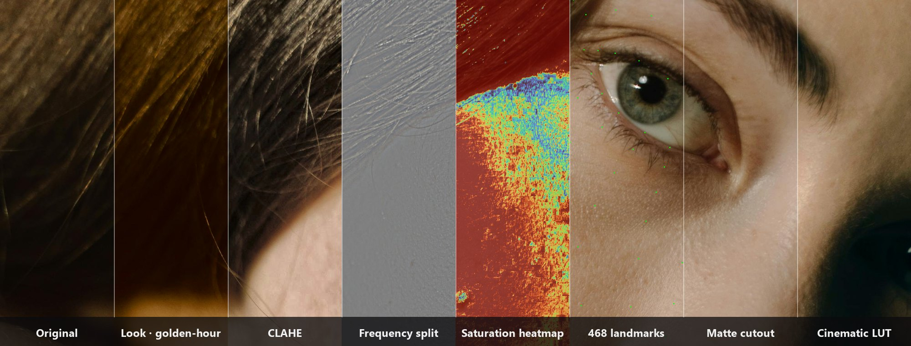
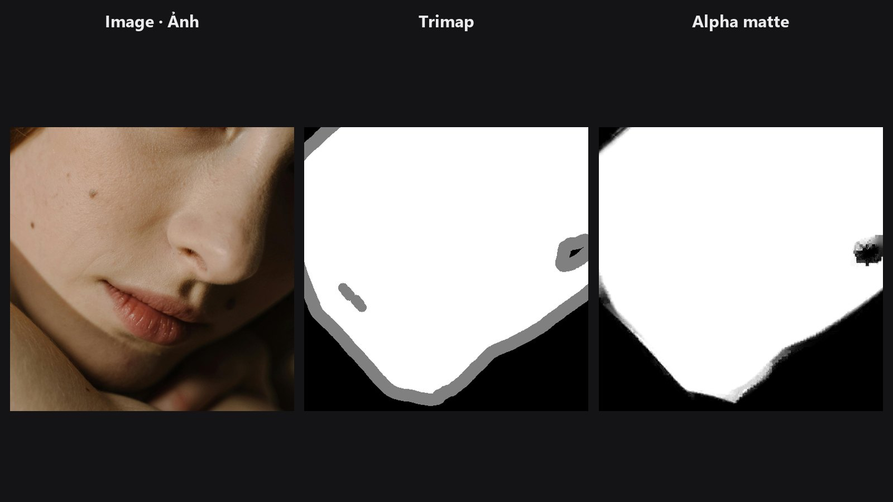
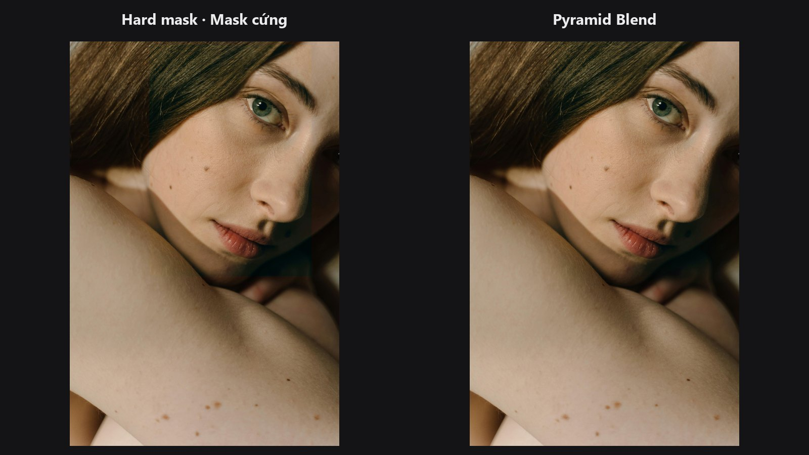

<div align="center">

# PixelPro for ComfyUI

**Pro-grade retouch, colour and mask tools for ComfyUI — 54 GPU nodes built on PyTorch + Kornia.**

[](https://github.com/jetthuangai/ComfyUI-JH-PixelPro/actions/workflows/ci.yml)
[](https://jetthuangai.github.io/ComfyUI-JH-PixelPro/)
[](https://github.com/jetthuangai/ComfyUI-JH-PixelPro/releases/latest)
[](https://www.python.org/)
[](LICENSE)

**English** · [Tiếng Việt](README.vi.md) · [Documentation](https://jetthuangai.github.io/ComfyUI-JH-PixelPro/)



</div>

## What it is

PixelPro brings the techniques of a professional retouching desk into ComfyUI as plain nodes: **frequency separation, luminosity masks, LAB colour matching, LUTs, a Photoshop-style layer stack, hair-accurate alpha mattes, face alignment and paste-back**, plus QA metrics to check your result.

- **Real retouch techniques**, not renamed filters: every node does what a retoucher expects from its name.
- **GPU first, CPU safe.** Heavy filters run on CUDA with bounded memory, and everything also runs on CPU.
- **Built for AI pipelines.** Align a face, run inpaint or ControlNet, paste it back seamlessly. Masks work with any segmenter.
- **Tested and documented.** 800+ automated tests, sample workflows, and a [bilingual guide](https://jetthuangai.github.io/ComfyUI-JH-PixelPro/) for every node.

<table>
<tr>
<td></td>
<td></td>
</tr>
<tr>
<td align="center"><b>Frequency Separation</b> — colour and detail on separate layers</td>
<td align="center"><b>Alpha Matte</b> — trimap to a hair-accurate alpha</td>
</tr>
<tr>
<td></td>
<td></td>
</tr>
<tr>
<td align="center"><b>Color Matcher Region</b> — match skin to skin, sky to sky</td>
<td align="center"><b>Pyramid Blend</b> — composites without a visible seam</td>
</tr>
</table>

## Install

**ComfyUI Manager:** search for `ComfyUI-JH-PixelPro`, install, restart ComfyUI.

**Manual:**

```bash
cd ComfyUI/custom_nodes
git clone https://github.com/jetthuangai/ComfyUI-JH-PixelPro.git
cd ComfyUI-JH-PixelPro
pip install -r requirements.txt   # use the Python that runs ComfyUI
```

Restart ComfyUI. The nodes appear under **Add Node → ComfyUI-JH-PixelPro**.

Requirements: Python 3.10+, PyTorch (from ComfyUI), Kornia ≥ 0.7, MediaPipe ≥ 0.10, OpenCV ≥ 4.8, SciPy ≥ 1.10. Optional: `onnxruntime-gpu` (or `onnxruntime`) for Depth Anything and Depth Lens Blur. An NVIDIA GPU with 8 GB+ VRAM is recommended; CPU works too.

## Quick start

1. Copy `workflows/sample_portrait.jpg` (and `sample_binary_mask.png`) into `ComfyUI/input/`.
2. Drag any workflow from [`workflows/`](workflows/README.md) onto the canvas, for example the CLAHE, Face Detect Lite or Mask Cleanup examples.
3. Queue the prompt and change one setting at a time.

Full walk-through: [Quickstart](https://jetthuangai.github.io/ComfyUI-JH-PixelPro/quickstart/).

## The 54 nodes

Each name links to its guide (settings, tips, before/after image).

### Color & Tone · 18

| Node | What it does |
|---|---|
| [ColorLab](https://jetthuangai.github.io/ComfyUI-JH-PixelPro/nodes/color-lab/) | Camera Raw style panel in tabs: exposure, contrast, highlights/shadows, texture, clarity, dehaze, white balance, HSL, colour-grading wheels, B&W mix; edge-aware `local` engine; outputs its settings as a preset. |
| [Shadows/Highlights Pro](https://jetthuangai.github.io/ComfyUI-JH-PixelPro/nodes/shadows-highlights-pro/) | Lift shadows and recover highlights without halos, Camera Raw or Photoshop style. |
| [Apply ColorLab Preset](https://jetthuangai.github.io/ComfyUI-JH-PixelPro/nodes/apply-colorlab-preset/) | Put a ColorLab look on any photo or batch, with strength and mask. |
| [Lightroom Preset (XMP)](https://jetthuangai.github.io/ComfyUI-JH-PixelPro/nodes/lightroom-preset/) | Use Lightroom / Camera Raw presets (.xmp, .lrtemplate) with a thumbnail browser, favourites and a report. |
| [Lightroom Preset Contact Sheet](https://jetthuangai.github.io/ComfyUI-JH-PixelPro/nodes/lightroom-preset-contact-sheet/) | Compare a whole preset collection on one photo. |
| [Tone Curve](https://jetthuangai.github.io/ComfyUI-JH-PixelPro/nodes/tone-curve/) | Smooth master or per-channel RGB curves with presets. |
| [Color Matcher](https://jetthuangai.github.io/ComfyUI-JH-PixelPro/nodes/color-matcher/) | Transfer the colour of a reference photo in LAB. |
| [Color Matcher Region](https://jetthuangai.github.io/ComfyUI-JH-PixelPro/nodes/color-matcher-region/) | Match colour between two masked regions, any image sizes. |
| [CLAHE Local Contrast](https://jetthuangai.github.io/ComfyUI-JH-PixelPro/nodes/clahe-local-contrast/) | Adaptive local contrast on lightness only; colours stay put. |
| [Hue/Saturation per Range](https://jetthuangai.github.io/ComfyUI-JH-PixelPro/nodes/hue-saturation-range/) | Shift hue or saturation of one colour band. |
| [Luminosity Masking](https://jetthuangai.github.io/ComfyUI-JH-PixelPro/nodes/luminosity-masking/) | Shadow, midtone and highlight masks. |
| [Saturation Mask](https://jetthuangai.github.io/ComfyUI-JH-PixelPro/nodes/saturation-mask/) | Select by colour strength. |
| [LUT Preset](https://jetthuangai.github.io/ComfyUI-JH-PixelPro/nodes/lut-preset/) | Bundled .cube looks from a dropdown. |
| [LUT Import](https://jetthuangai.github.io/ComfyUI-JH-PixelPro/nodes/lut-import/) | Apply any .cube LUT, with mask and strength. |
| [LUT Export](https://jetthuangai.github.io/ComfyUI-JH-PixelPro/nodes/lut-export/) | Bake a graded HALD into a .cube file. |
| [HALD Identity](https://jetthuangai.github.io/ComfyUI-JH-PixelPro/nodes/hald-identity/) | Neutral HALD image to grade into a LUT. |
| [Tone Match LUT](https://jetthuangai.github.io/ComfyUI-JH-PixelPro/nodes/tone-match-lut/) | Generate a .cube from one graded reference frame. |
| [Palette Extract](https://jetthuangai.github.io/ComfyUI-JH-PixelPro/nodes/palette-extract/) | Dominant colours as swatches + HEX, and a flat-colour version. |

### Masks · 11

| Node | What it does |
|---|---|
| [Sub-Pixel Mask Refiner](https://jetthuangai.github.io/ComfyUI-JH-PixelPro/nodes/sub-pixel-mask-refiner/) | Turn a hard mask into a soft alpha edge, protecting the inside and outside. |
| [Edge-Aware Mask Refiner](https://jetthuangai.github.io/ComfyUI-JH-PixelPro/nodes/edge-aware-mask-refiner/) | Snap a mask edge to the real edges of the photo (guided filter). |
| [Trimap Builder](https://jetthuangai.github.io/ComfyUI-JH-PixelPro/nodes/trimap-builder/) | Foreground / unknown / background map for matting. |
| [Alpha Matte](https://jetthuangai.github.io/ComfyUI-JH-PixelPro/nodes/alpha-matte/) | Closed-form matting: hair-accurate alpha from a trimap. |
| [Mask Morphology](https://jetthuangai.github.io/ComfyUI-JH-PixelPro/nodes/mask-morphology/) | Grow, shrink, open, close and other shape operations on a mask. |
| [Mask Combine](https://jetthuangai.github.io/ComfyUI-JH-PixelPro/nodes/mask-combine/) | Add, subtract, intersect, union or multiply two masks. |
| [Mask Edge Smoother](https://jetthuangai.github.io/ComfyUI-JH-PixelPro/nodes/mask-edge-smoother/) | Bilateral cleanup of jagged mask edges (CPU or GPU). |
| [Mask Cleanup](https://jetthuangai.github.io/ComfyUI-JH-PixelPro/nodes/mask-cleanup/) | Remove specks, fill holes, distance feather. |
| [SAM One-Click Mask](https://jetthuangai.github.io/ComfyUI-JH-PixelPro/nodes/sam-mask/) | Segment Anything from one point, a face box or a rough mask. |
| [Mask Preview](https://jetthuangai.github.io/ComfyUI-JH-PixelPro/nodes/mask-preview/) | See any mask as overlay, heatmap or cutout. |
| [Detail Mask](https://jetthuangai.github.io/ComfyUI-JH-PixelPro/nodes/high-freq-detail-masker/) | Mask of fine detail (hair, eyes, texture) to protect or sharpen. |

### Face · 8

| Node | What it does |
|---|---|
| [Face Detect](https://jetthuangai.github.io/ComfyUI-JH-PixelPro/nodes/face-detect/) | MediaPipe face boxes and 5-point landmarks. |
| [Face Detect Lite](https://jetthuangai.github.io/ComfyUI-JH-PixelPro/nodes/face-detect-lite/) | Fast YuNet detector on the GPU, with a face mask and real confidence. |
| [Face Landmarks](https://jetthuangai.github.io/ComfyUI-JH-PixelPro/nodes/face-landmarks/) | 468-point face mesh for reshaping. |
| [Face Warp](https://jetthuangai.github.io/ComfyUI-JH-PixelPro/nodes/face-warp/) | Reshape by moving landmarks (per-triangle). |
| [Face Warp TPS](https://jetthuangai.github.io/ComfyUI-JH-PixelPro/nodes/face-warp-tps/) | Same idea with one smooth thin-plate-spline field, no seams. |
| [Unwrap Face](https://jetthuangai.github.io/ComfyUI-JH-PixelPro/nodes/unwrap-face/) | Paste an edited aligned face back onto the original. |
| [Face Beauty Blend](https://jetthuangai.github.io/ComfyUI-JH-PixelPro/nodes/face-beauty-blend/) | Blend a retouched face plate in with mask and strength. |
| [Skin Tone Tri-Region](https://jetthuangai.github.io/ComfyUI-JH-PixelPro/nodes/skin-tone-tri-region/) | Shadow / midtone / highlight masks of the skin. |

### Compositing · 5

| Node | What it does |
|---|---|
| [Layer Stack Start](https://jetthuangai.github.io/ComfyUI-JH-PixelPro/nodes/layer-stack-start/) | Start a layer stack from a background. |
| [Layer Add](https://jetthuangai.github.io/ComfyUI-JH-PixelPro/nodes/layer-add/) | Add a layer with blend mode, opacity, fill, mask and clipping. |
| [Layer Group](https://jetthuangai.github.io/ComfyUI-JH-PixelPro/nodes/layer-group/) | Nest a sub-stack as one grouped layer. |
| [Layer Flatten](https://jetthuangai.github.io/ComfyUI-JH-PixelPro/nodes/layer-flatten/) | Render the stack to an image. |
| [Pyramid Blend](https://jetthuangai.github.io/ComfyUI-JH-PixelPro/nodes/pyramid-blend/) | Multi-band blending for seamless composites. |

### Filters · 5 · Depth · 2 · Geometry · 3 · Looks · 1 · QA · 1

| Node | What it does |
|---|---|
| [Frequency Separation](https://jetthuangai.github.io/ComfyUI-JH-PixelPro/nodes/frequency-separation/) | Split colour/tone (low) from texture (high). |
| [Frequency Recombine](https://jetthuangai.github.io/ComfyUI-JH-PixelPro/nodes/frequency-recombine/) | Rebuild the image from low + high, with a texture amount. |
| [Skin Smoother](https://jetthuangai.github.io/ComfyUI-JH-PixelPro/nodes/edge-aware-smoother/) | Edge-preserving skin smoothing with mask and strength. |
| [Smart Sharpen](https://jetthuangai.github.io/ComfyUI-JH-PixelPro/nodes/smart-sharpen/) | Unsharp mask on luminance, with threshold and mask. |
| [Dust & Spot Removal](https://jetthuangai.github.io/ComfyUI-JH-PixelPro/nodes/dust-spot-removal/) | Heal small specks and dust, leave larger details alone. |
| [Depth Anything V2](https://jetthuangai.github.io/ComfyUI-JH-PixelPro/nodes/depth-anything/) | Depth map from a single photo (Small model: Apache-2.0). |
| [Depth Lens Blur](https://jetthuangai.github.io/ComfyUI-JH-PixelPro/nodes/depth-lens-blur/) | Bokeh from depth, focus picked by a face or subject mask. |
| [Facial Aligner](https://jetthuangai.github.io/ComfyUI-JH-PixelPro/nodes/facial-aligner/) | Align a face to a standard square crop; outputs the matrix Unwrap Face needs to paste it back. |
| [Lens Distortion](https://jetthuangai.github.io/ComfyUI-JH-PixelPro/nodes/lens-distortion/) | Correct or add barrel/pincushion distortion. |
| [Auto Align](https://jetthuangai.github.io/ComfyUI-JH-PixelPro/nodes/auto-align/) | Align a second shot to a reference (SIFT or LoFTR). |
| [Look Select](https://jetthuangai.github.io/ComfyUI-JH-PixelPro/nodes/look-select/) | Finished colour looks with intensity. |
| [QA Image Diff](https://jetthuangai.github.io/ComfyUI-JH-PixelPro/nodes/qa-image-diff/) | SSIM, PSNR and a diff heatmap between two images. |

## Documentation

- **Guide (EN / VI):** <https://jetthuangai.github.io/ComfyUI-JH-PixelPro/>
- **Sample workflows:** [`workflows/README.md`](workflows/README.md)
- **Changes:** [CHANGELOG.md](CHANGELOG.md)

## License

Apache-2.0. See [LICENSE](LICENSE). Sample portrait by [cottonbro studio](https://www.pexels.com/@cottonbro/) on Pexels (Pexels License).

Maintained by **JH** ([@jetthuangai](https://github.com/jetthuangai)).
