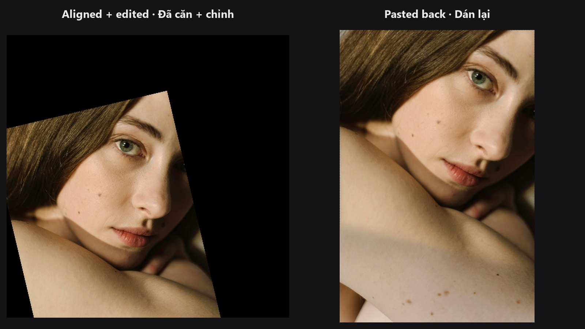

# Face

The face group covers everything a portrait retouch needs around the face itself: finding it, reshaping it, pasting an edited version back, and splitting skin into tone ranges. Most chains follow one pattern, described below, so you can send a small, upright face crop to an AI or retouch pass and return it to the full photo without touching the rest of the image.

-   

    **[Face Detect](../nodes/face-detect.md)**

    Finds faces with MediaPipe and returns five key points per face.

-   

    **[Face Detect Lite](../nodes/face-detect-lite.md)**

    Fast YuNet detector with five key points, real confidence and a face mask.

-   

    **[Face Landmarks](../nodes/face-landmarks.md)**

    A dense 468-point map of the face, with a preview overlay.

-   

    **[Face Warp](../nodes/face-warp.md)**

    Reshapes the face triangle by triangle, strictly inside the face mesh.

-   

    **[Face Warp TPS](../nodes/face-warp-tps.md)**

    Reshapes the face with one smooth field, no triangle seams.

-   

    **[Unwrap Face](../nodes/unwrap-face.md)**

    Pastes an edited, straightened face crop back into the original photo.

-   

    **[Face Beauty Blend](../nodes/face-beauty-blend.md)**

    Blends a retouched picture over the original through a mask and strength.

-   

    **[Skin Tone Tri-Region](../nodes/skin-tone-tri-region.md)**

    Splits skin into shadow, midtone and highlight masks.

## The align → edit → paste-back pipeline

AI skin passes, face restoration and detail enhancers work best on a small, upright face. The standard chain gives them exactly that and then puts the result back:

1. **Detect.** [Face Detect](../nodes/face-detect.md) or [Face Detect Lite](../nodes/face-detect-lite.md) finds the face and outputs five landmarks as `landmarks_json`.
2. **Align.** [Facial Aligner](../nodes/facial-aligner.md) (in the [Geometry](geometry.md) group) turns the face into a straight, square crop (`image_aligned`) and also outputs `inverse_matrix_json`, the recipe for undoing the move.
3. **Edit.** Run your AI or retouch pass on the aligned crop.
4. **Paste back.** [Unwrap Face](../nodes/unwrap-face.md) takes the edited crop, the original photo and `inverse_matrix_json`, and returns the full photo with only the face area changed.
5. **Polish (optional).** [Face Beauty Blend](../nodes/face-beauty-blend.md) mixes the result over the original through a mask, with a strength slider, so the retouch looks natural.

Keep the original image wired to both Unwrap Face and Face Beauty Blend. The untouched pixels outside the face come from there.

## Which node should I pick?

**MediaPipe Face Detect or YuNet Face Detect Lite?**

| Choose | When |
|---|---|
| [Face Detect Lite](../nodes/face-detect-lite.md) | You want speed (batches, previews), a face mask, a real confidence score, or you do not have MediaPipe installed. It uses the GPU when available. |
| [Face Detect](../nodes/face-detect.md) | You already use MediaPipe, you want its eye-corner points, or you also run [Face Landmarks](../nodes/face-landmarks.md) and want both to agree. |

Both give the same five-point output, and both work with the aligner. Neither feeds the warp nodes directly: those need the 468-point output of Face Landmarks.

**Delaunay Face Warp or TPS Face Warp?**

| Choose | When |
|---|---|
| [Face Warp TPS](../nodes/face-warp-tps.md) | You want gentle, natural reshaping (slimming, eye or jaw tweaks) with no triangle seams, GPU speed, or you are matching landmarks from another photo (it has a `smoothness` control for detector noise). |
| [Face Warp](../nodes/face-warp.md) | The change must stay strictly inside the face mesh, or you want every one of the 468 points honoured locally. It runs on the CPU. |

## Typical chains

- **AI skin pass, pasted back:** Load Image → [Face Detect Lite](../nodes/face-detect-lite.md) → [Facial Aligner](../nodes/facial-aligner.md) → your AI pass → [Unwrap Face](../nodes/unwrap-face.md) → [Face Beauty Blend](../nodes/face-beauty-blend.md).
- **Subtle reshaping:** Load Image → [Face Landmarks](../nodes/face-landmarks.md) (source) and a second [Face Landmarks](../nodes/face-landmarks.md) (target) → [Face Warp TPS](../nodes/face-warp-tps.md) → Preview Image.
- **Tone-targeted retouch:** Load Image + skin mask → [Skin Tone Tri-Region](../nodes/skin-tone-tri-region.md) → one mask into [Face Beauty Blend](../nodes/face-beauty-blend.md). See the [Skin Tone Retouch example](../examples/skin-tone-retouch.md).
