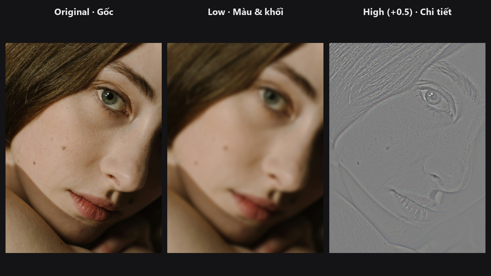
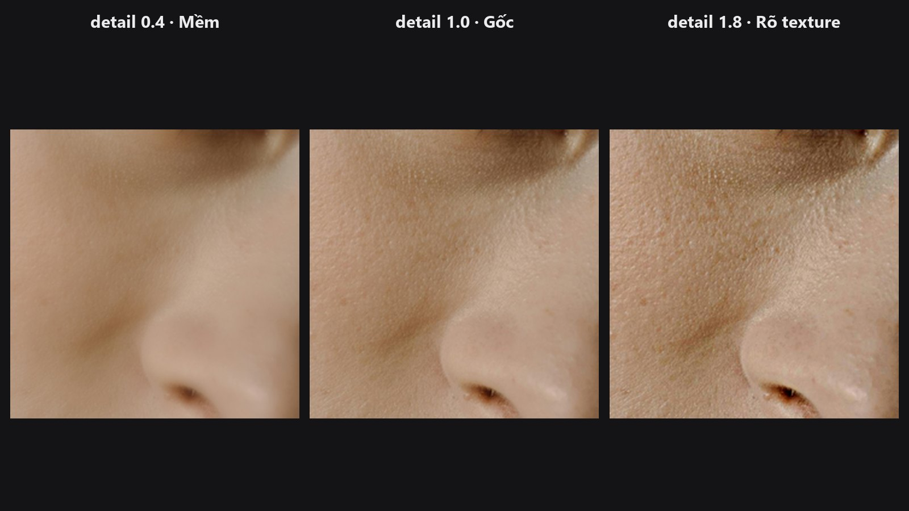
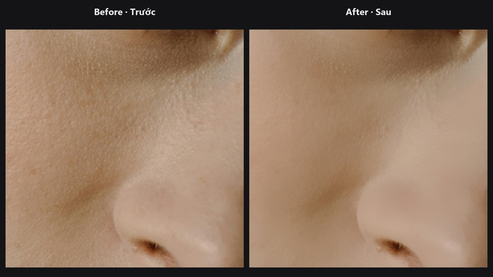
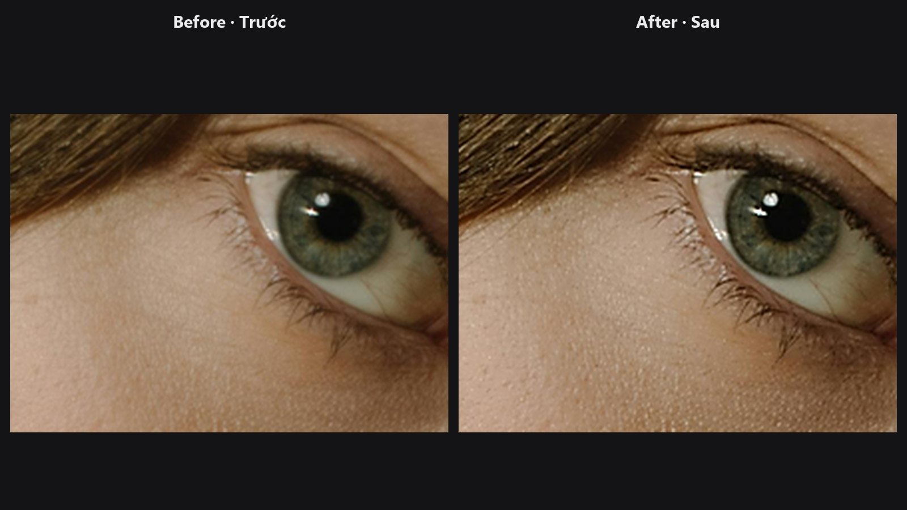
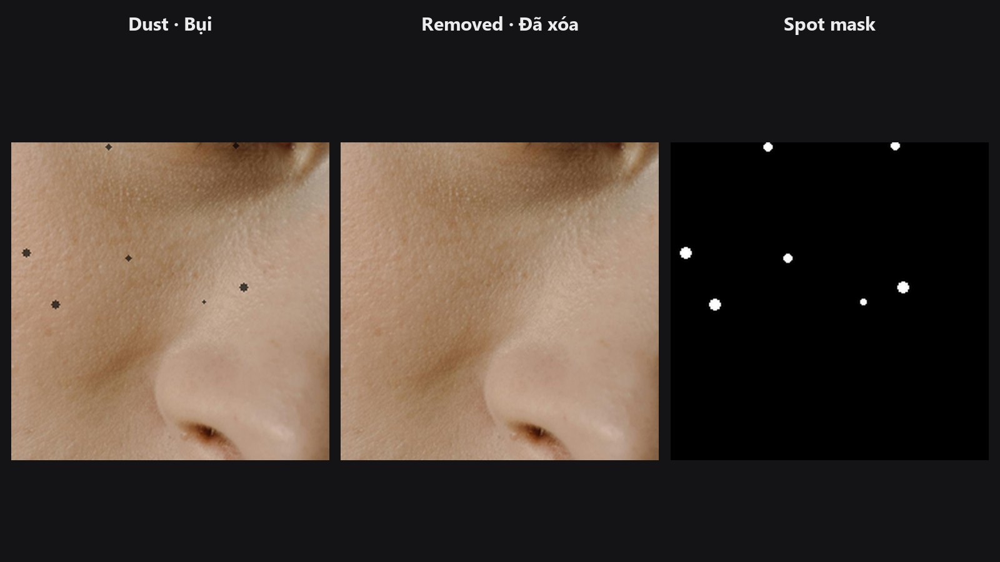
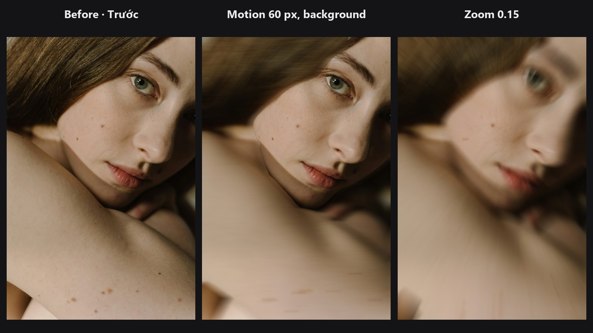

# Bộ lọc (Filters)

Nhóm bộ lọc làm việc trực tiếp trên bức ảnh: texture, cạnh và độ mịn. Tách chi tiết khỏi tông màu bằng frequency separation, làm mịn da mà không mất cạnh, và làm nét ở cuối. Các node này gộp lại là phần lõi của một lượt retouch chân dung.

-   

    **[Frequency Separation](../nodes/frequency-separation.md)**

    Tách ảnh thành lớp màu mượt và lớp chi tiết mịn.

-   

    **[Frequency Recombine](../nodes/frequency-recombine.md)**

    Ghép lại hai lớp low và high, có thanh trượt tăng hoặc giảm texture.

-   

    **[Skin Smoother](../nodes/edge-aware-smoother.md)**

    Làm mịn da bằng blur giữ cạnh, có mask tùy chọn và xử lý chia ô.

-   

    **[Smart Sharpen](../nodes/smart-sharpen.md)**

    Unsharp mask với ngưỡng nhiễu, chế độ chỉ luminance và mask.

-   

    **[Dust & Spot Removal](../nodes/dust-spot-removal.md)**

    Tìm và xóa đốm nhỏ tối hoặc sáng (bụi cảm biến, mụn nhỏ), không đụng vào chi tiết lớn.

-   

    **[Motion / Zoom Blur](../nodes/motion-zoom-blur.md)**

    Mờ chuyển động theo một góc, hoặc mờ zoom về một điểm, có mask.

## Chuỗi node thường dùng

- **Da tự nhiên:** Load Image → [Skin Smoother](../nodes/edge-aware-smoother.md) (strength 0.3 đến 0.5, kèm mask da) → [Smart Sharpen](../nodes/smart-sharpen.md) → Preview Image
- **Sửa màu, giữ lỗ chân lông:** Load Image → [Frequency Separation](../nodes/frequency-separation.md) → chỉ chỉnh `low` → [Frequency Recombine](../nodes/frequency-recombine.md)
- **Chỉ làm nét phần chi tiết:** [Detail Mask](../nodes/high-freq-detail-masker.md) → `mask` của [Smart Sharpen](../nodes/smart-sharpen.md)
