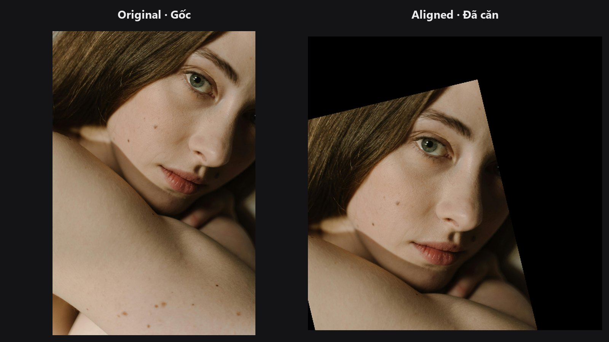
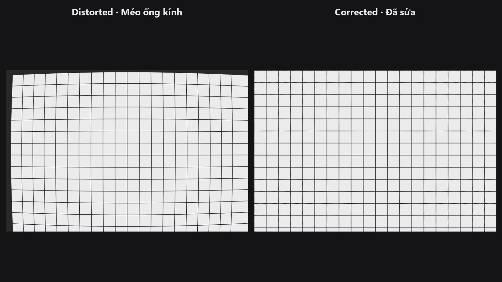
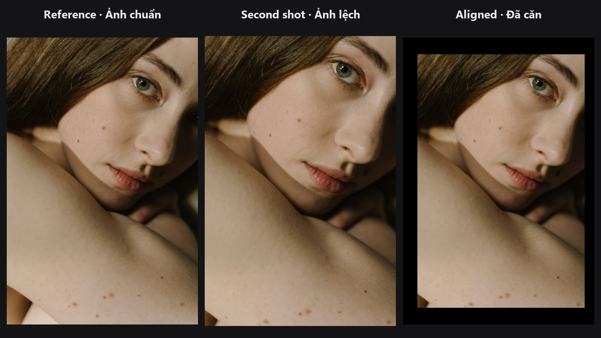

# Hình học (Geometry)

Nhóm node hình học chỉnh hình dạng và vị trí của bức ảnh trước khi bạn bắt đầu retouch: nắn thẳng méo ống kính, căn hai ảnh cho khớp, hoặc đưa khuôn mặt về khung thẳng đứng chuẩn. Làm bước này trước giúp các chỉnh sửa sau đó dễ đoán hơn.

-   

    **[Facial Aligner](../nodes/facial-aligner.md)**

    Xoay, co giãn và cắt khuôn mặt về khung vuông chuẩn từ năm điểm landmark.

-   

    **[Lens Distortion](../nodes/lens-distortion.md)**

    Sửa (hoặc thêm) méo thùng và méo gối với các preset ống kính.

-   

    **[Auto Align](../nodes/auto-align.md)**

    So khớp đặc trưng giữa hai ảnh và warp ảnh này vào ảnh kia.

## Chuỗi node thường dùng

- **Chân dung góc rộng đến chỉnh sửa mặt:** Load Image → [Lens Distortion](../nodes/lens-distortion.md) → [Face Detect Lite](../nodes/face-detect-lite.md) → [Facial Aligner](../nodes/facial-aligner.md) → chỉnh sửa → [Unwrap Face](../nodes/unwrap-face.md)
- **Khớp hai ảnh chụp:** [Auto Align](../nodes/auto-align.md) → [Color Matcher](../nodes/color-matcher.md) → [Layer Add](../nodes/layer-add.md)
