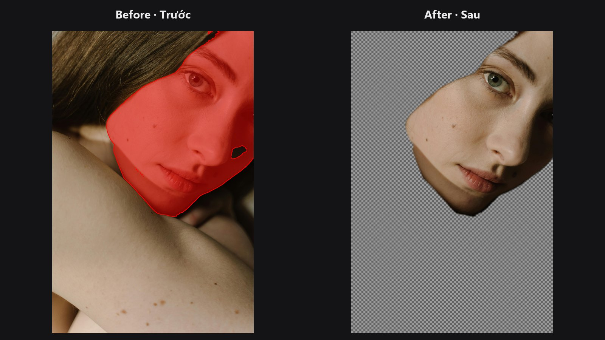
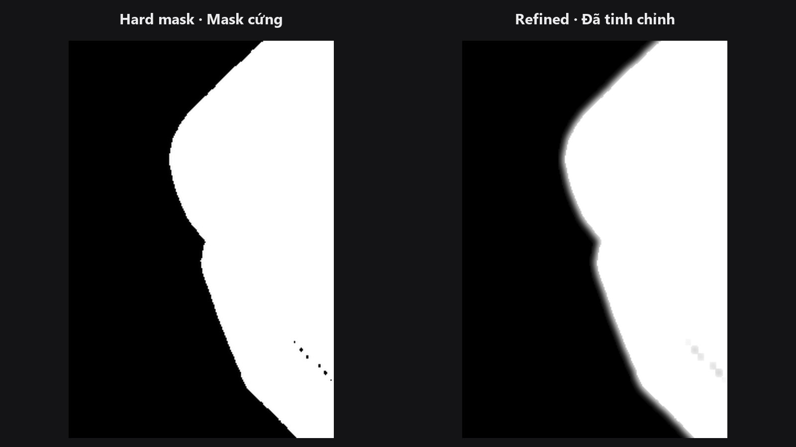
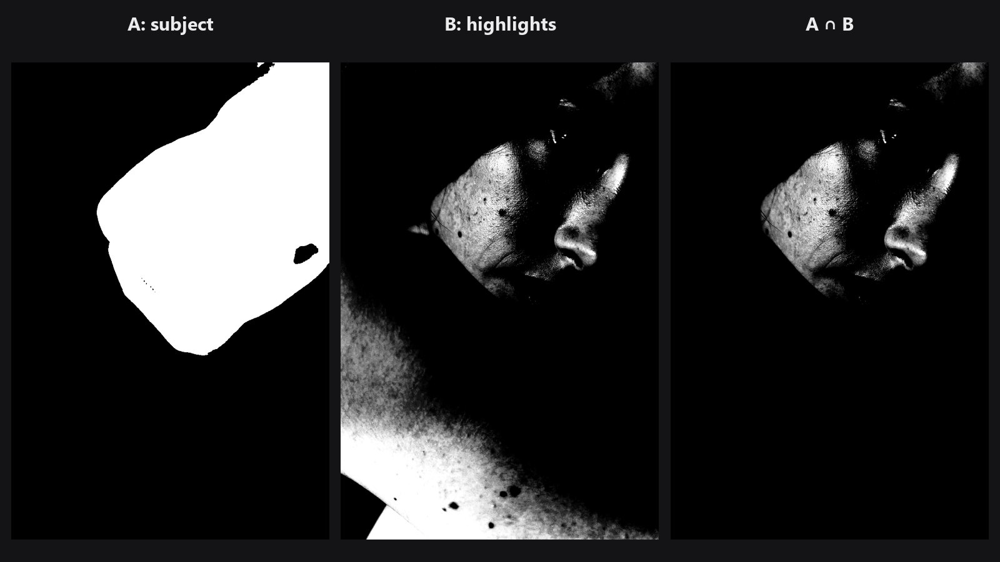
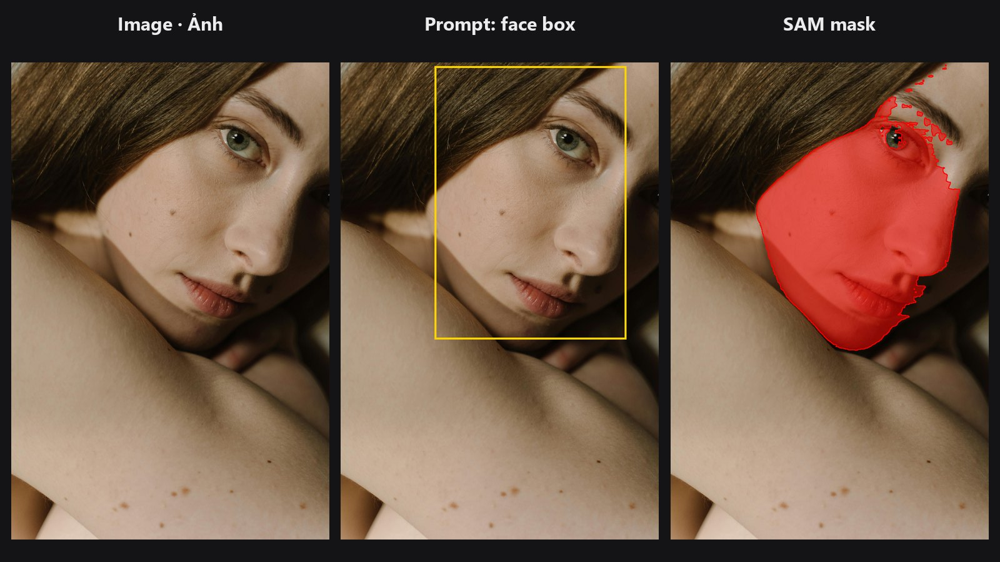

# Mask

Mask quyết định chỉnh sửa xảy ra *ở đâu*: pixel nào được làm mịn, chỉnh màu, thay thế hay cắt tách. Nhóm này bao phủ toàn bộ vòng đời của một mask, từ dọn vùng chọn AI còn thô, làm mềm và siết viền, trích xuất cutout cỡ tóc, đến kiểm tra kết quả.

## Kiến thức nền về mask, nói đơn giản

- **Mask nhị phân (binary mask):** mỗi pixel hoặc được chọn hoàn toàn (1) hoặc không chọn (0). Nhanh và đơn giản, nhưng viền cứng, trông như cắt dán.
- **Mask mềm / alpha matte:** pixel dọc viền có giá trị trung gian, ví dụ 0.5 cho pixel nửa chủ thể nửa nền. Đây là thứ giúp tóc và lông hòa vào nền mới.
- **Feather:** chuyển tiếp mềm có kiểm soát qua viền. Nó che đường nối, nhưng blur đơn thuần cũng có thể ăn vào chủ thể.
- **Trimap:** bản đồ gợi ý ba giá trị, `0` = chắc chắn là nền, `0.5` = chưa biết, `1` = chắc chắn là chủ thể. Matting chỉ cần giải dải xám, nên viền tóc đẹp hơn hẳn so với ngưỡng hóa đơn giản.
- **Closed-form matting:** phương pháp giải toàn bộ alpha mềm cùng lúc, dùng chính màu của ảnh làm hướng dẫn. Đây là nền tảng của [Alpha Matte](../nodes/alpha-matte.md).
- **Ảnh guide:** ảnh gốc, đưa cho node mask để viền bám theo ranh giới thật trong hình.

## Chọn đúng công cụ mask

| Vấn đề của bạn | Dùng node |
|---|---|
| Mask có đốm nhỏ trôi nổi hoặc lỗ li ti | [Mask Cleanup](../nodes/mask-cleanup.md) |
| Viền cứng, trông như dán sticker | [Sub-Pixel Mask Refiner](../nodes/sub-pixel-mask-refiner.md) |
| Viền răng cưa hoặc lượn sóng nhưng hình dạng đúng | [Mask Edge Smoother](../nodes/mask-edge-smoother.md) |
| Viền mask lệch vài pixel so với cạnh thật của chủ thể | [Edge-Aware Mask Refiner](../nodes/edge-aware-mask-refiner.md) |
| Tóc, lông hoặc kính cần độ trong suốt thật | [Trimap Builder](../nodes/trimap-builder.md), rồi [Alpha Matte](../nodes/alpha-matte.md) |
| Mask to hoặc nhỏ hơn vài pixel | [Mask Morphology](../nodes/mask-morphology.md) (`dilate` hoặc `erode`) |
| Chỉ cần dải đường viền quanh mép | [Mask Morphology](../nodes/mask-morphology.md) (`gradient`) |
| Muốn cộng, trừ hoặc lấy phần chồng của hai mask | [Mask Combine](../nodes/mask-combine.md) |
| Muốn mask chỉ gồm vùng sắc nét, có texture | [Detail Mask](../nodes/high-freq-detail-masker.md) |
| Muốn mask cho shadow, midtone hoặc highlight | [Luminosity Masking](../nodes/luminosity-masking.md) |
| Muốn xem mask thực sự phủ những gì | [Mask Preview](../nodes/mask-preview.md) |
| Muốn đo một chỉnh sửa đã thay đổi ảnh bao nhiêu | [QA Image Diff](../nodes/qa-image-diff.md) |

-   

    **[Mask Cleanup](../nodes/mask-cleanup.md)**

    Xóa đốm, lấp lỗ nhỏ và feather theo khoảng cách.

-   

    **[Sub-Pixel Mask Refiner](../nodes/sub-pixel-mask-refiner.md)**

    Biến mask cứng thành mask có feather, lõi bên trong vẫn đặc.

-   

    **[Edge-Aware Mask Refiner](../nodes/edge-aware-mask-refiner.md)**

    Kéo viền mask bám vào cạnh thật của ảnh.

-   

    **[Mask Edge Smoother](../nodes/mask-edge-smoother.md)**

    Làm mượt viền răng cưa bằng bilateral filter, có thể dẫn hướng bằng ảnh.

-   

    **[Trimap Builder](../nodes/trimap-builder.md)**

    Tạo bản đồ chủ thể chắc chắn, chưa biết và nền chắc chắn cho matting.

-   

    **[Alpha Matte](../nodes/alpha-matte.md)**

    Alpha mềm cỡ tóc từ trimap và ảnh gốc.

-   

    **[Mask Morphology](../nodes/mask-morphology.md)**

    Nở, co, đóng hoặc lấy đường viền của mask.

-   

    **[Mask Combine](../nodes/mask-combine.md)**

    Cộng, trừ, giao hoặc nhân hai mask.

-   

    **[Detail Mask](../nodes/high-freq-detail-masker.md)**

    Chọn các vùng sắc nét, nhiều chi tiết của ảnh.

-   

    **[Mask Preview](../nodes/mask-preview.md)**

    Xem mask dạng phủ màu, heatmap, đen trắng hoặc cutout.

-   

    **[SAM One-Click Mask](../nodes/sam-mask.md)**

    Segment Anything: một điểm, một khung mặt hoặc một mask thô là ra mask vật thể sạch.

## Chuỗi node thường dùng

- **Cutout AI sạch (sản phẩm hoặc chân dung):** [Mask Cleanup](../nodes/mask-cleanup.md) → [Edge-Aware Mask Refiner](../nodes/edge-aware-mask-refiner.md) → [Sub-Pixel Mask Refiner](../nodes/sub-pixel-mask-refiner.md) → [Mask Preview](../nodes/mask-preview.md)
- **Cutout cỡ tóc:** mask thô → [Mask Cleanup](../nodes/mask-cleanup.md) → [Trimap Builder](../nodes/trimap-builder.md) → [Alpha Matte](../nodes/alpha-matte.md) (ảnh gốc làm `guide`) → [Mask Preview](../nodes/mask-preview.md) ở chế độ `cutout`
- **Chỉ chỉnh vùng có texture:** [Detail Mask](../nodes/high-freq-detail-masker.md) → [Mask Combine](../nodes/mask-combine.md) với mask chủ thể (`intersect`) → dùng làm cổng cho bước sharpen hoặc làm mịn
