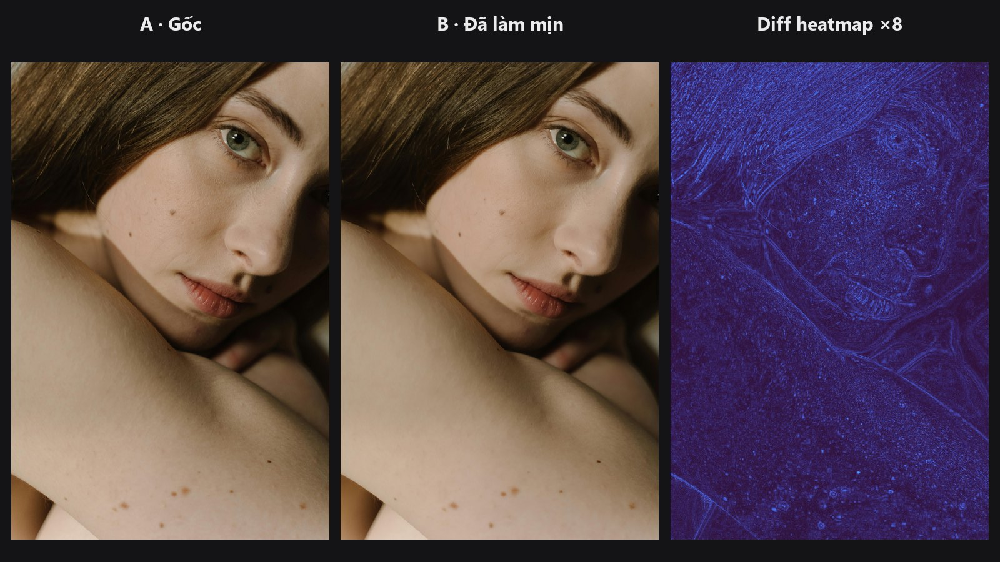
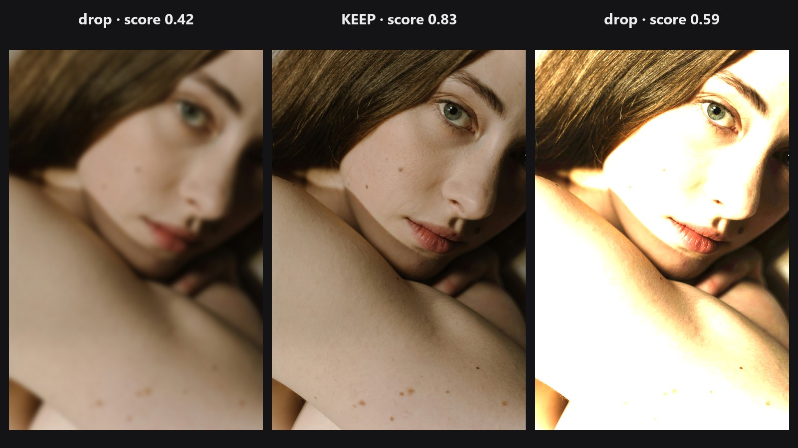

# Kiểm tra chất lượng (QA)

Các node QA đo kết quả chứ không thay đổi nó. Thêm chúng ở cuối chuỗi retouch để xem một chỉnh sửa đã làm ảnh dịch chuyển bao nhiêu, để xác nhận thay đổi nằm trong vùng bạn đã mask, hoặc để so sánh hai bộ thông số trên cùng một ảnh đầu vào.

-   

    **[QA Image Diff](../nodes/qa-image-diff.md)**

    So sánh hai ảnh bằng SSIM, PSNR và MAE, rồi vẽ ảnh khác biệt dạng heatmap, tuyệt đối hoặc bản đồ SSIM.

-   

    **[Cull Score](../nodes/cull-score.md)**

    Chấm điểm cả lô ảnh theo độ nét, phơi sáng, mắt nhắm và ảnh trùng; giữ tấm tốt nhất.

Muốn kiểm tra một *mask* thay vì một ảnh, dùng [Mask Preview](../nodes/mask-preview.md) trong nhóm [Mask](mask.md).

## Chuỗi node thường dùng

- **Retouch của tôi chỉ đổi phần da thôi chứ?** ảnh gốc và ảnh đã retouch → [QA Image Diff](../nodes/qa-image-diff.md) (thêm mask da để giới hạn các con số trong vùng đó) → đọc `changed_pct` và heatmap.
- **So sánh hai bộ thông số:** chạy cùng một ảnh qua hai phiên bản của một node → đưa cả hai kết quả vào [QA Image Diff](../nodes/qa-image-diff.md) ở chế độ `ssim_map` để thấy cấu trúc khác nhau ở đâu.
- **Kiểm tra một lượt làm mịn:** [Skin Smoother](../nodes/edge-aware-smoother.md) → [QA Image Diff](../nodes/qa-image-diff.md) so với ảnh gốc, rồi dùng [Mask Preview](../nodes/mask-preview.md) trên mask da để xác nhận hai bên khớp nhau.
