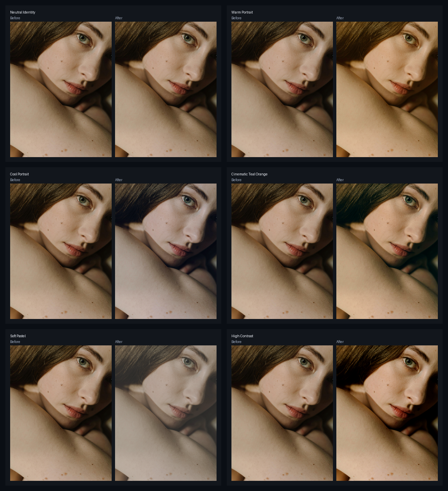

# Thư viện LUT Preset

[LUT Preset](../nodes/lut-preset.md) đi kèm sáu look Adobe Cube phổ thông. Thư viện bên dưới được tạo từ `workflows/sample_portrait.jpg` bằng cách chạy chính node đó và lưu ảnh trước/sau.

## Mỗi preset dùng khi nào

| Preset | Dùng khi |
|---|---|
| `neutral-identity` | Bạn muốn kiểm tra đấu nối hoặc so với mốc không thay đổi. |
| `warm-portrait` | Bạn muốn hướng chân dung ấm, mềm mà không phải dựng cả bước chỉnh màu. |
| `cool-portrait` | Bạn muốn sắc lạnh, sạch hơn cho chân dung editorial hoặc ảnh sản phẩm có người. |
| `cinematic-teal-orange` | Bạn muốn look split-tone mạnh hơn, bóng lạnh hơn và vùng gần da ấm hơn. |
| `soft-pastel` | Bạn muốn màu nhạt, tương phản thấp cho ảnh làm đẹp nhẹ nhàng hoặc ảnh đăng mạng xã hội. |
| `high-contrast` | Bạn muốn tách tông mạnh hơn để xem nhanh hoặc làm điểm khởi đầu đậm hơn. |

## Tự thử

Mở [LUT Preset example workflow](https://github.com/jetthuangai/ComfyUI-JH-PixelPro/blob/main/workflows/N-34-lut-preset.json), chọn ảnh của bạn trong Load Image rồi đổi danh sách `preset`. Giảm `intensity` xuống dưới `1.0` khi LUT đầy đủ quá mạnh.

Muốn một look không có trong danh sách? Tự dựng bằng [HALD Identity](../nodes/hald-identity.md) và [LUT Export](../nodes/lut-export.md), rồi áp bằng [LUT Import](../nodes/lut-import.md).
