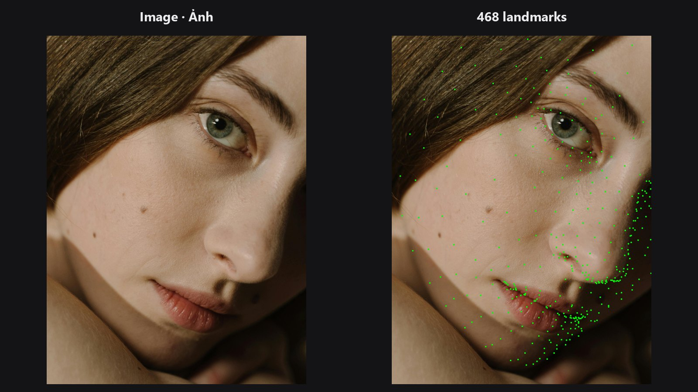

<div class="pp-hero" markdown>

# PixelPro cho ComfyUI

<p class="pp-lead">Những kỹ thuật hậu kỳ bạn vẫn dùng hằng ngày (tách tần số, luminosity mask, LUT, chồng layer, tách nền chuẩn từng sợi tóc, căn khuôn mặt) nay thành 61 node chạy GPU ngay trong ComfyUI.</p>

[Bắt đầu :material-arrow-right:](quickstart.md){ .md-button .md-button--primary }
[Xem các node](categories/color.md){ .md-button }
[GitHub](https://github.com/jetthuangai/ComfyUI-JH-PixelPro){ .md-button }

</div>


## Vì sao chọn PixelPro

<div class="grid cards" markdown>

-   :material-palette-swatch-outline:{ .lg } **Kỹ thuật retouch thật**

    Không phải bộ lọc đặt tên kêu. Tách tần số (frequency separation), luminosity mask, khớp màu trong LAB, hòa trộn theo kim tự tháp Laplacian và tách alpha closed-form đều hoạt động đúng như người làm hậu kỳ mong đợi.

-   :material-chip:{ .lg } **Ưu tiên GPU, vẫn chạy được trên CPU**

    Xây dựng trên PyTorch và [Kornia](https://kornia.github.io/). Các bộ lọc nặng chạy trên CUDA và luôn giữ bộ nhớ trong giới hạn. Máy chỉ có CPU vẫn chạy được, chỉ chậm hơn.

-   :material-vector-difference:{ .lg } **Ăn khớp với quy trình AI**

    Căn khuôn mặt, chạy inpaint hay ControlNet, rồi dán lại liền mạch. Dựng mask cho bất kỳ công cụ phân vùng nào và kiểm tra kết quả bằng SSIM/PSNR.

-   :material-test-tube:{ .lg } **Kiểm thử kỹ, tài liệu đầy đủ**

    Hơn 800 test tự động, workflow mẫu cho từng node mới, và tài liệu song ngữ Anh – Việt.

</div>

## Chọn theo việc cần làm

<div class="grid cards" markdown>

-   

    **[Màu & tông](categories/color.md)**

    Chỉnh màu kiểu ACR, đường cong tông, khớp màu, nhập/xuất LUT và tăng tương phản cục bộ CLAHE.

-   

    **[Mask](categories/mask.md)**

    Từ mask phân vùng thô đến alpha sạch chuẩn từng sợi tóc: tinh chỉnh, tách alpha, dọn dẹp và xem trước.

-   

    **[Khuôn mặt](categories/face.md)**

    Nhận diện mặt, 468 điểm landmark, chỉnh dáng, căn mặt rồi dán lại, kèm mask theo tông da.

-   

    **[Bộ lọc](categories/filters.md)**

    Tách tần số, làm mịn da giữ chi tiết và làm nét không viền màu.

-   

    **[Ghép ảnh](categories/compositing.md)**

    Chồng layer kiểu Photoshop với 27 blend mode, và hòa trộn đa tần số không lộ đường nối.

-   

    **[Hình học](categories/geometry.md)**

    Căn khuôn mặt, sửa méo ống kính và tự căn khớp ảnh chụp thứ hai.

-   

    **[Look màu](categories/looks.md)**

    Các look màu hoàn chỉnh chọn từ một danh sách, có thanh chỉnh cường độ.

-   

    **[Kiểm tra chất lượng](categories/qa.md)**

    Đo xem bản chỉnh đã thay đổi gì: SSIM, PSNR và bản đồ nhiệt vùng thay đổi.

</div>

## Một chuỗi retouch chân dung điển hình

```text
Load Image
  → Face Detect Lite ──→ Facial Aligner ──→ (bước AI hoặc retouch của bạn) ──→ Unwrap Face
  → Frequency Separation / Skin Smoother  (da)
  → Smart Sharpen + Detail Mask            (mắt, tóc)
  → ColorLab hoặc LUT Preset               (màu)
  → QA Image Diff                          (kiểm tra kết quả)
```

Mỗi bước là một node. Hãy bắt đầu với [Hướng dẫn nhanh](quickstart.md), hoặc mở các [ví dụ](examples/index.md).

## Tổng quan

| Nhóm | Số node | Nổi bật |
|---|---:|---|
| [Màu & tông](categories/color.md) | 14 | ColorLab (kiểu ACR), Tone Curve, Color Matcher (toàn ảnh và theo vùng), LUT Preset / Import / Export, HALD, Tone Match LUT, CLAHE |
| [Mask](categories/mask.md) | 11 | Tinh chỉnh Sub-Pixel và Edge-Aware, Alpha Matte, Trimap, Morphology, Combine, Edge Smoother, Cleanup, Preview, Detail Mask |
| [Khuôn mặt](categories/face.md) | 8 | Face Detect (MediaPipe) và Detect Lite (YuNet GPU), 468 landmark, warp Delaunay và TPS, Unwrap, Beauty Blend, mask tông da |
| [Ghép ảnh](categories/compositing.md) | 5 | Chồng layer (start, add, group, flatten), Pyramid Blend |
| [Bộ lọc](categories/filters.md) | 5 | Frequency Separation và Recombine, Skin Smoother, Smart Sharpen, Dust & Spot Removal |
| [Độ sâu](categories/depth.md) | 2 | Depth Anything V2, Depth Lens Blur (bokeh) |
| [Hình học](categories/geometry.md) | 3 | Facial Aligner, Lens Distortion, Auto Align |
| [Look màu](categories/looks.md) | 1 | Look Select |
| [Kiểm tra chất lượng](categories/qa.md) | 1 | QA Image Diff |
| **Tổng** | **50** | v1.5.x · Apache-2.0 |
