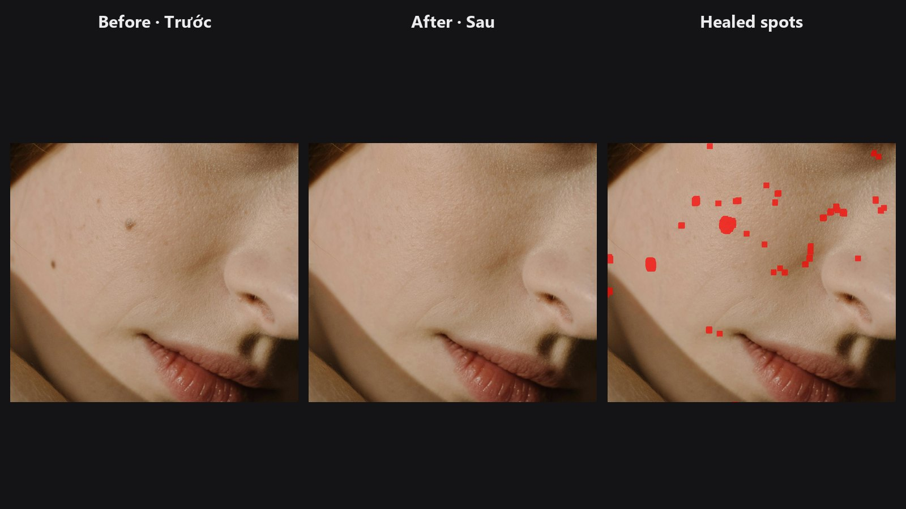

# Auto Blemish

Detects the faces in a portrait and heals pimples, spots and small marks on the skin. The skin texture continues through each healed spot, so it does not look smoothed.

| | |
|---|---|
| **In ComfyUI** | `Add Node → ComfyUI-JH-PixelPro → face → Face: Auto Blemish` |
| **Good for** | A first pass of spot healing on portraits, group photos, batches of headshots, body skin with your own mask |
| **Speed** | About 5 s on a CPU for an 8 MP portrait, under 1.1 GB VRAM |

## When to use it

This is the automatic version of the Spot Healing Brush. It does the dull part of portrait retouching: finding every small mark. You then check the result and fix what remains by hand.

!!! warning
    It also removes natural moles unless you protect them. Draw a mask over any beauty mark, freckle pattern or tattoo you want to keep and connect it to `protect_mask`.

Each face is processed in its own crop, with its own spot size, so group photos work. Eyes, brows and the mouth are never touched. For skin without a face in the frame (back, hands, arms), give the node a `mask` of the skin area instead.

## Quick start

1. Load Image → **Face: Auto Blemish** → Preview Image.
2. Keep the defaults. Raise `sensitivity` if faint marks are left. Lower it if freckles start to disappear.
3. Connect `spot_mask` to [Mask Preview](mask-preview.md) to see exactly what was healed.
4. Check `face_count`. If it is 0 on a portrait, the face was not found; use `mask` instead.

## Settings

| Setting | Default | What it does | Tip |
|---|---|---|---|
| `image` | | The portrait to retouch. | |
| `sensitivity` | 0.5 | 0 to 1. Higher catches fainter marks. Very high also removes freckles. | 0.3 to 0.6 for most portraits. |
| `spot_scale` | 1.0 | 0.25 to 4. The largest mark to remove, relative to the automatic size (5 % of each face width). | Raise it for bigger pimples. Lower it to keep small features. |
| `mask` (optional) | | Skin area to clean instead of the detected faces. Spot size then follows the mask width. | For body, back and hands. |
| `protect_mask` (optional) | | Areas that are never touched. | A beauty mark you keep, tattoos. |

**Outputs**

| Output | What it is |
|---|---|
| `image` | The retouched image. |
| `spot_mask` | The pixels that were healed. Check it with Mask Preview. |
| `face_count` | How many faces were found. 0 when a `mask` is given. |

## Tips from retouching

- Always look at `spot_mask` once. It shows whether the node caught real blemishes or something you want to keep.
- Natural moles and strong freckles are at risk at high `sensitivity`. Protect them with `protect_mask`.
- Follow with [Skin Smoother](edge-aware-smoother.md) or [Frequency Separation](frequency-separation.md) for tone evening. Auto Blemish only removes marks.
- A mark that survived is often bigger than the automatic limit. Raise `spot_scale`, or heal it with [Heal / Content-Aware Fill](heal.md).
- Large images work well: each face is cropped, so cost depends on the faces, not the whole frame.

??? note "Under the hood"
    1. **Region.** [Face Detect Lite](face-detect-lite.md) (YuNet) finds the faces. The weights are downloaded once by Kornia. Each face box, grown by 25 %, is processed as its own crop. Only skin-coloured pixels are kept (a soft YCrCb test that covers light to dark skin), minus discs around the eyes, brows and mouth placed from the five landmarks. A user `mask` replaces the face search.
    2. **Detection.** The spot detector of [Dust & Spot Removal](dust-spot-removal.md) runs on a signal made of luma darkening plus redness, because pimples are redder more than they are darker. The largest spot follows the face size (about 5 % of the face width).
    3. **Healing.** The texture fill of Dust & Spot copies the best nearby skin patch, matched on the ring and brightness-corrected, so pores continue.

    Source: `core/blemish.py`, wrapper `nodes/blemish_node.py`.

## Related nodes

- [Heal / Content-Aware Fill](heal.md): remove marks that you paint yourself
- [Dust & Spot Removal](dust-spot-removal.md): the spot engine used here, for sensor dust
- [Face Detect Lite](face-detect-lite.md): the face detector used here
- [Skin Smoother](edge-aware-smoother.md): even out skin tone after cleaning
- [Mask Preview](mask-preview.md): see what was healed

## Example workflow

[Auto Blemish example workflow](https://github.com/jetthuangai/ComfyUI-JH-PixelPro/blob/main/workflows/N-59-auto-blemish.json) runs the sample portrait through Auto Blemish and shows the previews plus a Mask Preview of `spot_mask`. Copy `workflows/sample_portrait.jpg` into `ComfyUI/input/` (Pexels License).
