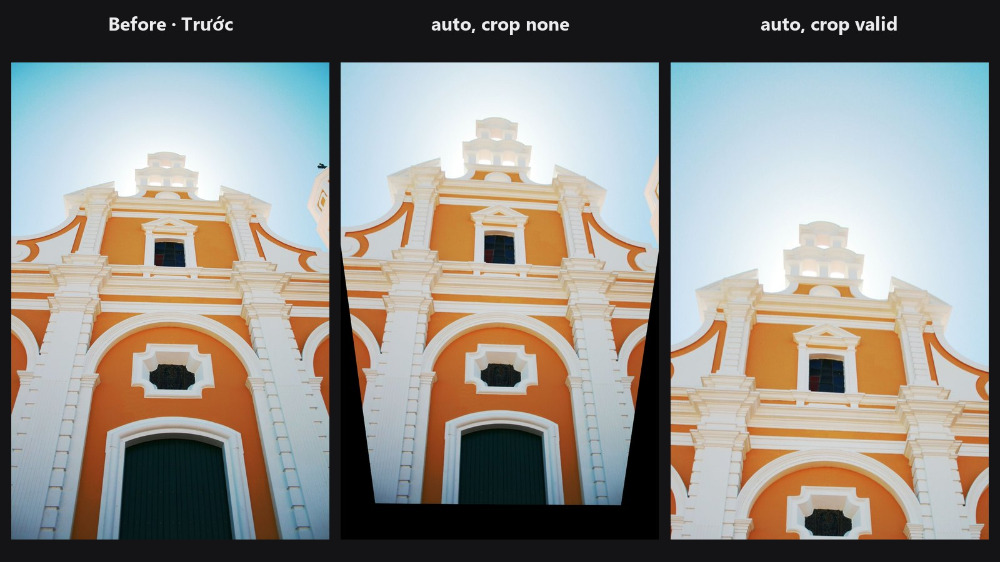

# Auto Upright

Straightens a photo the way Lightroom's Upright does: it finds the lines in the picture, then levels the horizon or makes the building verticals parallel. If it is not sure, it leaves the photo alone.

| | |
|---|---|
| **In ComfyUI** | `Add Node → ComfyUI-JH-PixelPro → geometry → Auto: Upright` |
| **Good for** | Tilted horizons, buildings shot looking up, interiors, architecture and real-estate photos |
| **Speed** | About 0.1 to 0.3 s per image, VRAM under 0.3 GB |

## When to use it

Tilt the camera up at a building and the vertical lines lean toward each other. Hold the camera slightly rolled and the horizon is crooked. This node measures both from the straight lines in the photo and corrects them with no sliders to guess.

It only acts when the evidence is clear. Portraits, trees, clouds or noisy scenes have no reliable lines, so the image comes back unchanged and `confidence` is 0. A wrong guess would be worse than no correction.

## Quick start

1. Load Image → **Auto: Upright** → Preview Image.
2. Keep `mode` on `auto`. Set `crop` to `valid` for a clean final image.
3. If a tall building looks too rigid, lower `strength` to about 0.7.
4. Watch the `confidence` output (connect it to a text preview). 0 means nothing was changed.

## Settings

| Setting | Default | What it does | Tip |
|---|---|---|---|
| `image` | | The photo or batch to straighten. | |
| `mode` | `auto` | `auto` = parallel verticals if buildings are found, otherwise a level horizon. `level` = rotate only. `vertical` = parallel verticals. `full` = verticals plus the main horizontal lines. | `level` for landscapes and seascapes. `full` for a facade seen straight on. |
| `strength` | 1.0 | 0 to 1. The fraction of the correction to apply. | About 0.7 keeps a natural bit of perspective in tall buildings. |
| `crop` | `none` | `none` keeps everything, with black corners where the picture was turned. `valid` zooms in until no empty corners remain. | `valid` for final output. |
| `max_angle` (optional) | 25 | 0 to 45 degrees. Larger corrections stop at this angle. | Steep look-up shots are corrected part of the way instead of being stretched too far. |

**Outputs**

| Output | What it is |
|---|---|
| `image` | The straightened image, same size as the input. |
| `confidence` | 0 to 1, the lowest value of a batch. 0 means the image was left unchanged. |
| `matrix` | Text (JSON) list of the 3x3 pixel transforms that were applied, one per image. |

## Tips from retouching

- Run Auto Upright before [Auto Tone](auto-tone.md) and other colour work, so you measure the final framing.
- With `crop` set to `none`, the corners go black. Use `valid`, or crop yourself, before you send the picture on.
- Strong wide-angle distortion bends lines too. If lines curve near the edges, fix that first with [Lens Distortion](lens-distortion.md).
- Use `level` when the scene has only a horizon and no buildings. It will not invent a perspective change.
- A `confidence` of 0 usually means the photo has too few long straight lines, or its verticals lean more than 15 degrees, which are not treated as walls. Straighten it by hand or try `level`.

??? note "Under the hood"
    Straight line segments are found with OpenCV's line segment detector on a copy whose long edge is at most 1024 px. Source: `core/upright.py`, wrapper `nodes/upright_node.py`.

    **level**: the tilt is the length-weighted median of the near-horizontal and near-vertical lines, and the photo is rotated about its centre.

    **vertical / full**: vanishing points are found by RANSAC, then refined. The camera is virtually rotated (`H = K·R·K⁻¹`) so the vertical vanishing point goes to infinity and the verticals become parallel. `full` also does this for the main horizontal point. Focal length comes from the two points when they are orthogonal, otherwise a default of about a 36 mm lens.

    **Safety gate**: `level` needs at least 3 lines, enough total length and 60 % of that length in agreement. A vanishing point needs at least 5 lines and agreeing lines totalling half the long edge. Lines leaning more than 15 degrees are not treated as walls. Otherwise the image is returned unchanged with confidence 0.

    The warp runs with Kornia on the image's device. `crop` `valid` zooms to the largest rectangle of the original shape that holds only image pixels.

## Related nodes

- [Auto Tone](auto-tone.md): fix exposure and white balance after straightening
- [Lens Distortion](lens-distortion.md): remove barrel or pincushion bending before straightening
- [Auto Align](auto-align.md): align a series of photos to each other

## Example workflow

[Auto Upright example workflow](https://github.com/jetthuangai/ComfyUI-JH-PixelPro/blob/main/workflows/N-56-auto-upright.json): a church photo shot looking up is straightened with `crop` set to `valid`, then goes through [Auto Tone](auto-tone.md). It uses only core ComfyUI nodes and this pack. Copy `workflows/sample_architecture.jpg` into `ComfyUI/input/` (Pexels License).

