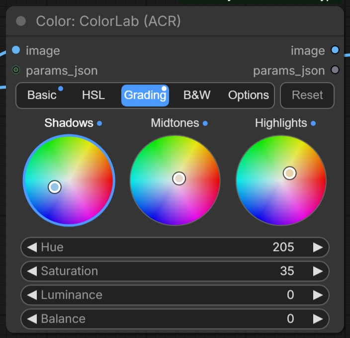

# ColorLab

Một khâu hoàn thiện kiểu Camera Raw trong đúng một node: cân bằng trắng, phơi sáng và tông, HSL theo từng màu, color grading ba vùng bằng bánh xe màu và bộ trộn đen trắng. Mọi thanh trượt đều bắt đầu ở mức trung tính, và bộ thông số có thể chuyển tiếp thành preset.

| | |
|---|---|
| **Trong ComfyUI** | `Add Node → ComfyUI-JH-PixelPro → color → Color: ColorLab (ACR)` |
| **Dùng để** | Grade nhanh toàn ảnh, tông teal-and-orange, split toning (nhuộm màu bóng/sáng), chuyển đen trắng, hoàn thiện cuối bằng một node, grade một lần rồi dùng lại look cho ảnh khác |
| **Tốc độ** | Với `tone_engine` là `local`, ảnh 4K mất khoảng 0.2 giây trên GPU, bộ nhớ đỉnh khoảng 1.56 GB. |

## Khi nào dùng

Nếu bạn quen Lightroom hay Camera Raw thì đã biết cách dùng node này. Thay vì nối nhiều node nhỏ, bạn có đủ các bảng theo đúng thứ tự quen thuộc và chạy thành một chuỗi: **Cân bằng trắng → Basic → HSL → Color Grading → Đen trắng (Gray Mix)**. Nó hợp làm bước cuối sau khi retouch nặng xong, hoặc thay cho một lượt Camera Raw trên ảnh AI.

Đây là bản xấp xỉ viết riêng cho pack, không phải code của Adobe, nên con số sẽ không khớp từng chút với Camera Raw. Hãy đánh giá bằng mắt. Khi mọi thanh trượt ở 0 và chế độ đen trắng tắt, ảnh đi qua không đổi.

Node có 59 thông số cùng một đầu vào tùy chọn `params_json`. Tên thông số cho biết bảng: `basic_*`, `wb_*`, `hsl_*`, `grade_*`, `gray_*`.

### Giao diện dạng tab

Để node gọn, các thông số được chia vào các tab: **Basic**, **HSL**, **Grading**, **B&W** và **Options**.

- **Basic** gồm nhóm Light (ánh sáng) và Presence (độ nổi), cùng Temp và Tint trong mục *White balance*.
- **HSL** có một hàng 8 chấm màu. Bấm vào chấm để chọn màu; ba thanh Hue, Saturation, Luminance của màu đó hiện ra bên dưới.
- **Grading** có ba bánh xe màu kiểu Lightroom cho Shadows, Midtones và Highlights. Kéo bên trong bánh xe: góc quay chọn hue, khoảng cách tới tâm là saturation. Bấm vào tâm để bỏ màu nhuộm. Bên dưới là các thanh Hue, Saturation, Luminance và Balance của vùng đang chọn.
- **B&W** gồm *Convert to B&W* và các thanh trộn xám theo từng màu.
- **Options** gồm `exposure_mode` và `tone_engine`.
- Một chấm xanh nhỏ đánh dấu tab (và màu HSL hay bánh xe grading) đã có chỉnh sửa.
- **Reset** đưa tab đang mở về trung tính. Ở HSL và Grading, nút này chỉ reset màu hoặc vùng đang hiển thị.

Workflow lưu từ trước khi có tab sẽ mở ở tab đầu tiên có chỉnh sửa. Tab chỉ thay đổi cách hiển thị: giá trị lưu trong workflow và gửi qua API prompt vẫn y như trước. Nếu bạn bật chế độ Vue nodes của ComfyUI, node sẽ hiện danh sách thanh trượt thông thường.

## Bắt đầu nhanh

1. **Load Image** → ColorLab → **Preview Image**.
2. Ở tab **Basic**, chỉnh nhẹ Exposure và Contrast, rồi Highlights và Shadows. Sửa ám màu bằng Temp và Tint.
3. Về màu, chuyển sang **HSL** hoặc **Grading**. Mỗi lần chỉ chỉnh một tab và so với ảnh gốc.
4. Muốn đen trắng, mở **B&W**, bật *Convert to B&W* rồi tạo tông bằng các thanh màu.
5. Muốn highlight và shadow phản ứng giống Lightroom hơn? Ở **Options**, đặt `tone_engine` là `local`.

## Thông số

Mọi thanh trượt mặc định là 0, trừ khi ghi khác. "±100" nghĩa là thanh chạy từ -100 đến 100.

### Basic

Tông toàn ảnh và độ "nổi" (tab **Basic**).

| Thông số | Khoảng | Tác dụng |
|---|---|---|
| `basic_exposure` | -5 đến 5 (stop) | Độ sáng chung. Mỗi +1 là gấp đôi lượng sáng. |
| `basic_contrast` | ±100 | Đẩy các tông ra xa mức xám trung bình. Với engine `local`, đây là đường cong chữ S giữ nguyên điểm đen và điểm trắng. |
| `basic_highlights` | ±100 | Làm sáng hoặc cứu lại nửa sáng của ảnh. |
| `basic_shadows` | ±100 | Mở hoặc làm sâu nửa tối. |
| `basic_whites` | ±100 | Chỉnh những tông sáng nhất. |
| `basic_blacks` | ±100 | Chỉnh những tông tối nhất. |
| `basic_texture` | ±100 | Độ nổi chi tiết nhỏ (bán kính nhỏ). |
| `basic_clarity` | ±100 | Local contrast ở midtone (bán kính lớn hơn), mạnh nhất ở vùng midtone. |
| `basic_dehaze` | ±100 | Xua sương mù; giá trị âm tạo lớp sương nhẹ. |
| `basic_vibrance` | ±100 | Tăng các màu yếu nhiều hơn màu mạnh và bảo vệ màu da. |
| `basic_saturation` | ±100 | Tăng giảm mọi màu như nhau. |

### Cân bằng trắng

Hiện thành Temp và Tint ở tab **Basic**. Cả hai đều tùy chọn và mang tính tương đối: chúng dịch màu của ảnh bạn đang có, không phải giá trị Kelvin.

| Thông số | Khoảng | Tác dụng |
|---|---|---|
| `wb_temperature` | ±100 | Ấm hơn (+) hoặc lạnh hơn (-). |
| `wb_tint` | ±100 | Ngả magenta (+) hoặc xanh lá (-). |

Độ sáng được giữ nguyên khi đổi màu, nên chỉnh cân bằng trắng không làm ảnh sáng lên hay tối đi.

### HSL

Tám dải màu: `red`, `orange`, `yellow`, `green`, `aqua`, `blue`, `purple`, `magenta`. Mỗi dải có ba thanh `hsl_<màu>_hue`, `hsl_<màu>_sat` và `hsl_<màu>_lum`, đều ±100 (tổng 24, ví dụ `hsl_orange_sat`). Ở tab **HSL**, chọn màu bằng chấm màu tương ứng.

| Thanh | Tác dụng |
|---|---|
| `hsl_<màu>_hue` | Xoay màu đó về phía các màu lân cận (tối đa khoảng 30 độ ở đầu thanh). |
| `hsl_<màu>_sat` | Làm màu đó đậm hơn hoặc nhạt hơn. |
| `hsl_<màu>_lum` | Làm màu đó sáng hơn hoặc tối hơn. |

Các dải chồng nhẹ lên nhau nên màu kế bên sẽ dịch chuyển một chút theo màu bạn chỉnh. Đây là bảng để làm teal-and-orange, lá cây xanh hơn hoặc da bớt đỏ.

### Color Grading

Ba vùng tông: `shadow`, `mid`, `highlight`. Mỗi vùng có bốn thanh `grade_<vùng>_hue`, `grade_<vùng>_sat`, `grade_<vùng>_lum` và `grade_<vùng>_bal` (tổng 12, ví dụ `grade_shadow_hue`). Ở tab **Grading**, bánh xe màu đặt sẵn `hue` và `sat` cho bạn.

| Thanh | Khoảng | Tác dụng |
|---|---|---|
| `grade_<vùng>_hue` | 0 đến 360 | Màu nhuộm, tính theo vị trí trên vòng màu. |
| `grade_<vùng>_sat` | 0 đến 100 | Độ đậm của màu nhuộm. Màu nhuộm chỉ hiện khi giá trị này lớn hơn 0. |
| `grade_<vùng>_lum` | ±100 | Làm vùng tông đó sáng hơn hoặc tối hơn. |
| `grade_<vùng>_bal` | ±100 | Coi pixel là sáng hơn (dương) hoặc tối hơn (âm) khi xếp vào vùng. Dương sẽ thu hẹp vùng shadow và nới rộng vùng highlight. |

Đặt `hue` trước, rồi tăng `sat` từ từ. Chút xanh lam ở vùng bóng và vàng ấm ở vùng sáng là split-tone kinh điển.

### Gray Mix (đen trắng)

Chuyển đen trắng với điều khiển theo từng màu (tab **B&W**).

| Thông số | Mặc định | Khoảng | Tác dụng |
|---|---|---|---|
| `gray_enable` | tắt | bật / tắt | Chuyển ảnh sang xám (*Convert to B&W*). Khi tắt, không thanh nào trong bảng này có tác dụng. |
| `gray_red`, `gray_orange`, `gray_yellow`, `gray_green`, `gray_aqua`, `gray_blue`, `gray_purple` | 0 | -200 đến 300 | Màu đó sáng hay tối thế nào trong ảnh xám. Dương làm sáng, âm làm tối. |

Không có thanh `gray_magenta`: magenta đi theo các màu lân cận, trừ khi preset đặt giá trị cho nó (xem bên dưới).

### Options

| Thông số | Mặc định | Tác dụng |
|---|---|---|
| `exposure_mode` (tùy chọn) | `display` | `display` nhân giá trị ảnh với 2^EV (cách ColorLab hoạt động từ trước). `linear` đổi sang ánh sáng tuyến tính, nhân, rồi đổi ngược lại, giống máy ảnh hoặc Lightroom. |
| `tone_engine` (tùy chọn) | `legacy` | `legacy` giữ cách xử lý của các phiên bản trước. `local` làm Highlights và Shadows bám theo cạnh (chúng chạy theo hình khối trong ảnh thay vì dịch cả dải tông), dùng Clarity bám cạnh, Dehaze theo dark channel và Contrast dạng đường cong S giữ nguyên đen trắng. Chạy trên GPU nếu máy có GPU. |

### Đầu vào params_json

`params_json` (tùy chọn, chỉ nhận dây nối) nhận bộ thông số ColorLab dạng văn bản, ví dụ từ **Color: Lightroom Preset (XMP)** hoặc từ đầu ra `params_json` của một ColorLab khác.

- **Giá trị số được cộng** vào thanh trượt. Preset đặt điểm xuất phát, còn thanh trượt trên node này tinh chỉnh thêm: preset có Exposure 0.5 cộng thanh trượt 0.2 thành 0.7.
- **Công tắc bật/tắt và thông số dạng chữ** (`gray_enable`, `exposure_mode`, `tone_engine`) **thay thế** giá trị của node.
- Tên lạ bị bỏ qua kèm cảnh báo trong console. Văn bản không phải đối tượng JSON hợp lệ sẽ dừng lượt chạy với thông báo lỗi.

### Thông số chỉ có qua params_json

Các thông số này không có thanh trượt. Chúng đi vào qua `params_json`, thường từ preset Lightroom hoặc preset lưu từ ColorLab.

| Thông số | Giá trị | Tác dụng |
|---|---|---|
| `tone_curve` | danh sách điểm `[x, y]`, 0 đến 255 | Đường cong điểm (point curve) trên mọi kênh, như Point Curve của Lightroom. |
| `tone_curve_red`, `tone_curve_green`, `tone_curve_blue` | danh sách điểm `[x, y]`, 0 đến 255 | Đường cong điểm cho một kênh. Mỗi đường cần ít nhất hai điểm có `x` khác nhau. |
| `calib_red_hue`, `calib_red_sat`, `calib_green_hue`, `calib_green_sat`, `calib_blue_hue`, `calib_blue_sat`, `calib_shadow_tint` | ±100 | Bảng Calibration: dịch hue và saturation của ba màu gốc đỏ, lục, lam, và ám xanh lá/magenta ở vùng tối sâu. |
| `vignette_amount`, `vignette_midpoint`, `vignette_feather`, `vignette_roundness` | amount ±100 (âm làm tối góc) | Vignette (tối/sáng góc ảnh) sau crop. Midpoint, feather và roundness mặc định là 50, 50 và 0. |
| `grain_amount`, `grain_size`, `grain_frequency` | amount 0 đến 100 | Hạt phim (grain) trên độ sáng. Size và độ thô mặc định 25 và 50. Hạt giống hệt nhau ở mọi lượt chạy. |
| `gray_magenta` | -200 đến 300 | Thanh magenta của bộ trộn đen trắng. Khi không đặt, magenta đi theo các màu lân cận. |

**Đầu ra**

| Đầu ra | Là gì |
|---|---|
| `image` | Ảnh đã chỉnh. |
| `params_json` | Bộ thông số của node này dưới dạng preset: chỉ gồm các giá trị khác trung tính, kể cả phần đi vào qua `params_json`. Nối vào `params_json` của một ColorLab khác hoặc vào [Apply ColorLab Preset](apply-colorlab-preset.md). |

## Mẹo khi chỉnh ảnh

- Muốn chỉnh phơi sáng tự nhiên, đặt `exposure_mode` là `linear`. Ánh sáng thật cộng dồn trong không gian tuyến tính, nên +1 stop giống mở khẩu máy ảnh thêm một stop: xám trung bình 0.5 lên khoảng 0.69, vùng sáng chuyển mượt và màu giữ được cân bằng. `display` nhân thẳng giá trị đã lưu nên cùng +1 đẩy xám trung bình lên 1.0 và vùng sáng cháy rất nhanh. Workflow cũ vẫn dùng `display`.
- Cần cứu bầu trời cháy hay mở mặt người ngược sáng? Thử `tone_engine` = `local`. Engine legacy kéo cả dải tông lên xuống nên dễ làm ảnh bẹt; engine local xử lý quanh các cạnh nên giữ được chi tiết và tương phản cục bộ.
- Làm từ trên xuống: cân bằng trắng và tông ở Basic trước, màu ở HSL hoặc Grading sau, để chỉnh màu nằm trên nền ổn định.
- Chỉnh bước nhỏ. Nhiều thanh rất mạnh ở gần hai đầu; 10 đến 30 thường là đủ.
- Da chủ yếu nằm ở dải orange. Chỉnh `hsl_orange_*` nhẹ tay, đẩy mạnh hơn ở blue và green khi muốn tạo tông mà da không bị xanh xao.
- Đen trắng: hạ `gray_blue` để bầu trời sâu hơn, nâng `gray_orange` và `gray_red` để da mịn hơn.
- Grade một tấm chủ đạo, rồi đưa `params_json` của nó sang [Apply ColorLab Preset](apply-colorlab-preset.md) để cả loạt ảnh có cùng look.
- Khi nối hai node ColorLab, chỉ nối ảnh hoặc `params_json` từ node đầu, đừng nối cả hai. Nối cả hai thì look bị áp hai lần.
- ColorLab tác động lên toàn khung. Muốn grade riêng một phần, trộn kết quả lại bằng mask (xem [Luminosity Masking](luminosity-masking.md)), hoặc dùng đầu vào `mask` của Apply ColorLab Preset.
- Chỉ cần local contrast? [CLAHE Local Contrast](clahe-local-contrast.md) nâng vùng phẳng hoặc tối theo cách khác với `basic_clarity`.

??? note "Bên trong node hoạt động thế nào"
    Chuỗi xử lý nằm ở `core/color_lab.py`, dùng PyTorch thuần cùng Kornia. Ảnh vào được kẹp trong 0..1. Thứ tự: cân bằng trắng → calibration → Basic → đường cong điểm → HSL → Color Grading → Gray Mix → vignette → grain.

    - **Cân bằng trắng:** trong ánh sáng tuyến tính, kênh đỏ nhân `1 + 0.3·temp`, kênh lục nhân `1 - 0.22·tint`, kênh lam nhân `1 - 0.3·temp`, sau đó đưa về đúng luminance ban đầu (Rec. 709).
    - **Calibration:** ma trận 3×3 trên RGB tuyến tính, xoay hue và co giãn chroma của từng màu gốc trong OkLCh mà giữ nguyên điểm trắng; Shadows Tint đổi kênh lục ở vùng tối sâu và giữ luminance.
    - **Basic, engine `legacy`:** exposure nhân với `2^exposure` (`display`, trên giá trị sRGB) hoặc đổi sang RGB tuyến tính bằng Kornia, nhân với `2^exposure`, kẹp rồi đổi ngược lại (`linear`; xám 0.5 ở +1 EV thành khoảng 0.686); contrast xoay quanh 0.5; highlights, shadows, whites, blacks cộng độ lệch có trọng số smoothstep theo luma (hệ số Rec. 601) và có bảo vệ biên để không bị cháy; texture và clarity là kiểu unsharp dùng box blur 5 px và 9 px với biên được sao chép (clarity ưu tiên midtone); dehaze là thay đổi tương phản và offset; vibrance và saturation làm việc trong HSV, vibrance giảm tác động gần hue của da.
    - **Basic, engine `local`:** dehaze chạy trước, dùng dark-channel prior (He và cộng sự, 2009) với airlight ước lượng trên ảnh proxy 512 px; contrast là đường cong S `x - a·sin(2πx)/2π` (giữ nguyên đen và trắng); highlights và shadows dùng bộ lọc local Laplacian; clarity tăng một dải log luminance tách ra bằng guided filter, ưu tiên midtone. Whites, blacks, texture, vibrance và saturation giống `legacy`. Khi ảnh nằm trên CPU và có GPU CUDA, chuỗi xử lý chuyển sang GPU rồi trả về; nếu GPU hết bộ nhớ thì quay về chạy CPU.
    - **Đường cong điểm:** đường cong bậc ba đơn điệu (Fritsch-Carlson), phẳng ngoài hai điểm đầu cuối; đường master trước, rồi tới từng kênh.
    - **HSL:** mỗi dải là một đường Gauss trên vòng hue (sigma 20 độ) quanh điểm neo cố định: red 0, orange 30, yellow 60, green 120, aqua 180, blue 240, purple 280, magenta 310.
    - **Color Grading:** mỗi vùng dùng một mask luma mượt (dịch bởi `bal`), màu nhuộm dựng từ `hue` và `sat`, còn `lum` là độ nâng.
    - **Gray Mix:** luma được điều biến theo trọng số của từng dải; magenta chỉ tham gia khi `gray_magenta` được đặt.
    - **Vignette và grain** chạy cuối cùng, theo thứ tự của Lightroom. Grain dùng seed cố định.

    Kết quả đi qua `nan_to_num` rồi kẹp 0..1. Nếu mọi thông số ở mức trung tính và `gray_enable` tắt, ảnh vào được trả về nguyên vẹn. Khi để các đầu vào mới ở mặc định, kết quả giống hệt các phiên bản trước.

## Node liên quan

- [Apply ColorLab Preset](apply-colorlab-preset.md): áp bộ thông số ColorLab lên ảnh khác, có thanh cường độ và mask
- [Lightroom Preset](lightroom-preset.md): nạp preset Lightroom hoặc Camera Raw thành thông số ColorLab
- [Tone Curve](tone-curve.md): tạo tương phản chính xác bằng đường cong
- [Hue/Saturation per Range](hue-saturation-range.md): một dải hue chỉnh được độ rộng
- [CLAHE Local Contrast](clahe-local-contrast.md): local contrast thích ứng chỉ trên độ sáng
- [Luminosity Masking](luminosity-masking.md): chỉ grade vùng bóng, midtone hoặc sáng
- [LUT Preset](lut-preset.md): áp một look dựng sẵn sau khi grade

## Workflow mẫu

Các workflow mẫu (chép `workflows/sample_portrait.jpg` vào `ComfyUI/input/` trước):

- [Workflow mẫu ColorLab Basic](https://github.com/jetthuangai/ComfyUI-JH-PixelPro/blob/main/workflows/S-21-colorlab-basic-only.json)
- [Workflow mẫu ColorLab HSL teal-orange](https://github.com/jetthuangai/ComfyUI-JH-PixelPro/blob/main/workflows/S-22-colorlab-hsl-teal-orange.json)
- [Workflow mẫu ColorLab Color Grading](https://github.com/jetthuangai/ComfyUI-JH-PixelPro/blob/main/workflows/S-23-colorlab-color-grading-cinematic.json)
- [Workflow mẫu ColorLab Gray Mix](https://github.com/jetthuangai/ComfyUI-JH-PixelPro/blob/main/workflows/S-24-colorlab-gray-mix-bw.json)
- [Workflow mẫu ColorLab đầy đủ](https://github.com/jetthuangai/ComfyUI-JH-PixelPro/blob/main/workflows/S-25-colorlab-full-acr-preset.json)
- [Workflow mẫu Apply ColorLab Preset](https://github.com/jetthuangai/ComfyUI-JH-PixelPro/blob/main/workflows/N-51-apply-colorlab-preset.json): `params_json` của ColorLab điều khiển Apply ColorLab Preset ở nửa cường độ
