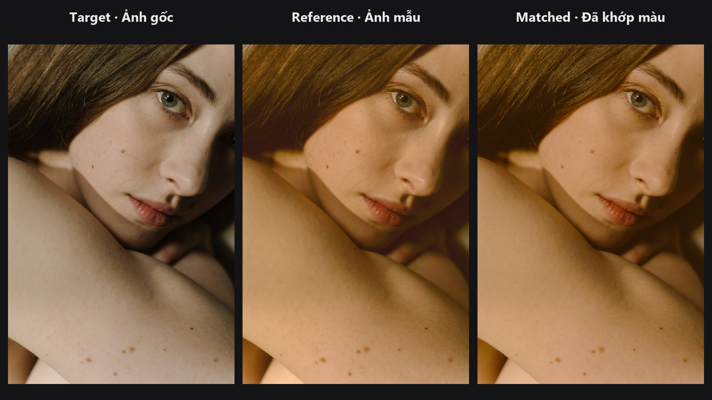

# Color Matcher

Kéo màu của ảnh đích về phía ảnh tham chiếu, giống như khi bạn khớp màu da giữa hai tấm hình, hoặc kéo ảnh AI về lại tông của ảnh gốc.

| | |
|---|---|
| **Trong ComfyUI** | `Add Node → ComfyUI-JH-PixelPro → color → Color Matcher (LAB)` |
| **Dùng để** | Kéo màu da ảnh AI về ảnh gốc, đồng bộ cả loạt ảnh theo một khung chuẩn, hòa màu ảnh ghép vào ảnh nền |

## Khi nào dùng

Hai tấm ảnh cùng một chủ thể hiếm khi giống nhau về màu: cân bằng trắng khác, ánh sáng khác, hoặc bản AI bị ngả ấm. Color Matcher đo "tính cách màu" tổng thể của ảnh tham chiếu (giá trị trung bình và độ trải của từng kênh) rồi uốn ảnh đích theo. Đây là phép chuyển màu Reinhard kinh điển, chạy trong CIE LAB, không gian màu bám theo cách mắt người nhìn màu, tách độ sáng (L) khỏi hai trục màu (a và b).

Mặc định node chỉ khớp hai trục màu (`ab`). Độ sáng và tương phản giữ nguyên nên ánh sáng không bị bệt. Chọn `lab` khi bạn muốn khớp luôn cả độ sáng tổng thể của ảnh tham chiếu.

Cần khớp riêng một vùng, hoặc hai ảnh khác kích thước? Dùng [Color Matcher Region](color-matcher-region.md).

## Bắt đầu nhanh

1. Mở ảnh cần sửa bằng **Load Image** và nối vào `image_target`.
2. Mở ảnh có tông màu bạn muốn bằng một **Load Image** khác và nối vào `image_reference`. Ảnh này phải cùng chiều rộng và chiều cao với ảnh đích.
3. Để `channels` là `ab`, đặt `strength` khoảng 0.7.
4. Nối `image_matched` vào **Preview Image**.

## Thông số

| Thông số | Mặc định | Tác dụng | Gợi ý |
|---|---|---|---|
| `image_target` | bắt buộc | Ảnh được đổi màu. | |
| `image_reference` | bắt buộc | Ảnh có màu bạn muốn. Cùng rộng, cao với ảnh đích. Batch 1 ảnh sẽ được dùng cho mọi khung của ảnh đích. | |
| `channels` | `ab` | `ab` chỉ khớp màu, giữ độ sáng của ảnh đích. `lab` khớp cả độ sáng. | Chân dung, sản phẩm: dùng `ab`. |
| `strength` | 1.0 (0 đến 1) | Pha trộn giữa ảnh gốc (0) và bản khớp hoàn toàn (1). | Da tự nhiên: 0.6 đến 0.8. |
| `mask` (tùy chọn) | không | Mask quyết định pixel nào được dùng để đo thống kê màu, trên cả hai ảnh. | Xem lưu ý bên dưới. |
| `method` (tùy chọn) | `stats` | `stats` khớp giá trị trung bình và độ trải của từng kênh (mượt, an toàn). `histogram` khớp toàn bộ phân bố của từng kênh, nên vùng tối, trung tính và sáng đều rơi đúng chỗ như ảnh tham chiếu. | Thử `histogram` khi `stats` gần đúng nhưng chưa tới. |

**Đầu ra:** `image_matched`, ảnh đã đổi màu.

!!! note "Mask chọn vùng để đo, không chọn vùng áp dụng"
    Mask chỉ dùng để đo thống kê màu (ví dụ chỉ đo các pixel da của hai ảnh). Phần chỉnh màu sau đó vẫn áp lên toàn khung ảnh đích. Muốn giới hạn vùng bị đổi màu, hãy dùng [Color Matcher Region](color-matcher-region.md), hoặc tự trộn kết quả lại bằng mask trong chuỗi node của bạn.

## Stats hay histogram?

- **`stats`** (mặc định) dịch và co giãn từng kênh để trung bình và độ trải bằng ảnh tham chiếu. Nhẹ nhàng, dễ đoán, hợp với hầu hết việc sửa màu da và cân bằng trắng.
- **`histogram`** uốn từng kênh để toàn bộ phân bố (histogram) theo ảnh tham chiếu. Dùng khi hai ảnh cùng mức trung bình nhưng cảm giác khác hẳn, ví dụ bản render phẳng so với ảnh chụp tương phản. Mạnh hơn, nên hạ `strength` và để ý nhiễu hoặc dải bậc (banding) ở vùng mịn.

Workflow cũ vẫn chạy: khi không có `method`, node dùng `stats`.

## Mẹo khi chỉnh ảnh

- Với chân dung, giữ `channels` là `ab`. `lab` cũng kéo theo độ phơi sáng và có thể làm phẳng ánh sáng.
- Vẽ mask phủ vùng da trên cả hai ảnh để tường xanh hay nền lá không làm lệch kết quả.
- Đừng đẩy `strength` lên 1.0 khi hai ảnh quá khác nhau (đèn trong nhà ấm so với ánh sáng ngày lạnh). Bắt đầu ở 0.6 và đánh giá bằng màu da.
- Chạy node này trước bước grade cuối để [Tone Curve](tone-curve.md) hay [ColorLab](color-lab.md) làm việc trên nền màu đồng nhất.

??? note "Bên trong node hoạt động thế nào"
    Cả hai ảnh được chuyển sang LAB bằng Kornia `rgb_to_lab`. Với các kênh được chọn, ảnh đích được dịch và co giãn để trung bình và độ lệch chuẩn bằng của ảnh tham chiếu: `(target − mean_t) × (std_ref / std_t) + mean_ref`. Khi có mask, trung bình và độ lệch chuẩn được tính có trọng số theo mask. Kết quả đổi về RGB, loại NaN, kẹp trong 0..1 rồi trộn với ảnh gốc theo `strength`. `strength = 0` trả lại ảnh nguyên bản. Ảnh đích và tham chiếu phải cùng chiều cao, chiều rộng; mask cũng phải khớp và có ít nhất một pixel dương. Giá trị ngoài 0..1 bị kẹp lại kèm cảnh báo trong log.

    Với `method = histogram`, mỗi kênh được chọn của ảnh đích và ảnh tham chiếu được chia vào histogram 4096 bin (có trọng số theo mask nếu có). Mỗi pixel đích được ánh xạ sang phân vị của nó trong CDF của ảnh đích, rồi sang giá trị ở cùng phân vị trong CDF của ảnh tham chiếu (nội suy tuyến tính trong bin). Phần trộn theo `strength` và đường ra giống `stats`. Chạy trên GPU vài mili giây ở 2K, dùng dưới 1 GB.

## Node liên quan

- [Color Matcher Region](color-matcher-region.md): khớp vùng này với vùng kia, ảnh khác kích thước cũng được
- [Skin Tone Tri-Region](skin-tone-tri-region.md): tạo mask da để đưa vào phép khớp
- [Tone Match LUT](tone-match-lut.md): biến ảnh đã grade thành LUT dùng lại được
- [ColorLab](color-lab.md): tinh chỉnh tiếp sau khi khớp

## Workflow mẫu

[Workflow mẫu Color Matcher](https://github.com/jetthuangai/ComfyUI-JH-PixelPro/blob/main/workflows/S-08-color-matcher.json). Bản chỉnh tông lạnh của ảnh chân dung là ảnh đích, bản golden-hour là ảnh tham chiếu; Color Matcher chuyển màu tham chiếu sang trong không gian LAB. Chép `workflows/sample_portrait.jpg` vào `ComfyUI/input/`. Workflow chỉ dùng node lõi của ComfyUI và pack này.

[Workflow stats và histogram](https://github.com/jetthuangai/ComfyUI-JH-PixelPro/blob/main/workflows/N-49-color-matcher-histogram.json) chạy cả hai giá trị `method` trên cùng một cặp ảnh để so sánh.

