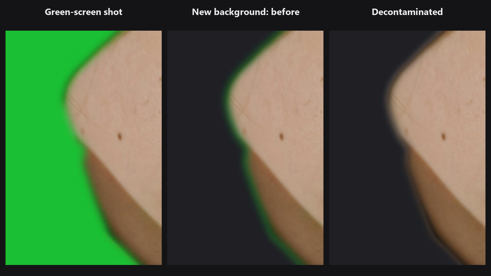

# Decontaminate Colors

Làm sạch viền màu quanh ảnh tách nền. Khi đặt chủ thể lên phông mới, các pixel ở rìa vẫn mang màu phông cũ. Node này thay chúng bằng chính màu của chủ thể.

| | |
|---|---|
| **Trong ComfyUI** | `Add Node → ComfyUI-JH-PixelPro → mask → Mask: Decontaminate Colors` |
| **Dùng cho** | Màu xanh phông green screen lem vào tóc, quầng sáng của bầu trời quanh chủ thể, mọi ảnh tách nền có matte mềm |
| **Tốc độ** | Khoảng 0,9 GB VRAM ở 4K. |

## Khi nào dùng

Matte (mask tách nền) có các pixel viền mềm, giá trị mask nằm giữa 0 và 1. Mỗi pixel đó là hỗn hợp của chủ thể và phông cũ. Khi ghép chủ thể lên phông mới, hỗn hợp này hiện ra thành viền xanh lá, xanh dương hoặc trắng, rõ nhất ở tóc.

Node ước lượng màu của chủ thể gần mỗi pixel viền rồi ghi lại vào ảnh. Sau đó bạn ghép bằng **ảnh đã xử lý và cùng mask đó**, ví dụ với [Mask Preview](mask-preview.md) ở chế độ cutout hoặc các node Layer.

Mask cứng thì không có tác dụng: nếu mọi giá trị đều đúng bằng 0 hoặc 1 thì ảnh không đổi. Hãy tạo viền mềm trước bằng [Alpha Matte](alpha-matte.md), [Sub-Pixel Mask Refiner](sub-pixel-mask-refiner.md) hoặc [Edge-Aware Mask Refiner](edge-aware-mask-refiner.md).

## Bắt đầu nhanh

1. Load Image → một mask chủ thể mềm (Alpha Matte, hoặc mask đã refine).
2. Nối ảnh vào `image` và mask vào `mask` của **Mask: Decontaminate Colors**.
3. Bắt đầu với `radius` 16 và `strength` 1.
4. Ghép ảnh đầu ra với **cùng mask** lên phông mới và so với ảnh gốc.

## Thông số

| Thông số | Mặc định | Tác dụng | Mẹo |
|---|---|---|---|
| `radius` | 16 | 1 đến 256. Node tìm màu của chính chủ thể trong phạm vi bao xa (pixel). | Tăng khi viền rộng, mảnh như tóc. |
| `strength` | 1.0 | 0 đến 1. 0 giữ nguyên ảnh, 1 là sửa hoàn toàn. | Giảm nếu viền trông sạch quá so với phần còn lại của chủ thể. |

**Đầu ra**

| Đầu ra | Là gì |
|---|---|
| `image` | Ảnh với màu viền đã được sửa. Pixel nơi mask đúng bằng 0 hoặc 1 giữ nguyên. |

## Mẹo khi chỉnh ảnh

- Luôn dùng ảnh đầu ra cùng với đúng mask đó. Mask vẫn quyết định phần chủ thể nào hiện ra.
- Viền mask rộng, mềm cho node nhiều dữ liệu hơn. Hãy refine viền trước rồi mới decontaminate.
- Tăng `radius` với tóc dài. Giữ thấp cho cạnh sản phẩm sắc nét.
- Kiểm tra kết quả trên phông cuối cùng, không phải trên phông cũ: viền màu chỉ lộ ra ở đó.

??? note "Bên trong node hoạt động thế nào"
    Pixel viền tuân theo `I = alpha × F + (1 − alpha) × B`. Node ước lượng màu chủ thể từ các pixel chủ thể đặc (alpha từ 0.95) và màu phông từ các pixel gần đó có alpha tối đa 0.05, bằng tích chập chuẩn hóa. Chỗ alpha lớn, node giải phương trình để tìm `F`, nhờ đó giữ được chi tiết tóc mảnh. Chỗ alpha nhỏ, phép giải không ổn định nên dùng màu chủ thể ở gần. Ở giữa, hai kết quả được hòa dần. Nếu không có pixel đặc nào trong tầm với, các lần blur rộng hơn sẽ lấp chỗ trống. Các lần blur chạy trên bản thu nhỏ rồi phóng lại, nên bộ nhớ chỉ tăng theo số pixel. Mã nguồn: `core/decontaminate.py`.

## Node liên quan

- [Alpha Matte](alpha-matte.md) để tạo mask mềm
- [Edge-Aware Mask Refiner](edge-aware-mask-refiner.md) để kéo mask thô bám vào cạnh thật
- [Sub-Pixel Mask Refiner](sub-pixel-mask-refiner.md) để tạo viền mềm mà không cần guide
- [Mask Preview](mask-preview.md) để xem ảnh tách nền trên phông mới

## Workflow mẫu

[Workflow mẫu Decontaminate Colors](https://github.com/jetthuangai/ComfyUI-JH-PixelPro/blob/main/workflows/N-54-decontaminate-colors.json) lấy ảnh chân dung và mask mẫu, làm mềm viền bằng Sub-Pixel Mask Refiner, kéo viền bám cạnh bằng Edge-Aware Refiner (`guide_mode` rgb), xử lý màu rồi hiển thị ảnh tách nền trước và sau trong Mask Preview. Chép `workflows/sample_portrait.jpg` và `workflows/sample_binary_mask.png` vào `ComfyUI/input/`.
