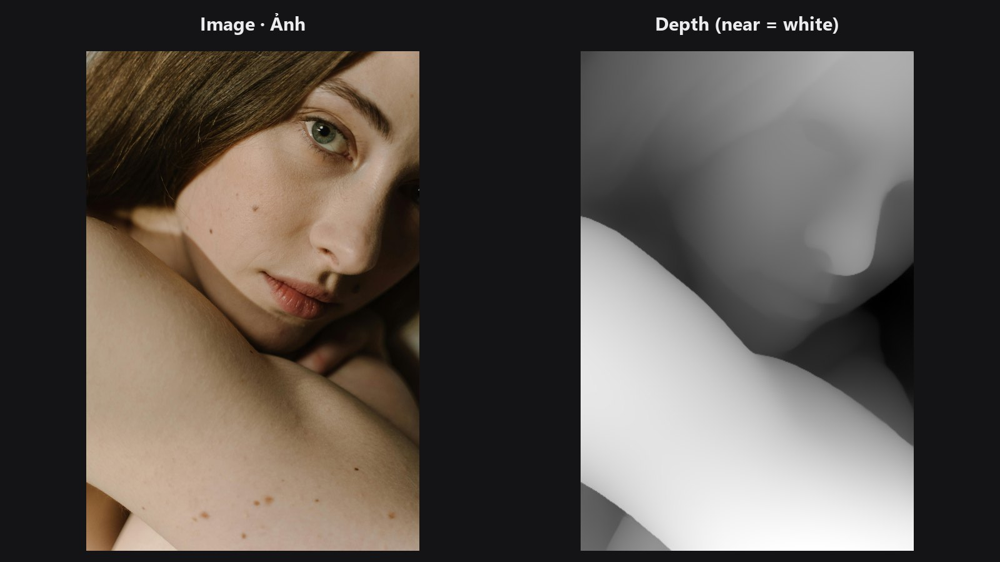

# Depth Anything V2

Turns a flat photo into a depth map: white is near the camera, black is far away. Use it to drive lens blur, fog, relighting or depth-based masks.

| | |
|---|---|
| **In ComfyUI** | `Add Node → ComfyUI-JH-PixelPro → depth → Depth: Depth Anything V2` |
| **Good for** | Fake depth of field, separating foreground from background, depth masks for colour grading |

## When to use it

A depth map is a greyscale picture where brightness means distance. Depth Anything V2 guesses it from one photo, with no stereo pair or sensor. The result is *relative*: it tells you what is nearer than what, not how many metres away it is. Values are normalised for each image, so 1 is the nearest thing in the frame and 0 the farthest.

Connect the `depth` output to [Depth Lens Blur](depth-lens-blur.md) or to any node that takes a mask. `depth_preview` is the same map as a greyscale image for Preview Image.

## Quick start

1. Load Image → **Depth: Depth Anything V2** → Preview Image (use `depth_preview`).
2. Keep `model` on `small` and `resolution` on 518.
3. Wire `depth` into [Depth Lens Blur](depth-lens-blur.md).

## Setup

- Install onnxruntime once: `pip install onnxruntime-gpu` (or `pip install onnxruntime` for CPU only). Without it the node raises a clear error.
- The model file is downloaded on first use into `ComfyUI/models/depth_anything/` (or the `depth_anything` folder from `extra_model_paths.yaml` if you set one) as `depth-anything-v2-<size>.onnx` (small is about 99 MB). The folder is only created when a download starts. Downloads come from a fixed Hugging Face revision (not `main`) with a 60 s network timeout; the small model is also checked against its SHA256, while base and large are pinned by revision only. If the download is blocked, save the file there by hand from `https://huggingface.co/onnx-community/depth-anything-v2-<size>/resolve/<revision>/onnx/model.onnx` (revisions are listed in `core/depth_anything.py`).

## Settings

| Setting | Default | What it does | Tip |
|---|---|---|---|
| `model` | `small` | Size of the network. | `small` is fast and free for any use. `base` and `large` show finer detail. |
| `resolution` | 518 | Long side (pixels) the network works at; both sides are rounded to a multiple of 14. | 266 to 1036. Raise it for finer edges, lower it for speed. |
| `keep_model_loaded` (optional) | on | Keep the Depth Anything model in VRAM between runs. | Turn off to free its VRAM right after the run; ComfyUI's *Free memory* button does not reach this model. |

**Outputs:** `depth` (MASK, 1 = nearest) and `depth_preview` (IMAGE, the depth as greyscale).

!!! warning "Licensing"
    `small` is Apache-2.0 and fine for commercial work. `base` and `large` are **CC-BY-NC-4.0: non-commercial use only**. Do not use them for paid jobs.

## Tips from retouching

- Depth is guessed, so thin objects (hair, wires) and glass can be wrong. Check `depth_preview` before blurring.
- The map is relative per image. In a batch, each image is normalised on its own, so the same distance can get different values in two frames. For video this means the depth can flicker from frame to frame.
- A close-up with no real background (a tight face crop) gives a depth map of the face shape itself, not of a "background".
- You can soften depth edges with [Mask Edge Smoother](mask-edge-smoother.md) before using the map.

??? note "Under the hood"
    The image is resized (bicubic) so both sides are multiples of 14 with the long side close to `resolution`, then normalised with ImageNet mean and std and run through the ONNX model with onnxruntime directly (CUDA provider when available, otherwise CPU; one session is cached; with CUDA it uses the `kSameAsRequested` memory strategy, which keeps the extra GPU memory at about 0.4 to 0.5 GB instead of about 1.3 GB). The raw output is relative inverse depth; it is resized back to the image size (bilinear) and scaled per image to 0..1. A constant image gives all zeros. Images in a batch are processed one at a time. Source: `core/depth_anything.py`.

## Related nodes

- [Depth Lens Blur](depth-lens-blur.md) uses this map for photographic blur
- [Face Detect Lite](face-detect-lite.md) for a face mask to focus on
- [Mask Edge Smoother](mask-edge-smoother.md) to soften the map

## Example workflow

[Depth Lens Blur example workflow](https://github.com/jetthuangai/ComfyUI-JH-PixelPro/blob/main/workflows/N-45-depth-lens-blur.json) runs Depth Anything inside Depth Lens Blur and shows the resulting blur map. It uses only core ComfyUI nodes and this pack. Copy `workflows/sample_portrait.jpg` into `ComfyUI/input/`.

