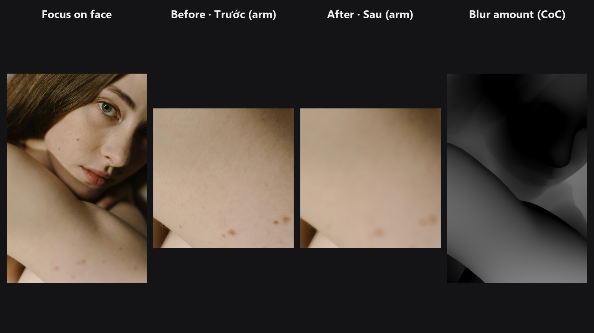

# Depth Lens Blur

Fake a wide-aperture lens after the shot. The subject stays sharp and everything nearer or farther melts into smooth bokeh, according to a depth map.

| | |
|---|---|
| **In ComfyUI** | `Add Node → ComfyUI-JH-PixelPro → depth → Depth: Lens Blur` |
| **Good for** | Background blur on portraits, product shots with creamy backgrounds, rescuing busy backgrounds |
| **Speed** | 2048 × 2048 image arriving from ComfyUI (CPU tensor), depth model excluded: about 0.03 s with a CUDA GPU (RTX 5090, transfers included); about 2 s on CPU only at `max_blur` 24, up to about 10 s at `max_blur` 96 with 16 layers |

## When to use it

On a real lens, only one distance is sharp. The farther something is from that distance, the bigger its blur disc (the circle of confusion). This node does the same per pixel, using a depth map where 1 is nearest.

- **Focus** (`focus_depth`) is the depth that stays sharp.
- **Depth of field** (`depth_of_field`) is the width of the sharp zone. Small values act like f/1.4, large values like f/16.
- **Max blur** (`max_blur`) is how big the blur gets at the farthest distance from focus, in pixels.

No depth map connected? The node estimates one itself with [Depth Anything V2](depth-anything.md) (small model, 518 px). That needs onnxruntime (`pip install onnxruntime-gpu`).

## Quick start

1. Load Image → **Depth: Lens Blur** → Preview Image.
2. Leave `depth` empty for automatic depth, or connect your own map (for example from [Depth Anything V2](depth-anything.md)).
3. Try `depth_of_field` 0.1 and `max_blur` 24, then raise `max_blur` for stronger blur.
4. To keep a person sharp automatically, connect a face mask to `focus_mask` (see below).

## Settings

| Setting | Default | What it does | Tip |
|---|---|---|---|
| `focus_depth` | 0.5 | Depth value that stays sharp (1 = nearest). | Ignored when `focus_mask` is connected. |
| `depth_of_field` | 0.1 | Width of the sharp zone. | 0 to 1. Lower = shallower focus. |
| `max_blur` | 24 | Blur radius in pixels at the farthest distance from focus. | 1 to 96. Scale up for large images. |
| `bokeh` | `disc` | `disc` gives flat, lens-like bokeh. `gaussian` is a softer blur. | `disc` for photographic look. |
| `layers` | 8 | Number of blur steps blended together. | 2 to 16. More = smoother transitions. |
| `blur_foreground` | on | Off: only things behind the focus plane blur. | Turn off to keep a near subject edge or foreground sharp. |
| `depth` (optional) | none | Depth map, 1 = nearest. | If missing, estimated internally. A map of another size is resized to the image. |
| `focus_mask` (optional) | none | Subject mask. The median depth inside it becomes the focus. | Works with face masks or SAM masks. |
| `keep_model_loaded` (optional) | on | Keep the built-in Depth Anything model in VRAM between runs (only used when `depth` is not connected). | Turn off to free its VRAM right after the run; ComfyUI's *Free memory* button does not reach this model. |

**Outputs:** `image` (IMAGE) and `coc` (MASK, blur amount from 0 to 1; multiply by `max_blur` for pixels), useful for checking what gets blurred.

## Chaining: auto-focus on a face

[Face Detect Lite](face-detect-lite.md) `face_mask` → **Depth Lens Blur** `focus_mask`. The face depth is measured automatically and the face stays sharp, however far the person stands. Any other mask works the same way, for example from [SAM Mask](sam-mask.md).

## Tips from retouching

- For video, the automatic depth is normalised on every frame, so the focus can flicker between frames. Feed a steady depth map, or a fixed `focus_depth`, for clips.
- Check the depth map first. Blur follows the depth edges, so a wrong depth edge shows as a wrong blur edge.
- Use `max_blur` in proportion to the image size: 24 is moderate on a 2K image, 60 or more suits 6K.
- A little `depth_of_field` (0.05 to 0.15) keeps the whole face sharp, not just the eyes.
- Add subtle noise or grain after the blur so blurred areas match the sharp ones.

??? note "Under the hood"
    Circle of confusion per pixel: `clamp((|depth − focus| − dof/2) / (1 − dof/2), 0, 1) × max_blur`. The node renders `layers` blur images with radii from 0 to `max_blur` and blends each pixel between the two nearest radii. Each layer is a normalised convolution (`blur(image·w) / blur(w)`) where `w` shrinks for pixels that are sharper than the layer, so a sharp foreground does not smear into the blurred background. Radii above 8 px are blurred on a downscaled copy and upsampled, so memory and time stay bounded (no unfold). The work runs on the GPU when one is available (ComfyUI passes images on the CPU; the result goes back to the same device). Peak GPU memory was about 0.45 GB at 2048 × 2048. The blur map is cleaned up with a small closing (window about `max_blur / 8` px) so no thin sharp line appears where the depth crosses the focus plane between two blurred zones; wide in-focus areas stay untouched. NaN values in the depth or focus mask are treated as finite numbers, so one bad pixel cannot spoil the image. Limits: a blurred foreground does not spread over an in-focus background, and depth errors show up as blur errors. Source: `core/depth_lens_blur.py`.

## Related nodes

- [Depth Anything V2](depth-anything.md) for the depth map
- [Face Detect Lite](face-detect-lite.md) for a face mask to focus on
- [Mask Edge Smoother](mask-edge-smoother.md) to soften depth edges first

## Example workflow

[Depth Lens Blur example workflow](https://github.com/jetthuangai/ComfyUI-JH-PixelPro/blob/main/workflows/N-45-depth-lens-blur.json) estimates depth with the built-in Depth Anything, focuses on the face from Face Detect Lite and blurs the arm in the foreground; crops show the arm before and after. It uses only core ComfyUI nodes and this pack. Copy `workflows/sample_portrait.jpg` into `ComfyUI/input/`.

