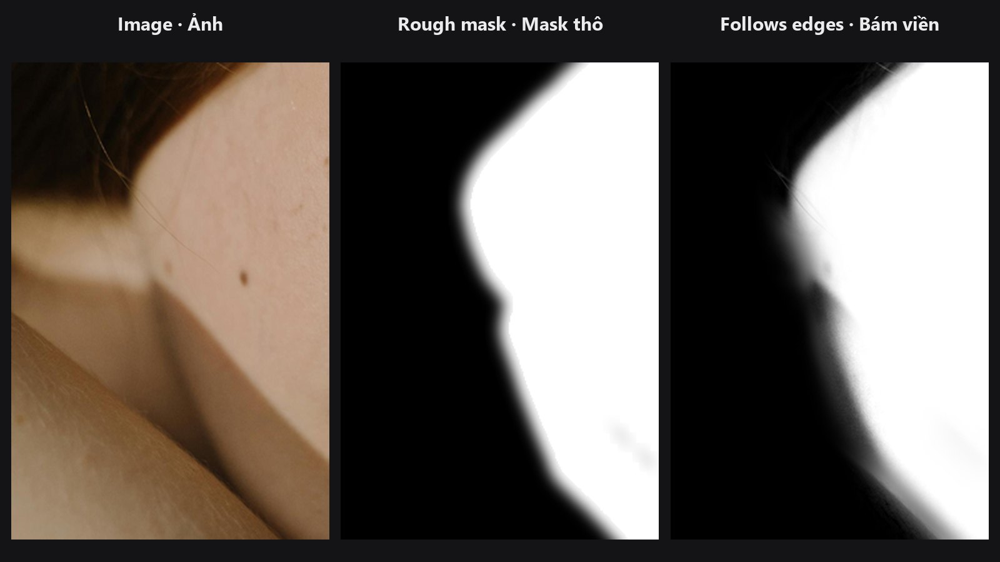

# Edge-Aware Mask Refiner

Your mask is roughly right, but the edge cuts through the subject or leaves a halo. This node looks at the photo and pulls the mask edge onto the real boundary.

| | |
|---|---|
| **In ComfyUI** | `Add Node → ComfyUI-JH-PixelPro → mask → Mask: Edge-Aware Refiner` |
| **Good for** | Fixing loose AI-segmentation masks, tightening a rough selection around a person or product, reducing halos |

## When to use it

Segmentation tools such as SAM often give a mask that is a few pixels off. A blur cannot fix that, because a blur does not know where the real edge is. This node uses the photo as a **guide**: where the photo has a strong edge, the mask edge snaps to it; where the photo is smooth, the mask stays smooth. This technique is called a *guided filter*.

It works best on edges with clear contrast between subject and background. For wispy hair where the edge is partly transparent, use [Alpha Matte](alpha-matte.md), which can recover real semi-transparency.

## Quick start

1. `Load Image` → your segmentation node → mask.
2. Connect the mask to `mask` and the **same photo** to `guide`. The two must have the same width and height.
3. Try `radius` 8 and `eps` 0.001. Increase `radius` if the mask is far off.
4. Preview with [Mask Preview](mask-preview.md) in overlay mode with `show_edges` on.

## Settings

| Setting | Default | What it does | Tip |
|---|---|---|---|
| `radius` | 8 | How far (in pixels) the filter looks around each pixel. A larger radius can correct a looser mask. | 1 to 32. Use roughly the size of the error you want to fix. |
| `eps` | 0.001 | Edge sensitivity. Smaller values follow the photo's edges more tightly; larger values give a smoother, softer result. | 0.000001 to 1. Try 0.0001 for crisp edges, 0.01 for soft ones. |
| `feather_sigma` | 0.0 | Optional extra Gaussian blur after filtering, in pixels. 0 = off. | 0 to 64. Use 1 to 3 for a gentle finish. |

**Output:** `refined_mask` (MASK).

## Tips from retouching

- Clean up the mask first with [Mask Cleanup](mask-cleanup.md), then refine edges.
- If the result looks too soft, lower `eps`. If it follows noise or texture, raise `eps`.
- Do not use a huge `radius` on a mask that is already close. It can pull in unwanted background detail.
- Run it before [Mask Combine](mask-combine.md) or compositing so every edge is already tight.

??? note "Under the hood"
    A grey-scale guided filter (He et al.) computed on the luma of the guide image (`0.299 R + 0.587 G + 0.114 B`). Window statistics come from box filters built from two 1-D average pools with replicate padding, so pixels at the image border are not pulled towards zero. The coefficients are `a = cov(I, p) / (var(I) + eps)` and `b = mean(p) - a * mean(I)`; the output is the box-filtered `a` times the guide plus the box-filtered `b`, clamped to 0..1. An optional Gaussian blur follows. The guide must be float RGB with the same height and width as the mask; a guide batch of 1 is broadcast. Source: `core/mask_edge_refine.py`.

## Related nodes

- [Sub-Pixel Mask Refiner](sub-pixel-mask-refiner.md) for feathering without a guide image
- [Alpha Matte](alpha-matte.md) for hair and semi-transparent edges
- [Trimap Builder](trimap-builder.md) to prepare the matting input
- [Mask Preview](mask-preview.md) for checking the edge

## Example workflow

[Edge-Aware Mask Refiner example workflow](https://github.com/jetthuangai/ComfyUI-JH-PixelPro/blob/main/workflows/N-28-edge-aware-mask-refiner.json). Copy `workflows/sample_portrait.jpg` and `workflows/sample_binary_mask.png` into `ComfyUI/input/`. A deliberately soft mask from Sub-Pixel Mask Refiner is snapped onto the real hair and skin edge, using the portrait as the guide. It uses only core ComfyUI nodes and this pack.

