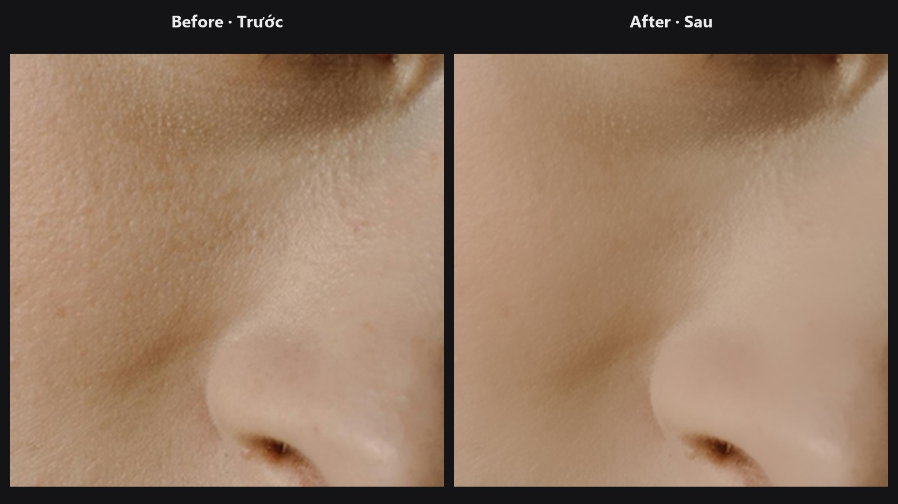

# Face Beauty Blend

Trộn ảnh đã retouch trở lại lên ảnh gốc, nhưng chỉ ở nơi mask cho phép. Cách hoạt động giống một layer có mask và thanh opacity.

| | |
|---|---|
| **Trong ComfyUI** | `Add Node → ComfyUI-JH-PixelPro → face → Face Beauty Blend` |
| **Dùng để** | Bước cuối của chuỗi xử lý mặt; giảm bớt hiệu ứng AI hoặc làm mịn cho vừa mắt; giữ mắt, môi, tóc vẫn sắc nét |

## Khi nào dùng

Một bước retouch mạnh (AI làm da, làm mịn nhiều, sửa bằng tách tần số) thường trông quá tay khi áp 100 % lên toàn bộ ảnh. Face Beauty Blend cho bạn hai công cụ quen thuộc như trong phần mềm chỉnh ảnh: một mask quyết định nơi nào hiện hiệu ứng, và một thanh strength quyết định hiện nhiều hay ít.

Node làm việc trên hai ảnh nguyên khung cùng kích thước. Nếu bạn đã dán khuôn mặt về bằng [Unwrap Face](unwrap-face.md), node này là bước hoàn thiện tùy chọn ở cuối.

## Bắt đầu nhanh

1. Nối ảnh gốc vào `base` và ảnh đã retouch vào `retouched`.
2. Nối một mask vào `mask` (trắng = hiện phần retouch). Mask da hoặc mask khuôn mặt đều phù hợp.
3. Bắt đầu với `strength` bằng `1.0` và `feather` từ `8` đến `16`, sau đó hạ `strength` đến khi trông tự nhiên.

## Thông số

| Thông số | Mặc định | Tác dụng | Gợi ý |
|---|---|---|---|
| `base` | — | Ảnh gốc. | |
| `retouched` | — | Phiên bản đã chỉnh. Phải cùng kích thước với `base`. | |
| `mask` | — | Nơi phần retouch hiện ra (1 = hoàn toàn, 0 = không). | Nếu kích thước khác ảnh, mask sẽ được resize cho khớp. |
| `strength` | `1.0` (0–1) | Độ đậm tổng thể của phần retouch. | Retouch da chân dung thường đẹp nhất ở khoảng `0.5` đến `0.8`. |
| `feather` | `0` (0–64) | Làm mềm mép mask, tính bằng pixel. | `8` đến `24` giúp che chỗ chuyển. `0` giữ nguyên mask của bạn. |

Đầu ra: `blended` (`IMAGE`), ảnh cuối cùng.

## Mẹo khi chỉnh ảnh

- Vẽ hoặc tạo mask sao cho loại trừ mắt, lông mày, môi và tóc. Những vùng đó sẽ giữ độ sắc nét từ ảnh gốc.
- Muốn hiệu ứng nhẹ hơn mà không động đến mask, chỉ cần hạ `strength`.
- Cần làm mềm hoặc làm sạch mask trước? Dùng [Mask Cleanup](mask-cleanup.md) hoặc [Mask Edge Smoother](mask-edge-smoother.md).
- `base` và `retouched` phải khớp kích thước và batch. Lệch kích thước sẽ báo lỗi.

??? note "Bên trong node hoạt động thế nào"
    Mask được kẹp trong `[0, 1]`, resize bilinear nếu cần, rồi làm mờ Gaussian với sigma `feather / 3` (viền replicate). Sau đó `blended = base × (1 − m) + retouched × m` với `m = mask đã làm mờ × strength`. Một mask batch 1 được dùng lại cho mọi ảnh trong batch. Mã nguồn nằm ở `core/face_pipeline.py` (`beauty_blend`).

## Node liên quan

- [Unwrap Face](unwrap-face.md) — dán vùng mặt đã căn chỉnh về trước bước trộn cuối này.
- [Skin Tone Tri-Region](skin-tone-tri-region.md) — tạo mask shadow, midtone, highlight để trộn qua.
- [Face Warp TPS](face-warp-tps.md) và [Face Warp](face-warp.md) — kết quả warp có thể được giới hạn trong vùng mặt tại đây.
- [Tổng quan nhóm Khuôn mặt](../categories/face.md)

## Workflow mẫu

[Workflow mẫu face pipeline](https://github.com/jetthuangai/ComfyUI-JH-PixelPro/blob/main/workflows/S-18-face-pipeline-v2.json). Hãy chép `workflows/sample_portrait.jpg` vào `ComfyUI/input/` trước.
