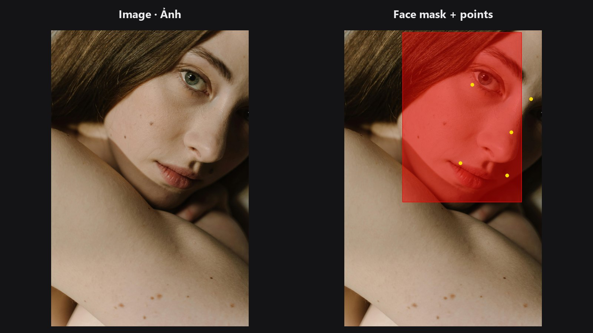

# Face Detect Lite

A quick face finder that runs on the GPU. It returns the same five key points as [Face Detect](face-detect.md), plus a ready-made mask of the face area.

| | |
|---|---|
| **In ComfyUI** | `Add Node → ComfyUI-JH-PixelPro → face → Face: Detect Lite (YuNet GPU)` |
| **Good for** | Batches and quick previews; feeding [Facial Aligner](facial-aligner.md); limiting a later edit to the face area |
| **Speed** | About 31 ms on an RTX 5090 versus about 84 ms for MediaPipe on CPU (sample portrait) |

## When to use it

Use Lite when you want the face position fast and do not need the full 468-point mesh. It uses the YuNet network that ships with Kornia, so it works even if MediaPipe is not installed. It uses the GPU when one is available and falls back to CPU.

Stay with [Face Detect](face-detect.md) and [Face Landmarks](face-landmarks.md) when you need the dense mesh (warping, reshaping) or better handling of tilted and partly hidden faces.

| | Detect Lite (YuNet) | Face Detect (MediaPipe) |
|---|---|---|
| Needs MediaPipe | No | Yes |
| `conf` in `bbox_json` | Real detector score | The threshold you set |
| Face mask output | Yes (face box) | No |
| Eye points | Eye centres | Outer eye corners |
| Feeds the 468-point nodes | No | Use Face Landmarks |

Both feed the aligner. The eye points differ by roughly 10–20 % of the eye distance, which does not matter for alignment.

## Quick start

1. Connect **Load Image** to **Face: Detect Lite (YuNet GPU)**.
2. Connect `landmarks_json` to the `landmarks` input of [Facial Aligner](facial-aligner.md). It reads the first face.
3. Optional: use `face_mask` to limit a later edit to the face area.

## Settings

| Setting | Default | What it does | Tip |
|---|---|---|---|
| `mode` | `single_largest` | One largest face per image, or the top faces by box size. | Portraits: keep the default. |
| `max_faces` | `1` (1–10) | Faces per image in `multi_top_k`. | Group shots: raise it. |
| `confidence_threshold` | `0.6` (0.1–0.95) | Minimum detector score. | Raise to drop false hits. |
| `nms_threshold` | `0.3` (0.1–0.9) | Overlap above which duplicate boxes are merged. | Lower it if you see duplicate boxes on one face. |
| `detect_size` | `640` (160–1024) | Long side of the copy used for detection. Never enlarges. | Keep 640 for portraits. Raise only for group shots with small faces. |

Outputs:

| Output | Type | Meaning |
|---|---|---|
| `landmarks_json` | `STRING` | Per face: `[L-eye, R-eye, nose-tip, L-mouth, R-mouth]` in pixels. |
| `bbox_json` | `STRING` | Per face: `x, y, w, h` (pixels), `conf` (real score) and `batch_index`. |
| `face_count` | `INT` | Faces returned. |
| `face_mask` | `MASK` | 1 inside the selected face boxes, 0 elsewhere. |

## Tips from retouching

- `face_mask` is a box, not a face outline. Feather it (for example with [Mask Edge Smoother](mask-edge-smoother.md)) before using it as an edit mask.
- A larger `detect_size` is not always better. At very large values the detector can split or misplace big faces and add false hits on close-ups.
- A pure black frame can trigger a false detection. Use a real image or a higher threshold.
- Running a batch of portraits? Lite is the better pick: it is faster and needs no extra install.

??? note "Under the hood"
    The image is shrunk so its long side equals `detect_size` (smaller images are left alone), run through YuNet via `kornia.contrib.FaceDetector`, and boxes and points are scaled back to original pixels. Faces are sorted by box area. Images smaller than 64 px are padded with their mean colour for detection only. The detector is cached per device. Kornia downloads the weights once into the torch hub cache; if loading fails, the node raises a clear error. The code lives in `core/face_detect_lite.py`.

## Related nodes

- [Face Detect](face-detect.md) — MediaPipe version.
- [Facial Aligner](facial-aligner.md) — the next step in the chain.
- [Mask Preview](mask-preview.md) — check `face_mask` as an overlay.
- [Face category overview](../categories/face.md)

## Example workflow

[Face Detect Lite example workflow](https://github.com/jetthuangai/ComfyUI-JH-PixelPro/blob/main/workflows/N-38-face-detect-lite.json). Copy `workflows/sample_portrait.jpg` into `ComfyUI/input/` first.
