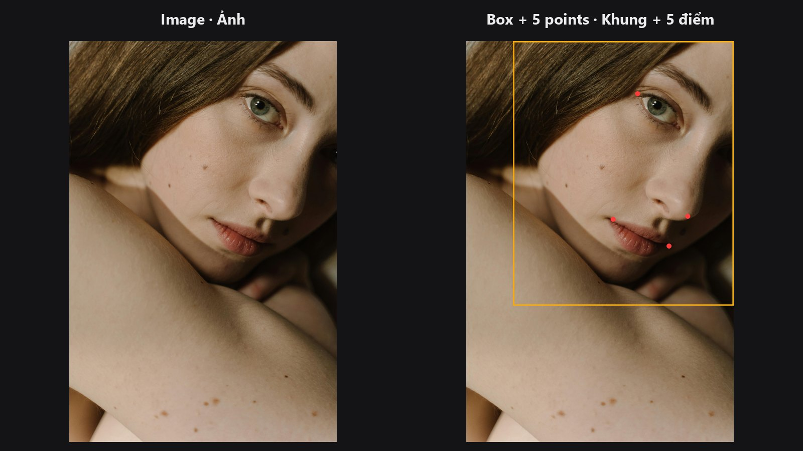

# Face Detect

Tìm khuôn mặt trong ảnh và cho biết vị trí hai mắt, mũi, hai khóe miệng. Đây thường là bước đầu tiên của mọi chỉnh sửa chân dung cần xoay thẳng hoặc cắt riêng khuôn mặt.

| | |
|---|---|
| **Trong ComfyUI** | `Add Node → ComfyUI-JH-PixelPro → face → Face Detect (MediaPipe)` |
| **Dùng để** | Đưa dữ liệu cho [Facial Aligner](facial-aligner.md); chọn mặt lớn nhất trong ảnh nhóm; đếm số mặt |
| **Tốc độ** | Khoảng 84 ms trên CPU với ảnh chân dung mẫu (MediaPipe, CPU máy bàn) |

## Khi nào dùng

Phần lớn các bước chỉnh mặt (AI làm da, đổi mặt, tăng chi tiết) cho kết quả tốt nhất khi khuôn mặt thẳng, nằm giữa khung và có kích thước cố định. Muốn vậy, pack phải biết mặt nằm ở đâu trước. Face Detect trả lời bằng 5 điểm mốc (landmark) cho mỗi mặt: mắt trái, mắt phải, đầu mũi, khóe miệng trái, khóe miệng phải.

Chọn node này khi bạn đã dùng MediaPipe sẵn, hoặc khi muốn dùng cùng [Face Landmarks](face-landmarks.md) để hai node thống nhất về cùng một khuôn mặt. Nếu chỉ cần nhận diện nhanh kèm mask khuôn mặt, hãy thử [Face Detect Lite](face-detect-lite.md).

## Bắt đầu nhanh

1. Thêm **Load Image**, nối `IMAGE` vào **Face Detect (MediaPipe)**.
2. Để `mode` ở `single_largest` với ảnh chân dung thông thường.
3. Nối `landmarks_json` vào ô `landmarks` của [Facial Aligner](facial-aligner.md).
4. Với ảnh nhóm, đổi `mode` sang `multi_top_k` và tăng `max_faces`.

## Thông số

| Thông số | Mặc định | Tác dụng | Gợi ý |
|---|---|---|---|
| `mode` | `single_largest` | `single_largest` trả về mặt có khung lớn nhất. `multi_top_k` trả về tối đa `max_faces` mặt, lớn nhất trước. | Chân dung: giữ mặc định. |
| `max_faces` | `1` (1–10) | Số mặt tối đa. Bị bỏ qua khi dùng `single_largest`. | Cảnh đông người: 5–10. |
| `confidence_threshold` | `0.5` (0.1–0.95) | Mức chắc chắn tối thiểu của MediaPipe để tính là một khuôn mặt. | Trên khoảng 0.85 có thể bỏ sót cả ảnh chân dung bình thường. Hạ xuống nếu bị sót mặt. |

Đầu ra:

| Đầu ra | Kiểu | Ý nghĩa |
|---|---|---|
| `landmarks_json` | `STRING` | Danh sách JSON, mỗi mặt một mục, theo thứ tự `[mắt trái, mắt phải, đầu mũi, khóe miệng trái, khóe miệng phải]` (toạ độ pixel `[x, y]`). |
| `bbox_json` | `STRING` | Danh sách JSON gồm khung mặt và thông tin kèm theo cho từng mặt. |
| `face_count` | `INT` | Số mặt được trả về. |

## Mẹo khi chỉnh ảnh

- Ảnh chân dung một người: `single_largest` là lựa chọn an toàn, bỏ qua khuôn mặt thừa ở hậu cảnh.
- Giá trị `conf` trong `bbox_json` chính là ngưỡng bạn đặt, không phải điểm tin cậy của từng mặt. Muốn xếp hạng, hãy dùng kích thước khung (`multi_top_k` đã tự sắp theo kích thước).
- Không thấy mặt? Hạ `confidence_threshold`, hoặc kiểm tra xem mặt có quá nhỏ hay quay đi quá nhiều không.
- Các chỉnh sửa cần lưới mặt đầy đủ (biến dạng, warp) dùng [Face Landmarks](face-landmarks.md). Node này chỉ cho 5 điểm.

??? note "Bên trong node hoạt động thế nào"
    Node bọc MediaPipe FaceLandmarker (tasks API). File model `face_landmarker.task` (khoảng 5 MB) được tải một lần vào `ComfyUI/models/mediapipe/` ở lần chạy đầu tiên. Năm điểm được lấy từ lưới 468 điểm, nên điểm mắt nằm ở khóe ngoài của mắt. Bộ nhận diện được cache giữa các lần chạy. Nếu thiếu `mediapipe`, node báo lỗi kèm hướng dẫn cài. Mã nguồn nằm ở `core/face_detect.py`.

## Node liên quan

- [Face Detect Lite](face-detect-lite.md) — lựa chọn nhanh hơn chạy trên GPU, không cần MediaPipe.
- [Facial Aligner](facial-aligner.md) — nhận `landmarks_json` và xoay thẳng khuôn mặt.
- [Face Landmarks](face-landmarks.md) — phiên bản 468 điểm chi tiết.
- [Tổng quan nhóm Khuôn mặt](../categories/face.md)

## Workflow mẫu

[Workflow mẫu Face Detect](https://github.com/jetthuangai/ComfyUI-JH-PixelPro/blob/main/workflows/S-10-face-detect.json). Hãy chép `workflows/sample_portrait.jpg` vào `ComfyUI/input/` trước.
