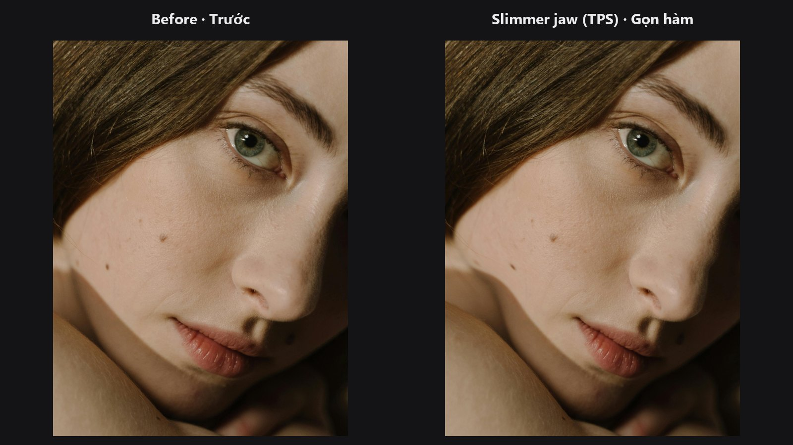

# Face Warp TPS

Moves the face from source landmarks to destination landmarks with a single smooth, rubber-sheet style distortion. Use it for subtle reshaping where triangle seams or kinks would show.

| | |
|---|---|
| **In ComfyUI** | `Add Node → ComfyUI-JH-PixelPro → face → Face Warp (TPS smooth)` |
| **Good for** | Slimming, eye or jaw adjustments; matching a face to another photo; edits that must look natural |
| **Speed** | About 19 ms on CUDA and about 0.85 s on CPU for a 1536×2048 image with 468 points (RTX 5090 / desktop CPU) |

## When to use it

A thin-plate spline (TPS) is a smooth surface that bends like a thin metal plate: it passes through your control points and stays as flat as possible between them. Applied to an image, it gives one continuous distortion with no visible triangle edges.

Pick TPS for gentle, natural changes and when you want GPU speed. Pick [Face Warp](face-warp.md) (Delaunay) when the change must stay strictly inside the face mesh or when every one of the 468 points must be honoured locally.

| | Delaunay ([Face Warp](face-warp.md)) | TPS (this node) |
|---|---|---|
| Field | One affine patch per triangle | One smooth global field |
| Seams or kinks | Possible on triangle edges for large moves | None |
| Outside the face | Unchanged | Fades out smoothly (pinned by `anchor_border`) |
| Runs on | CPU (OpenCV) | GPU when available |

## Quick start

1. Run [Face Landmarks](face-landmarks.md) on your photo and connect `landmarks` to `src_landmarks`.
2. Run [Face Landmarks](face-landmarks.md) on the target (a second photo, or a zoomed copy) and connect it to `dst_landmarks`.
3. Keep the defaults and check `warped` in a **Preview Image**.
4. If you still see ripples, raise `smoothness`.

## Settings

| Setting | Default | What it does | Tip |
|---|---|---|---|
| `max_points` | `468` (16–468) | Most landmark pairs used for the warp. Pairs that move are always kept. | Keep 468. Lower only for speed, since fewer pins let nearby features drift. |
| `anchor_border` | on | Pins points along the image border so the background does not swim. | Turn off only if the whole frame should move with the face (pure shift or scale). |
| `smoothness` | `1.0` (0–20) | `0` lands every landmark exactly. Higher values absorb detection noise. | Use `0` for hand-edited points. Keep 1 or more when targets come from another photo. Raise it if ripples remain. |

Output: `warped` (`IMAGE`), the reshaped picture.

## Tips from retouching

- Landmarks from a second detection differ from the source by detector noise as well as the real shape change. On the sample portrait that noise is about 13–17 px (median) for a 3–6 % zoomed copy. Matching it exactly would fold the image, so keep `smoothness` at 1 or higher for such targets.
- Move groups of neighbouring landmarks together. Pulling a few isolated points creates wide, rubbery effects.
- Missing faces (NaN points) or fewer than 3 valid pairs return the image unchanged.
- Warp first, then run skin retouch, so texture work follows the final shape.

??? note "Under the hood"
    The spline (kernel `r² log r` plus an affine part) is fitted on the output-to-input mapping, so every output pixel samples the source where the spline points. It is evaluated exactly on a grid with a 4 px step, upsampled bicubically to full size, then used to resample the image bilinearly. With `smoothness = 0`, control points land within about 0.6 px of their destination on a real 1536×2048 portrait. Moved pairs (more than 0.5 px) are never dropped when `max_points` is lowered; the rest is filled half with the unmoved pairs nearest the edit and half with evenly spaced ones. With `anchor_border` on, extra pairs with identical source and destination (corners plus 3 per edge) pin the border; higher `smoothness` relaxes them slightly (well under 1 px at the default). Peak memory is about 480 MiB at that size, mostly image buffers. The code lives in `core/face_warp_tps.py`.

## Related nodes

- [Face Warp](face-warp.md) — triangle-based alternative.
- [Face Landmarks](face-landmarks.md) — supplies both point sets.
- [Face Beauty Blend](face-beauty-blend.md) — limit the warp to the face with a mask.

## Example workflow

[Face Warp TPS example workflow](https://github.com/jetthuangai/ComfyUI-JH-PixelPro/blob/main/workflows/N-42-face-warp-tps.json). Copy `workflows/sample_portrait.jpg` into `ComfyUI/input/` first.
