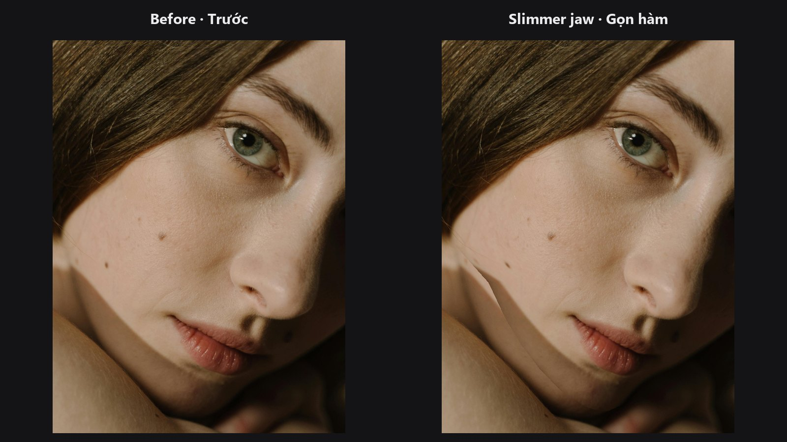

# Face Warp

Dịch chuyển khuôn mặt từ bộ landmark này sang bộ landmark khác, giống một thao tác liquify chính xác dựa trên lưới mặt. Kết quả chỉ nằm trong phạm vi lưới mặt, nên hậu cảnh không bị ảnh hưởng.

| | |
|---|---|
| **Trong ComfyUI** | `Add Node → ComfyUI-JH-PixelPro → face → Face Warp (Delaunay per-triangle)` |
| **Dùng để** | Chỉnh dáng mặt có kiểm soát; đưa khuôn mặt về dáng của ảnh khác; những chỉnh sửa không được lan ra ngoài khuôn mặt |

## Khi nào dùng

Node chia khuôn mặt thành nhiều tam giác nhỏ từ các landmark nguồn (phép chia tam giác Delaunay), rồi kéo từng tam giác về vị trí mới. Cả 468 điểm đều được tôn trọng ở mức cục bộ.

Chọn node này khi thay đổi cần nằm gọn trong lưới mặt. Chọn [Face Warp TPS](face-warp-tps.md) khi bạn cần biến dạng nhẹ nhàng, tự nhiên và không muốn lộ đường biên tam giác hay chỗ gấp khúc. [Tổng quan nhóm Khuôn mặt](../categories/face.md) so sánh hai node này cạnh nhau.

## Bắt đầu nhanh

1. Chạy [Face Landmarks](face-landmarks.md) trên ảnh của bạn và nối `landmarks` vào `src_landmarks`.
2. Lấy `dst_landmarks` từ một [Face Landmarks](face-landmarks.md) thứ hai chạy trên ảnh đích (hoặc một bộ điểm bạn đã chỉnh).
3. Nối `image` và xem `warped` trong **Preview Image**.

## Thông số

Node không có widget, chỉ có đầu vào.

| Đầu vào | Kiểu | Tác dụng |
|---|---|---|
| `image` | `IMAGE` | Ảnh cần chỉnh dáng. |
| `src_landmarks` | `LANDMARKS` | Vị trí hiện tại của các đặc điểm. |
| `dst_landmarks` | `LANDMARKS` | Vị trí các đặc điểm cần đến. |

| Đầu ra | Kiểu | Ý nghĩa |
|---|---|---|
| `warped` | `IMAGE` | Ảnh đã chỉnh dáng. |

## Mẹo khi chỉnh ảnh

- Nguồn và đích phải cùng bố cục 468 điểm. Node dùng khuôn mặt đầu tiên của mỗi bên.
- Nếu một bên thiếu khuôn mặt, ảnh được trả về nguyên vẹn.
- Dịch chuyển lớn có thể lộ đường nối dọc cạnh tam giác. Hãy dùng [Face Warp TPS](face-warp-tps.md) để có trường biến dạng mượt hơn.
- Warp trước, làm da sau, để các bước xử lý texture rơi vào đúng hình dáng cuối cùng.

??? note "Bên trong node hoạt động thế nào"
    Landmark được đọc dưới dạng toạ độ chuẩn hóa `[0, 1]` hoặc pixel. Điểm không hợp lệ bị loại, và nếu có ít hơn 3 cặp hợp lệ thì ảnh được trả về nguyên vẹn. SciPy dựng phép chia tam giác Delaunay trên các điểm nguồn, sau đó OpenCV warp từng tam giác bằng biến đổi affine và ghép lại với viền khử răng cưa. Node chạy trên CPU. Mã nguồn nằm ở `core/face_pipeline.py`.

## Node liên quan

- [Face Landmarks](face-landmarks.md) — cung cấp các điểm.
- [Face Warp TPS](face-warp-tps.md) — lựa chọn mượt hơn.
- [Face Beauty Blend](face-beauty-blend.md) — trộn kết quả warp trở lại bằng mask.

## Workflow mẫu

[Workflow mẫu face pipeline](https://github.com/jetthuangai/ComfyUI-JH-PixelPro/blob/main/workflows/S-18-face-pipeline-v2.json). Hãy chép `workflows/sample_portrait.jpg` vào `ComfyUI/input/` trước.
