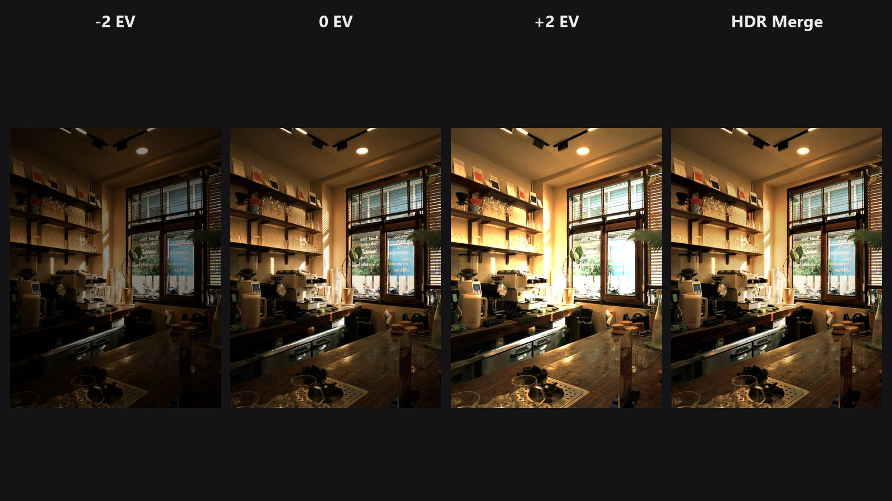

# HDR Merge

Give it a bracket of the same scene, such as dark, normal and bright. It returns one photo with the best-exposed parts of each shot.

| | |
|---|---|
| **In ComfyUI** | `Add Node → ComfyUI-JH-PixelPro → color → Color: HDR Merge (bracket)` |
| **Good for** | Interiors with bright windows, landscapes with a bright sky, real estate, any high-contrast scene shot as a bracket |
| **Speed** | About 1 s for three 2 MP frames, on the CPU |

## When to use it

A single exposure often cannot hold both a bright window and a dark room. A bracket (for example -2, 0 and +2 EV) captures both. This node picks, pixel by pixel, the well-exposed, contrasty and colourful parts of each frame and blends them smoothly.

The method is exposure fusion. It needs no exposure values and no camera response curve, and the result is ready to view. There is no tone-mapping step with sliders to tune.

The result is a normal display-ready image, not a 32-bit HDR file. Treat it as a starting point and finish it with [Auto Tone](auto-tone.md) or [ColorLab](color-lab.md).

## Quick start

1. Load the bracketed photos and combine them into one batch with Batch Images (or Load Image Batch). The order does not matter, and all frames must be the same size.
2. Connect the batch to **Color: HDR Merge (bracket)** and add a Preview Image.
3. Keep `align` and `deghost` on.
4. Finish with [Auto Tone](auto-tone.md) or [ColorLab](color-lab.md) if you want to adjust the look.

## Settings

| Setting | Default | What it does | Tip |
|---|---|---|---|
| `images` | | A batch of 2 or more bracketed shots, in any order, all the same size. | Use Batch Images or Load Image Batch to build the batch. |
| `align` | on | Lines up hand-held shots by fixing small shifts (translation only). | Turn off for shots taken on a tripod, if you want the fastest result. |
| `deghost` | on | Where something moved between shots (people, leaves), uses the middle exposure, brightness-matched, so nothing appears twice. | Turn off for fully static scenes. |

**Output**

| Output | What it is |
|---|---|
| `image` | One merged image. |

## Tips from retouching

- Shoot -2, 0 and +2 EV on a tripod, or use a fast burst, so the frames match as closely as possible.
- Big movements or rotation between shots are not aligned. Reshoot, or fix the rotation first with [Auto Align](auto-align.md) if the frames allow it.
- Moving subjects such as people, cars and tree branches are handled by `deghost`. Check them at 100 % after merging.
- The merge looks natural and slightly flat. Add contrast and colour afterwards with [Auto Tone](auto-tone.md), [ColorLab](color-lab.md) or [Shadows/Highlights Pro](shadows-highlights-pro.md).
- Two frames also work, but three or more give smoother transitions.

??? note "Under the hood"
    Frames are sorted by brightness and the middle one is the reference. With `align`, each frame is shifted onto the reference with median-threshold-bitmap alignment (OpenCV AlignMTB). A shift larger than 5 % of the long edge is treated as a failed alignment and ignored.

    With `deghost`, each frame is first scaled to the reference brightness. Where it still disagrees strongly, which means movement, the frame takes the brightness-matched reference pixels with a soft edge.

    The frames are fused with Mertens exposure fusion (Mertens, Kautz and Van Reeth, 2007): a multi-resolution blend weighted by contrast, saturation and well-exposedness. It runs on the CPU in OpenCV. Source: `core/hdr_merge.py`, wrapper `nodes/hdr_merge_node.py`.

## Related nodes

- [Auto Tone](auto-tone.md): automatic finishing after the merge
- [ColorLab](color-lab.md): full colour and tone control
- [Shadows/Highlights Pro](shadows-highlights-pro.md): recover shadows and highlights further
- [Auto Align](auto-align.md): align frames that are rotated or shifted a lot

## Example workflow

[HDR Merge example workflow](https://github.com/jetthuangai/ComfyUI-JH-PixelPro/blob/main/workflows/N-62-hdr-merge.json) turns one cafe photo into three exposures (-2, 0 and +2) with ColorLab, combines them with Batch Images, and merges them. Copy `workflows/sample_cafe.jpg` into `ComfyUI/input/` (Pexels License).
