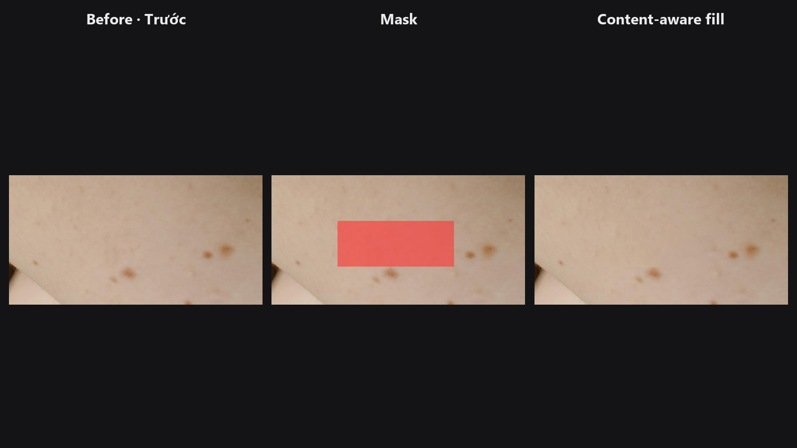

# Heal / Content-Aware Fill

Bạn tô mask lên thứ muốn xóa: dây điện, mụn, logo hay vật thừa. Node lấp vùng đó bằng texture và cấu trúc lấy từ vùng lân cận, giống Content-Aware Fill trong Photoshop.

| | |
|---|---|
| **Trong ComfyUI** | `Add Node → ComfyUI-JH-PixelPro → filters → Filters: Heal / Content-Aware Fill` |
| **Dùng cho** | Dây điện, cột, vết trên da, sẹo, vật nhỏ trên cỏ, bầu trời hoặc tường, logo trên bề mặt phẳng |
| **Tốc độ** | Trên GPU, 1 đến 3 giây với mask thông thường trên ảnh 8 MP, dưới 1,1 GB VRAM ở 4K. Trên CPU chậm hơn nhiều: khoảng 25 giây cho vùng 400 px ở 4K. |

## Khi nào dùng

Clone stamp là bạn tự chọn và chép từng mảng. Node này tìm giúp bạn: với mỗi pixel trong vùng cần lấp, nó tìm những mảng giống nhất ở quanh đó rồi hòa lại, để hạt ảnh, lỗ chân lông hay ngọn cỏ nối liền vào vùng được lấp.

Node hoạt động tốt nhất trên texture: da, bầu trời, cỏ, cát, tường. Cấu trúc phức tạp thì khó hơn. Vòm cuốn, chữ và khuôn mặt có thể bị vỡ. Với các trường hợp đó, hãy tô mask rộng tay, thử tăng `context`, hoặc chỉnh tay thêm sau đó.

Các phần mask nằm xa nhau được xử lý riêng, nên mask gồm nhiều đốm rải rác vẫn ổn. Kết quả luôn giống nhau mỗi lần chạy.

## Bắt đầu nhanh

1. Load Image và một mask (tô trong Mask Editor, hoặc tạo bằng các node mask khác). Trắng nghĩa là xóa và lấp.
2. Nối cả hai vào **Filters: Heal / Content-Aware Fill** rồi thêm Preview Image.
3. Giữ `mode` là `content_aware`. Chỉ dùng `smooth` cho vùng phẳng, không có texture.
4. Nếu chỗ lấp trông sai, tô mask rộng hơn một chút, hoặc tăng `context` lên 2.

## Thông số

| Thông số | Mặc định | Tác dụng | Mẹo |
|---|---|---|---|
| `image` | | Ảnh cần chỉnh. | |
| `mask` | | Trắng = xóa và lấp. | Phủ cả vật thể lẫn bóng đổ hoặc quầng của nó. |
| `mode` | `content_aware` | `content_aware` dựng lại texture và cấu trúc từ các mảng lân cận. `smooth` là lấp màu mềm, không có texture. | `smooth` dành cho vùng phẳng như bầu trời sạch hoặc phông studio. |
| `grow` | 2 | 0 đến 64 px. Nới rộng mask thêm chừng này pixel. | Tăng để lấy cả quầng sáng và bóng mờ. |
| `feather` | 1.5 | 0 đến 32 px. Độ hòa mềm bên ngoài rìa mask. | Tăng với vùng chuyển sắc mịn. Giữ thấp với texture nhiều chi tiết. |
| `context` (tùy chọn) | 1.0 | 0.25 đến 8. Tìm xa bao nhiêu quanh mỗi phần mask, tính theo bội số kích thước của nó. | Tăng khi texture đúng nằm xa chỗ cần lấp. |

**Đầu ra**

| Đầu ra | Là gì |
|---|---|
| `image` | Ảnh với vùng mask đã được lấp. |

## Mẹo khi chỉnh ảnh

- Tô dư một chút còn hơn thiếu. Phần rìa sót lại của vật thể là lý do phổ biến nhất khiến chỗ lấp trông sai.
- Với dây dài băng qua bầu trời, mask mảnh cùng `grow` 3 đến 6 thường là đủ.
- Nhiều điểm rời nhau trong cùng một mask vẫn ổn. Mỗi phần được xử lý riêng, với vùng tìm kiếm riêng.
- Nếu chỗ lấp lặp lại một họa tiết không mong muốn, giảm `context` để việc tìm kiếm ở gần vùng lấp. Nếu thiếu texture đúng, tăng `context`.
- Với tàn nhang hay mụn trên mặt, [Auto Blemish](auto-blemish.md) tự tìm giúp bạn. Để xóa bụi cảm biến, dùng [Dust & Spot Removal](dust-spot-removal.md).

??? note "Bên trong node hoạt động thế nào"
    `content_aware` là exemplar-based completion (Wexler, Shechtman và Irani, 2007) kết hợp tìm kiếm PatchMatch song song. Vùng cần lấp được điền từ thô đến mịn trên một kim tự tháp ảnh. Ở mỗi mức, mọi pixel có patch 7x7 chạm vào vùng lấp sẽ tìm patch đã biết đầy đủ giống nhất ở gần. Mỗi pixel trong vùng lấp trở thành kết quả bỏ phiếu có trọng số của các patch nguồn chồng lên nhau.

    Chỉ vùng quanh mỗi phần mask (khung bao cộng lề do `context` quyết định) được xử lý, nên bộ nhớ chỉ tăng theo diện tích đó. Dải feather cũng được tổng hợp và hòa từ đặc ở rìa mask xuống ảnh gốc ở mép ngoài dải. Việc tìm kiếm dùng seed ngẫu nhiên cố định, nên kết quả lặp lại chính xác.

    `smooth` lấp bằng tích chập chuẩn hóa từ màu xung quanh. Mã nguồn: `core/heal.py`, wrapper `nodes/heal_node.py`.

## Node liên quan

- [Auto Blemish](auto-blemish.md): tự tìm và xóa vết trên da mặt
- [Dust & Spot Removal](dust-spot-removal.md): tự tìm bụi cảm biến và đốm nhỏ
- [Mask Morphology](mask-morphology.md): nới, co hoặc làm sạch mask trước
- [Mask Preview](mask-preview.md): kiểm tra mask đang phủ vùng nào

## Workflow mẫu

[Workflow mẫu Heal](https://github.com/jetthuangai/ComfyUI-JH-PixelPro/blob/main/workflows/N-58-heal.json) xóa một cụm tàn nhang ở cánh tay và một nốt ruồi trên má. Chép `workflows/sample_portrait.jpg` và `workflows/sample_heal_mask.png` vào `ComfyUI/input/` (ảnh: Pexels License).
