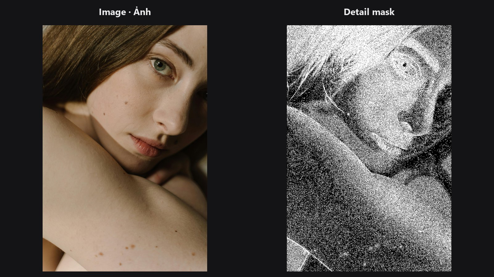

# Detail Mask

Tìm nơi ảnh có chi tiết mịn (lông mi, tóc, vân vải, cạnh) và trả về dưới dạng mask. Dùng để chỉ sharpen chỗ có texture, hoặc để tránh làm mịn lên chi tiết.

| | |
|---|---|
| **Trong ComfyUI** | `Add Node → ComfyUI-JH-PixelPro → mask → High-Frequency Detail Masker` |
| **Phù hợp để** | Chỉ sharpen vùng có texture, bảo vệ chi tiết khi làm mịn da, tạo mask cho xử lý nhiễu hoặc grain |

## Khi nào dùng

Theo cách nhìn về tần số, nội dung **tần số cao (high-frequency)** là phần chi tiết mịn, thay đổi nhanh của ảnh: lỗ chân lông, sợi tóc, cạnh. Nội dung **tần số thấp (low-frequency)** là màu và tông mượt. Node đo mỗi pixel có bao nhiêu chi tiết mịn, rồi giữ lại phần pixel mạnh nhất theo tỷ lệ bạn chọn.

Cách dùng thường gặp:

- Làm cổng cho [Smart Sharpen](smart-sharpen.md) để da phẳng và bầu trời không bị sharpen.
- Bảo vệ mắt, lông mi và tóc khi chạy [Skin Smoother](edge-aware-smoother.md).
- Đảo ngược mask để chỉ lấy vùng mượt.

## Bắt đầu nhanh

1. Nối ảnh vào `image`.
2. Bắt đầu với `kernel_type` là `laplacian` và `sensitivity` 0.4.
3. Xem mask bằng [Mask Preview](mask-preview.md). Tăng `sensitivity` để lấy thêm vùng.
4. Dùng mask làm cổng cho bước sharpen hoặc làm mịn của bạn.

## Thông số

| Thông số | Mặc định | Tác dụng | Gợi ý |
|---|---|---|---|
| `kernel_type` | `laplacian` | Cách đo chi tiết. `laplacian` tìm chi tiết mịn theo mọi hướng; `sobel` thiên về cạnh; `fs_gaussian` dùng hiệu giữa ảnh và bản blur nhẹ (high-pass của tách tần số). | Bắt đầu với `laplacian`. |
| `sensitivity` | 0.5 | Tỷ lệ pixel được giữ làm chi tiết. 0 cho mask rỗng, 1 cho mask đầy. | 0 đến 1. Chân dung thường dùng 0.3 đến 0.6. |
| `threshold_mode` | `relative_percentile` | `relative_percentile` thích ứng theo từng ảnh, nên cùng `sensitivity` chọn ra tỷ lệ pixel tương tự. `absolute` được chuẩn hóa theo chi tiết mạnh nhất trong ảnh. | Dùng mặc định. `absolute` dễ bị lệch bởi một đốm sáng. |
| `mask` (tùy chọn) | không có | Giới hạn kết quả trong một vùng. Đầu ra được nhân với mask này. | Dùng mask khuôn mặt hoặc chủ thể. |

**Đầu ra:** `mask_detail` (MASK), giá trị 0 hoặc 1.

## Mẹo khi chỉnh ảnh

- Đầu ra là mask bật/tắt cứng. Hãy làm mềm bằng [Mask Edge Smoother](mask-edge-smoother.md) hoặc một bước blur trước khi dùng làm mask trộn.
- Chi tiết được đo trên trung bình các kênh màu (xám), nên cạnh chỉ khác nhau về màu sẽ yếu.
- Ảnh nhiễu trông như "đầy chi tiết". Hãy khử nhiễu trước nếu mask sáng lên ở hạt nhiễu.
- `sensitivity` là tỷ lệ của ảnh, không phải cường độ. Ảnh phẳng vẫn trả đúng tỷ lệ đã yêu cầu, chỉ là ở những chỗ tương đối nét nhất.

??? note "Bên trong node hoạt động thế nào"
    Luma là trung bình các kênh RGB. Các lựa chọn high-pass: `laplacian` (Kornia, 3x3, biên replicate), `sobel` (Kornia, độ lớn gradient đã chuẩn hóa) hoặc `fs_gaussian` (luma trừ blur Gaussian 5x5, sigma 1). Ở chế độ `relative_percentile`, ngưỡng là giá trị thứ k của high-pass tuyệt đối trên từng ảnh, để khoảng `sensitivity` số pixel vượt qua. Ở chế độ `absolute`, high-pass được chia cho giá trị lớn nhất của ảnh rồi so với `1 - sensitivity`. Sensitivity 0 và 1 là đường tắt cho mask rỗng hoặc đầy. Mã nguồn: `core/detail_masker.py`.

## Node liên quan

- [Smart Sharpen](smart-sharpen.md) để sharpen qua mask này
- [Skin Smoother](edge-aware-smoother.md) để làm mịn quanh vùng chi tiết được bảo vệ
- [Frequency Separation](frequency-separation.md) cho cách tách thấp/cao đứng sau `fs_gaussian`
- [Mask Preview](mask-preview.md) để xem kết quả

## Workflow mẫu

[Workflow mẫu Detail Mask](https://github.com/jetthuangai/ComfyUI-JH-PixelPro/blob/main/workflows/S-04-hf-detail-masker.json). Hãy chép `workflows/sample_portrait.jpg` vào `ComfyUI/input/` trước.
