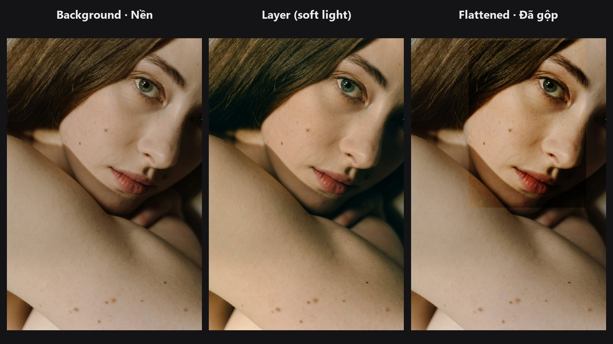

# Layer Flatten

Gộp tất cả layer của chồng layer thành một ảnh duy nhất, giống Layer → Flatten Image trong Photoshop. Dùng làm bước cuối của chuỗi compositing.

| | |
|---|---|
| **Trong ComfyUI** | `Add Node → ComfyUI-JH-PixelPro → compositing → Compositing: Layer Flatten` |
| **Dùng cho** | Lấy ảnh thường ra từ chồng layer để xem trước, lưu, hoặc tiếp tục chỉnh |

## Khi nào dùng

Chồng layer chưa phải là ảnh. Khi chưa flatten, bạn không xem trước hay lưu được. **Layer Flatten** render chồng layer từ layer dưới cùng đi lên: mỗi layer được hòa vào theo blend mode, opacity, fill, mask và clipping của nó.

## Bắt đầu nhanh

1. Dựng chồng layer bằng [Layer Stack Start](layer-stack-start.md) và [Layer Add](layer-add.md).
2. Nối `LAYER_STACK` cuối cùng vào **Layer Flatten** → `Preview Image` hoặc `Save Image`.

## Thông số

| Thông số | Mặc định | Tác dụng | Mẹo |
|---|---|---|---|
| `stack` | — | Chồng layer cần render. | Nối node cuối cùng của chuỗi. |

| Đầu ra | Kiểu | Ý nghĩa |
|---|---|---|
| `IMAGE` | `IMAGE` | Ảnh đã gộp, giá trị giới hạn trong 0..1. |

## Mẹo khi chỉnh ảnh

- Chỉ flatten một lần ở cuối. Ảnh đã flatten không cho bạn chỉnh từng layer nữa.
- Có thể flatten cùng một chồng layer ở hai điểm (ví dụ trước và sau một layer) để làm ảnh so sánh trước/sau.
- Chạy [QA Image Diff](qa-image-diff.md) giữa ảnh gốc và ảnh đã flatten để xem phần ghép làm thay đổi bao nhiêu.

??? note "Bên trong node hoạt động thế nào"
    Chạy `compose_stack` trong `core/blend_modes.py`. Chồng layer rỗng sẽ báo lỗi. Nguồn: `nodes/layer_compositing.py`.

## Node liên quan

- [Layer Stack Start](layer-stack-start.md)
- [Layer Add](layer-add.md)
- [Layer Group](layer-group.md)

## Workflow mẫu

[Layer compositing: chỉnh màu 5 layer kiểu cinematic](https://github.com/jetthuangai/ComfyUI-JH-PixelPro/blob/main/workflows/S-27-layer-compositing-5layer-cinematic.json). Chép `workflows/sample_portrait.jpg` vào `ComfyUI/input/`.
