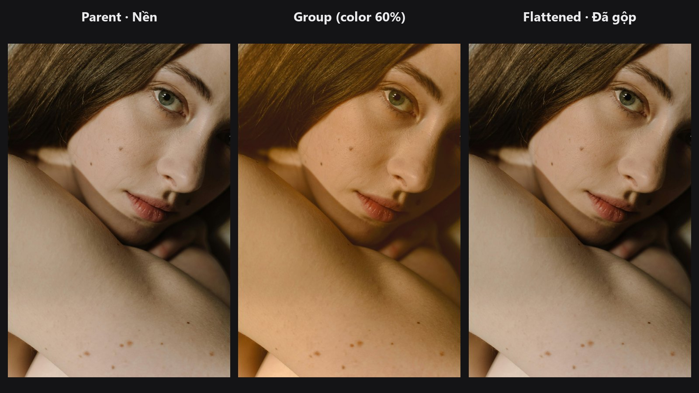

# Layer Group

Lấy một chồng layer thứ hai, gộp thành một layer duy nhất rồi thêm vào chồng layer chính. Nó hoạt động như một group (thư mục layer) trong Photoshop, có blend mode, opacity và mask riêng.

| | |
|---|---|
| **Trong ComfyUI** | `Add Node → ComfyUI-JH-PixelPro → compositing → Compositing: Layer Group (nest)` |
| **Dùng cho** | Gom một bộ layer chỉnh màu lại, tăng giảm cả một "look" bằng một thanh opacity, mask nhiều layer cùng lúc |

## Khi nào dùng

Khi một look gồm nhiều layer (ví dụ phủ màu, vignette và glow), bạn thường muốn điều khiển chúng như một khối. Hãy dựng các layer đó trong chồng layer riêng, rồi lồng vào bằng **Layer Group** và đặt một blend mode, opacity và mask chung cho cả khối.

## Bắt đầu nhanh

1. Chuỗi chính: `Load Image` → [Layer Stack Start](layer-stack-start.md) → các node [Layer Add](layer-add.md) → `parent_stack`.
2. Chuỗi group: một [Layer Stack Start](layer-stack-start.md) thứ hai cùng các node [Layer Add](layer-add.md) riêng → `sub_stack`.
3. Chọn `group_blend_mode` (thử `overlay`) và `group_opacity` (thử `0.8`).
4. Thêm layer khác, hoặc kết thúc bằng [Layer Flatten](layer-flatten.md).

## Thông số

| Thông số | Mặc định | Tác dụng | Mẹo |
|---|---|---|---|
| `parent_stack` | — | Chồng layer nhận group. | Group được đặt lên trên cùng. |
| `sub_stack` | — | Chồng layer sẽ gộp thành group. | Cần layer nền riêng từ Layer Stack Start. |
| `group_blend_mode` | `normal` | Cách group đã gộp hòa với các layer bên dưới. | Cùng 27 mode như [Layer Add](layer-add.md). |
| `group_opacity` | `1.0` (0 đến 1) | Độ mạnh của group. | Giảm xuống để mờ cả look. |
| `group_mask` (tùy chọn) | không | Nơi group hiện ra. | Trắng hiện group, đen ẩn đi. |

Đầu ra: `LAYER_STACK`, chồng layer chính có thêm group ở trên cùng.

## Mẹo khi chỉnh ảnh

- Group sau khi gộp là một ảnh đủ khung hình, gồm cả layer nền của chồng layer con. Hãy dùng blend mode như `overlay` hoặc `soft_light`, hoặc dùng mask, để các layer bên dưới vẫn còn hiện.
- Gắn mask vào group thay vì vào từng layer bên trong khi bạn muốn một vùng mềm chung cho cả look.
- Dựng các layer của group trên cùng ảnh với nền chính nếu muốn chúng phản ứng theo cùng một bức ảnh.

??? note "Bên trong node hoạt động thế nào"
    Chồng layer con được render trước bằng đúng bộ render của [Layer Flatten](layer-flatten.md) (`compose_stack` trong `core/blend_modes.py`), co giãn theo canvas của chồng chính, rồi được thêm vào chồng chính như một layer thường có nhớ chồng layer con. Nguồn: `nodes/layer_compositing.py`.

## Node liên quan

- [Layer Stack Start](layer-stack-start.md)
- [Layer Add](layer-add.md)
- [Layer Flatten](layer-flatten.md)

## Workflow mẫu

[Layer compositing: group và clipping](https://github.com/jetthuangai/ComfyUI-JH-PixelPro/blob/main/workflows/S-28-layer-compositing-group-clipping.json). Chép `workflows/sample_portrait.jpg` vào `ComfyUI/input/`.
