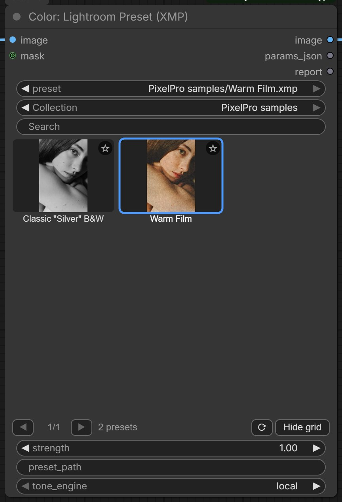

# Lightroom Preset

Dùng lại các preset bạn đã có trong Lightroom Classic hoặc Camera Raw cho bất kỳ ảnh nào trong ComfyUI. Chọn preset từ lưới ảnh thu nhỏ (thumbnail), chỉnh mức áp dụng, và node còn cho bạn biết thiết lập nào chuyển được, thiết lập nào không.

Ảnh trên gồm ảnh gốc, preset mẫu **Warm Film** (.xmp) và preset mẫu **Classic BW** (.lrtemplate) đi kèm pack.

| | |
|---|---|
| **Trong ComfyUI** | `Add Node → ComfyUI-JH-PixelPro → color → Color: Lightroom Preset (XMP)` |
| **Dùng cho** | Dùng lại look Lightroom cho ảnh tạo sinh hoặc ảnh đã retouch, giữ một tông màu cho cả loạt ảnh, làm điểm xuất phát để grade tiếp bằng ColorLab, duyệt thư viện preset lớn bằng mắt |
| **Bộ nhớ** | VRAM đỉnh 0,82 GB trên ảnh minh họa |

## Khi nào dùng

Một preset Lightroom thực chất là danh sách giá trị thanh trượt: Exposure +0.35, Highlights −45, một đường cong tông (tone curve), vài thiết lập color grading… Node đọc danh sách đó và dựng lại look bằng engine [ColorLab](color-lab.md) của pack, vốn có các panel giống Camera Raw. Đây là bản mô phỏng viết riêng cho pack, không phải mã của Adobe, nên hãy đánh giá bằng mắt thay vì mong khớp từng pixel.

Node đọc được hai loại file:

- **.xmp**: định dạng preset hiện tại của Lightroom Classic và Camera Raw.
- **.lrtemplate**: định dạng preset cũ của Lightroom. File chỉ được đọc như dữ liệu; mã Lua bên trong không bao giờ được chạy.

Node trả về ba thứ: ảnh đã chỉnh màu, preset dưới dạng thiết lập ColorLab (`params_json`) để bạn tinh chỉnh hoặc dùng lại, và một báo cáo văn bản (`report`) về những gì đã áp dụng.

### Những gì được chuyển sang

| Panel Lightroom | Được chuyển |
|---|---|
| Basic | Exposure, Contrast, Highlights, Shadows, Whites, Blacks (process 2012), Texture, Clarity, Dehaze, Vibrance, Saturation |
| Cân bằng trắng (white balance) | Temp / Tint dạng tương đối. White balance tuyệt đối (Kelvin, hoặc Daylight, Cloudy, Shade…) được quy đổi tương đối so với điểm trắng lúc chụp (as shot). Đây là ước lượng và có ghi chú trong report. |
| Tone curve | Point curve (tổng, đỏ, lục, lam) và parametric curve (đường cong theo vùng) |
| HSL / Color | Hue, saturation, luminance cho cả 8 màu |
| Color Grading | Ba bánh xe màu shadow, midtone, highlight kèm luminance, và Balance |
| B&W | Chuyển đen trắng và bộ trộn xám (gray mixer), có cả magenta |
| Calibration | Hue và saturation của ba màu gốc đỏ, lục, lam; shadow tint |
| Effects | Grain (hạt), vignette sau crop |

Exposure được áp trong không gian tuyến tính (linear light), giống cách Lightroom làm.

### Những gì không làm được

- **Creative profile** như "Vintage 06" hay các look "Artistic" của Adobe. Đây là bảng màu dựng sẵn riêng của Adobe, không nằm trong file preset. Profile Adobe Color và Adobe Standard được coi là trung tính nên không ảnh hưởng.
- **Mask cục bộ** (brush, gradient, mask chủ thể hoặc bầu trời).
- **Hiệu chỉnh ống kính** (lens correction), làm nét (sharpening) và giảm nhiễu (noise reduction). Đây là thiết lập chi tiết và quang học, không phải màu, nên report liệt kê riêng.

Các ô Point Color để trống được coi là trung tính. Mọi thứ node bỏ qua đều được ghi tên trong report, không bao giờ bị bỏ âm thầm.

## Bắt đầu nhanh

1. Chép preset của bạn vào `ComfyUI/models/lightroom_presets/`. Mỗi thư mục con trở thành một bộ sưu tập (collection).
2. Load Image → **Color: Lightroom Preset (XMP)** → Preview Image. Nối `report` vào một node hiển thị văn bản.
3. Bấm vào một ảnh thu nhỏ trong lưới để chọn preset, rồi chạy workflow.
4. Giảm `strength` nếu look quá mạnh. Đọc report để biết phần nào không chuyển được.

!!! tip "Chưa có preset?"
    Pack kèm sẵn hai preset mẫu trong `PixelPro samples/`: **Warm Film.xmp** và **Classic BW.lrtemplate**. Chúng hiện ngay trong danh sách để bạn thử node trước khi chép preset của mình vào.

## Thông số

| Thông số | Mặc định | Tác dụng | Mẹo |
|---|---|---|---|
| `image` | — | Ảnh cần chỉnh màu. | |
| `preset` | mục đầu danh sách | Preset cần áp, lấy từ các thư mục preset. Lưới thumbnail sẽ đặt giá trị này giúp bạn. | Tên có cả thư mục con, ví dụ `PixelPro samples/Warm Film.xmp`. |
| `strength` | 1.0 | Mức áp preset (0 đến 2), giống Amount của preset trong Lightroom. 0 trả về ảnh gốc. | Các giá trị thanh trượt và đường cong co giãn theo mức này; hue của color grading giữ nguyên. Với chân dung, 0.5 đến 0.8 thường tự nhiên hơn. |
| `preset_path` (tùy chọn) | trống | Đường dẫn đầy đủ tới một file preset bất kỳ trên ổ đĩa. Khi điền, nó thay cho lựa chọn trong danh sách. | Tiện cho file dùng một lần. File này không được thêm vào Recent. |
| `tone_engine` (tùy chọn) | `local` | `local` dùng công cụ tông giữ cạnh (edge-aware), gần Lightroom hơn. `legacy` dùng phép tính tông đơn giản ban đầu của ColorLab. | Giữ `local`, trừ khi cần khớp kết quả ColorLab cũ. |
| `mask` (tùy chọn) | không | Giới hạn vùng áp preset (trắng = áp đủ). | Phải cùng kích thước với ảnh. Dùng mask chủ thể hoặc bầu trời để chỉ grade một phần khung hình. |

**Đầu ra**

| Đầu ra | Là gì |
|---|---|
| `image` | Ảnh đã áp preset. |
| `params_json` | Preset dưới dạng thiết lập ColorLab, đã nhân theo `strength`. Nối vào [ColorLab](color-lab.md) để tinh chỉnh từng thanh trượt, hoặc vào [Apply ColorLab Preset](apply-colorlab-preset.md) để dùng lại cùng look ở chỗ khác. |
| `report` | Văn bản gồm tên preset, các thiết lập đã áp, danh sách "Not supported" (không hỗ trợ), danh sách riêng "Detail/optics, not colour" (làm nét, nhiễu, ống kính) và các ghi chú, ví dụ phần ước lượng white balance. |

## Trình duyệt preset

Bên dưới ô chọn `preset`, node có một trình duyệt trực quan:

- **Collection**: All (tất cả), ★ Favorites (yêu thích), Recent (dùng gần đây), và mỗi thư mục con trong thư mục preset một mục.
- **Search**: chỉ hiện preset có tên chứa mọi từ bạn gõ.
- **Lưới thumbnail**: ba hàng preset, bấm ◀ ▶ để lật trang. Preset đang chọn có viền xanh.
- **Ngôi sao ☆** (góc trên phải mỗi ô): bấm để thêm hoặc bỏ yêu thích.
- **Dấu "!" màu cam** (góc trên trái mỗi ô): preset chỉ được hỗ trợ một phần, ví dụ có dùng creative profile hoặc mask cục bộ.
- **Dòng cuối**: với preset đang chọn, liệt kê phần không hỗ trợ; nếu không thì hiện số preset khớp.
- **⟳**: tải lại danh sách preset, để file vừa chép vào hiện ra mà không cần khởi động lại ComfyUI.
- **Hide grid / Show grid**: thu gọn lưới cho node nhỏ lại.

Thumbnail hiển thị từng preset trên ảnh mà node xử lý gần nhất. Trước lần chạy đầu, chúng dùng một bảng màu thử được tạo sẵn (dải xám, màu da, trời, lá cây và các màu gốc). Thumbnail được render trên CPU, khoảng 10 ms mỗi ảnh, nên không tranh GPU với workflow đang chạy, và được lưu đệm (cache) nên mỗi trang chỉ render một lần.

Bấm vào một ô chỉ đổi giá trị `preset`. Workflow đã lưu và prompt gửi qua API vẫn y hệt như khi bạn chọn preset từ ô dropdown.

!!! note
    Trình duyệt được vẽ trên canvas node kiểu cổ điển. Khi bật giao diện node Vue mới của ComfyUI, trình duyệt không hiện; ô dropdown `preset` vẫn dùng bình thường.

## Quản lý thư viện lớn

- **Thư mục là collection.** Sắp xếp preset trong các thư mục con của `ComfyUI/models/lightroom_presets/` giống các nhóm preset (preset group) trong Lightroom, ví dụ `Portrait/`, `Film/`, `B&W/`. Mỗi thư mục con xuất hiện trong danh sách Collection.
- **Yêu thích** (★) và **Recent** (12 preset gần nhất bạn chạy từ danh sách) được lưu trong `.jh_presets.json` ngay trong thư mục preset. Mọi node Lightroom Preset và mọi workflow dùng chung, và chép thư mục sang máy khác là mang theo luôn.
- **Search** để lọc nhanh một collection, ví dụ `warm film` tìm các tên chứa cả hai từ.
- **Lật trang** giữ lưới nhanh: chỉ trang đang xem được render.
- Nếu bạn dùng `extra_model_paths.yaml` có mục `lightroom_presets`, thư mục đó sẽ được dùng thay thế.
- Để so nhiều preset trên cùng một ảnh, dùng [Lightroom Preset Contact Sheet](lightroom-preset-contact-sheet.md).

## Mẹo khi chỉnh ảnh

- Preset làm cho file raw thường đẩy Exposure, Shadows hay Dehaze rất mạnh vì dữ liệu raw còn nhiều khoảng dư. Với JPEG hoặc ảnh tạo sinh, hãy bắt đầu với `strength` khoảng 0.6.
- White balance tuyệt đối (Kelvin) trong preset ở đây chỉ là ước lượng, report có ghi rõ. Nếu màu bị lệch, bớt ấm lại trong [ColorLab](color-lab.md) bằng `wb_temperature`.
- Preset có dấu "!" cam thì nên đọc report. Nếu phần thiếu là creative profile, look sẽ khác Lightroom khá rõ.
- Làm nét và giảm nhiễu không bao giờ được áp. Thêm [Smart Sharpen](smart-sharpen.md) sau bước grade nếu cần.
- Muốn sửa một preset, đưa `params_json` vào ColorLab rồi chỉnh tiếp ở đó, thay vì sửa file .xmp.

??? note "Bên trong node hoạt động thế nào"
    File .xmp được đọc như một gói XMP và mọi thuộc tính `crs:` (camera-raw-settings) được gom lại, dù nằm ở dạng attribute hay phần tử con. File .lrtemplate được tách token như một bảng Lua và chỉ đọc bảng `value.settings`; không có gì được thực thi. File lớn hơn 4 MB bị từ chối. Lightroom Classic vẫn lưu hue và saturation của color grading vùng shadow/highlight dưới các khóa cũ `SplitToning*`, còn `ColorGrade*` giữ midtone và luminance; cả hai đều được ánh xạ. Parametric curve được dựng lại thành bảng tra (LUT) rồi ghép với point curve tổng. White balance tuyệt đối được đổi thành độ lệch Temp tương đối theo chênh lệch mired giữa nhiệt độ đích và nhiệt độ lúc chụp. Bộ tham số thu được chạy qua pipeline ColorLab với exposure trong không gian tuyến tính. `strength` nhân các giá trị thanh trượt và kéo đường cong về đường thẳng; hue color grading và các công tắc giữ nguyên. Node tự chạy lại khi file preset thay đổi trên ổ đĩa. Mã nguồn: `core/lr_preset.py`, `core/lr_preset_library.py`.

## Node liên quan

- [ColorLab](color-lab.md) để tinh chỉnh thiết lập của preset từ `params_json`
- [Apply ColorLab Preset](apply-colorlab-preset.md) để dùng lại cùng look cho ảnh khác
- [Lightroom Preset Contact Sheet](lightroom-preset-contact-sheet.md) để so nhiều preset cạnh nhau
- [LUT Preset](lut-preset.md) cho look lưu dạng LUT .cube

## Workflow mẫu

[Workflow mẫu Lightroom Preset](https://github.com/jetthuangai/ComfyUI-JH-PixelPro/blob/main/workflows/N-52-lightroom-preset.json) áp preset mẫu Warm Film lên ảnh chân dung và hiển thị report. Workflow chỉ dùng node lõi của ComfyUI và pack này. Chép `workflows/sample_portrait.jpg` vào `ComfyUI/input/`.

