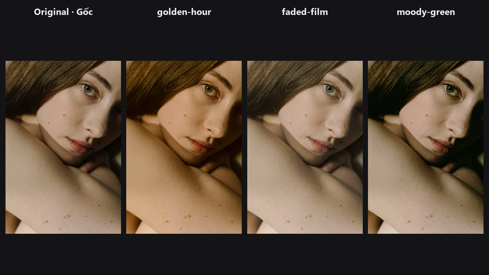

# Look Select

Choose a complete look such as teal and orange, faded film or golden hour, and blend it in with one slider. Optionally keep skin tones out of the effect.

| | |
|---|---|
| **In ComfyUI** | `Add Node → ComfyUI-JH-PixelPro → looks → Look: Select Preset` |
| **Good for** | Auditioning grades fast, a consistent style across a set, adding mood without building a colour chain |

## When to use it

Each look is a short recipe of colour moves: a shift of colour in the shadows or highlights (in LAB colour space), a gentle contrast curve, and saturation changes in selected hues. Look Select runs the recipe for you and blends the result with the original.

How it differs from [LUT Preset](lut-preset.md): the LUT presets are fixed colour tables. Looks here are built from the pack's own colour tools, which lets them protect skin and treat colours selectively. Both are for quick results; for your own `.cube` files use [LUT Import](lut-import.md).

## The six looks

| Preset | Character |
|---|---|
| `cinematic-teal-orange` | Classic cinema grade: teal shadows, orange highlights, mild S-curve. |
| `warm-skin-tone` | Portrait-safe warmth: lifts the orange band, calms greens, protects highlights. |
| `moody-green` | Deep editorial greens, crushed shadows, muted highlights. |
| `faded-film` | Lifted blacks, warm mids and gentle overall desaturation, like a soft film print. |
| `golden-hour` | Warm late-day cast, stronger orange and yellow, protected blues. |
| `desaturated-pop` | Muted background colour while orange-red skin tones stay lively. |

## Quick start

1. Connect **Load Image → Look: Select Preset → Preview Image**.
2. Pick a `preset`. Keep `intensity` at 0.7.
3. Turn on `protect_skin` if faces start to look orange, green or washed out.
4. To compare all six at once, open the six-look compare workflow below.

## Settings

| Setting | Default | What it does | Tip |
|---|---|---|---|
| `preset` | `cinematic-teal-orange` | The look to apply. | See the table above. |
| `intensity` | 0.70 | Mix between original (0) and full look (1). At 0 the image is returned unchanged. | 0.4 to 0.7 for natural results; 1.0 for a stylised look. |
| `protect_skin` | off | Reduces each step of the look on skin-coloured pixels. | Try it with `cinematic-teal-orange`, `golden-hour` and `moody-green`. |

**Output:** `image` — the graded image.

## Tips from retouching

- `warm-skin-tone` and `desaturated-pop` are designed around skin. They are used with `protect_skin` on in the compare workflow, but the switch is not turned on automatically, so set it yourself.
- Looks stack well with a final contrast tweak from [Tone Curve](tone-curve.md).
- For precise control over a single colour, switch to [Hue/Saturation per Range](hue-saturation-range.md) and [Saturation Mask](saturation-mask.md).
- To keep the same look across a series, fix `preset` and `intensity` and run the whole batch through the same node.
- Skin protection is a colour-based guess. Warm wood or sand can also be protected. Check the result.

??? note "Under the hood"
    Presets are JSON files in the pack's `presets/` folder with a list of operations; `nodes/look_base.py` runs them and blends with `lerp(original, processed, intensity)`. The operations are a LAB colour shift (global, shadow, highlight and midtone weights), an RGB tone curve, a hue/saturation change inside a hue band, and a saturation change inside a saturation range. With `protect_skin` the skin mask (hue around 24° with a 28° band, multiplied by a saturation range of 0.18 to 0.95) scales down each step's change (the change is multiplied by one minus the mask). Output is clamped to `[0, 1]`. The dropdown is a fixed list in `nodes/look_select.py`, so adding a JSON file alone does not add a look. The `protect_skin_default` field in the JSON files is not read by the node.

## Related nodes

- [LUT Preset](lut-preset.md) — bundled `.cube` looks.
- [LUT Import](lut-import.md) — your own LUT files.
- [Hue/Saturation per Range](hue-saturation-range.md) — the colour tool used inside several looks.
- [Tone Curve](tone-curve.md) — contrast control used inside several looks.
- [Skin Tone Tri-Region](skin-tone-tri-region.md) — dedicated skin tone correction.

## Example workflow

- [Look Select single example](https://github.com/jetthuangai/ComfyUI-JH-PixelPro/blob/main/workflows/S-19-look-select-single.json) — one look on one image.
- [Look Select six-look compare example](https://github.com/jetthuangai/ComfyUI-JH-PixelPro/blob/main/workflows/S-20-look-select-compare-6up.json) — all six looks side by side.

Copy `workflows/sample_portrait.jpg` into `ComfyUI/input/` and choose it in Load Image.
