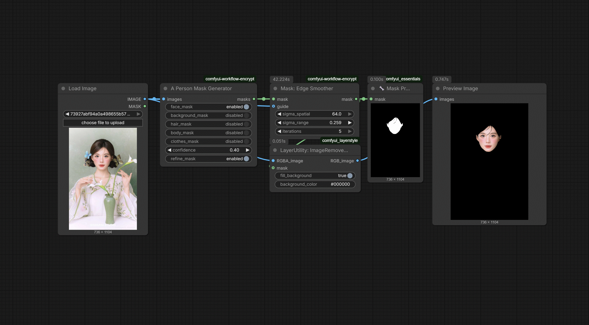

# N-33 Mask Edge Smoother

`JHPixelProMaskEdgeSmoother` cleans up noisy or jagged mask boundaries with bilateral filtering and an optional image guide. It is designed for the last stage of a masking pipeline, after person selection, morphology, or trimap work, when you want a more natural edge transition without rebuilding the mask from scratch.

## Schema

| Name | Kind | Type / default | Description |
|---|---|---|---|
| `mask` | Input | `MASK` | Source mask to smooth. |
| `guide` | Optional input | `IMAGE` | Optional image guide for edge-aware smoothing when subject detail should steer the result. |
| `sigma_spatial` | Widget | `FLOAT`, default `4.0` | Spatial radius of the bilateral smoothing pass. |
| `sigma_range` | Widget | `FLOAT`, default `0.1` | Range-domain smoothing weight on the normalized mask values. |
| `iterations` | Widget | `INT`, default `1` | Number of smoothing passes to run. |
| `backend` | Optional widget | `opencv` / `gpu`, default `opencv` | `opencv` runs on the CPU and only uses the guide when opencv-contrib is installed. `gpu` runs in torch on CUDA and always honours the guide. |
| `mask` | Output | `MASK` | Smoothed mask for downstream blending or compositing. |

## Backends

- `opencv` (default): unchanged behaviour. Without opencv-contrib the guide is silently ignored and a plain bilateral filter is used.
- `gpu`: pure-torch joint bilateral filter (L1 colour distance, reflected borders, square window) that runs on CUDA when available. The guide is always used, even without opencv-contrib. It accumulates the window one offset at a time, so memory stays at a few times the image size (about 0.3 GB for a 2048x2048 mask with guide) whatever `sigma_spatial` is. It matches `kornia.filters.joint_bilateral_blur` to about 1e-5. Without CUDA it runs on the CPU, logs a warning and is slow. Results are close to OpenCV but not identical (OpenCV uses a circular window, `gpu` a square one).

Measured on a 2048x2048 mask with a 3-channel guide (RTX 5090, one iteration; `opencv` used opencv-contrib here, so it also honoured the guide):

| `sigma_spatial` | `opencv` (CPU) | `gpu` (CUDA) |
|---|---|---|
| 4 | 0.03 s | 0.04 s |
| 16 | 0.78 s | 0.32 s |
| 64 | 10.9 s | 5.4 s |

At small sigma `opencv` is as fast or faster, so keep it unless you need the guide without opencv-contrib. `gpu` pulls ahead at larger sigma (about 2x at 16 and 64). Cost grows with the square of the window size, so sigma 64 is slow on any backend.

## Workflow preview

Workflow JSON: [workflows/N-33-mask-edge-smoother.json](https://github.com/jetthuangai/ComfyUI-JH-PixelPro/blob/main/workflows/N-33-mask-edge-smoother.json)
