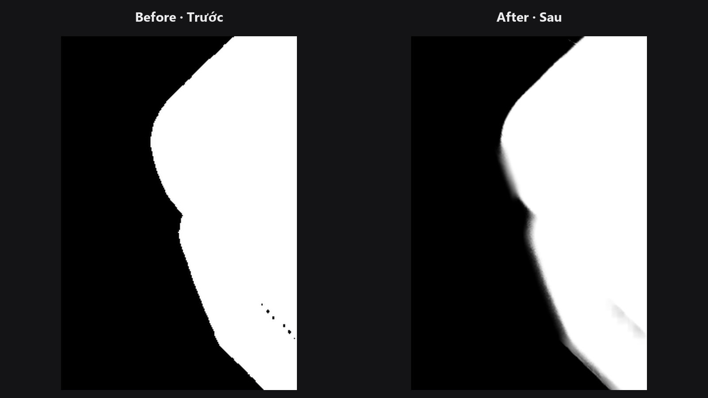

# Mask Edge Smoother

Bỏ bậc thang và độ lượn sóng trên viền mask mà không biến cả mask thành một khối mờ. Khi có ảnh guide, việc làm mượt sẽ tôn trọng các cạnh thật trong ảnh.

| | |
|---|---|
| **Trong ComfyUI** | `Add Node → ComfyUI-JH-PixelPro → mask → Mask: Edge Smoother` |
| **Phù hợp để** | Dọn viền răng cưa của mask phân vùng AI, làm mượt sau morphology, giữ viền bám vào ảnh |

## Khi nào dùng

Blur thông thường đối xử mọi pixel như nhau, nên làm tròn cả những góc thật. **Bilateral filter** chỉ lấy trung bình pixel với những lân cận có *giá trị gần giống*. Trong mask, điều đó nghĩa là việc làm mượt diễn ra dọc theo viền chứ không xuyên qua viền. Kết quả: đường viền sạch, mượt và không bị chảy.

Nếu bạn đưa thêm ảnh **guide**, node so sánh màu của ảnh thay vì giá trị của mask. Việc làm mượt khi đó bám theo ranh giới thật trong ảnh, nên mask ôm sát chủ thể.

## Bắt đầu nhanh

1. Nối mask. Tùy chọn nối cùng bức ảnh vào `guide`.
2. Bắt đầu với `sigma_spatial` 4, `sigma_range` 0.1, `iterations` 1.
3. Nếu viền còn răng cưa, tăng `iterations` lên 2 hoặc 3.
4. Với ảnh lớn trên máy có CUDA, chọn `backend` là `gpu`.

## Thông số

| Thông số | Mặc định | Tác dụng | Gợi ý |
|---|---|---|---|
| `sigma_spatial` | 4.0 | Việc làm mượt với tới bao xa (pixel). | 0.1 đến 64. Càng lớn càng mượt và càng chậm. |
| `sigma_range` | 0.1 | Hai giá trị khác nhau bao nhiêu thì vẫn được lấy trung bình cùng nhau. | 0.001 đến 1. Thấp giữ viền sắc; cao làm mượt hơn. |
| `iterations` | 1 | Số lượt làm mượt. | 1 đến 5. |
| `guide` (tùy chọn) | không có | Ảnh dẫn hướng cho việc làm mượt. Phải cùng kích thước với mask. | Dùng ảnh gốc. |
| `backend` | `opencv` | `opencv` chạy trên CPU. `gpu` chạy bằng PyTorch trên CUDA và luôn dùng guide. | Xem ghi chú bên dưới. |

**Đầu ra:** `mask` (MASK).

!!! note "Guide và backend"
    Backend `opencv` chỉ dùng guide nếu bạn đã cài thêm gói tùy chọn `opencv-contrib`. Nếu không, nó âm thầm quay về bilateral filter thường. Backend `gpu` luôn dùng guide. Nếu không có thiết bị CUDA, `gpu` chạy trên CPU và ghi cảnh báo rằng sẽ chậm.

## Mẹo khi chỉnh ảnh

- Chạy sau [Mask Morphology](mask-morphology.md) hoặc [Mask Combine](mask-combine.md), vì hai node đó có thể để lại răng cưa nhỏ.
- Muốn có viền trong suốt mềm (feather), nối tiếp [Sub-Pixel Mask Refiner](sub-pixel-mask-refiner.md). Node này làm mượt hình dạng, không tạo dải feather.
- `sigma_spatial` rất lớn sẽ chậm. Nên chạy vài lượt nhỏ thay vì một lượt khổng lồ.

??? note "Bên trong node hoạt động thế nào"
    Đường kính bộ lọc là `max(3, 2 * round(sigma_spatial) + 1)`. Đường `opencv` dùng `cv2.ximgproc.jointBilateralFilter` khi có guide và có module contrib, nếu không thì dùng `cv2.bilateralFilter`. Đường `gpu` là một lượt bilateral thuần PyTorch kiểu dịch-và-cộng dồn (khoảng cách màu L1, biên reflect-101), nên bộ nhớ tăng theo kích thước ảnh chứ không theo diện tích kernel. Mã nguồn: `core/mask_edge_smooth.py`.

## Node liên quan

- [Sub-Pixel Mask Refiner](sub-pixel-mask-refiner.md) để tạo viền feather
- [Edge-Aware Mask Refiner](edge-aware-mask-refiner.md) để kéo viền về ranh giới thật của ảnh
- [Mask Morphology](mask-morphology.md) để đổi hình dạng
- [Mask Preview](mask-preview.md) để kiểm tra kết quả

## Workflow mẫu

[Workflow mẫu Mask Edge Smoother](https://github.com/jetthuangai/ComfyUI-JH-PixelPro/blob/main/workflows/N-33-mask-edge-smoother.json). Chép `workflows/sample_portrait.jpg` và `workflows/sample_binary_mask.png` vào `ComfyUI/input/`. Workflow dùng `backend = gpu` (cần GPU NVIDIA) với ảnh chân dung làm guide để làm mượt mép mask bị răng cưa. Với backend mặc định `opencv`, node chạy bằng CPU. Workflow chỉ dùng node lõi của ComfyUI và pack này.

