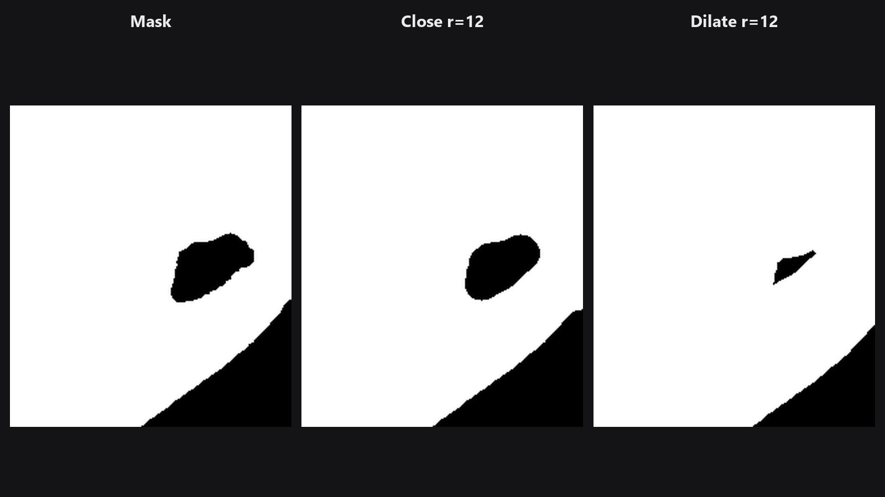

# Mask Morphology

Làm nở mask, co mask, lấp khe nhỏ, bỏ gai mảnh, hoặc chỉ lấy đường viền. Đây là phiên bản mask của Select → Modify → Expand / Contract trong Photoshop.

| | |
|---|---|
| **Trong ComfyUI** | `Add Node → ComfyUI-JH-PixelPro → mask → Mask: Morphology` |
| **Phù hợp để** | Nở mask để phủ halo, co để bỏ viền lem màu, lấp lỗ nhỏ, tạo dải viền |

## Khi nào dùng

*Morphology* thay đổi hình dạng của mask chứ không phải độ mềm. Ý tưởng là trượt một "cây cọ" tròn nhỏ (kernel) dọc theo viền mask. Có bảy phép:

| Phép | Điều xảy ra | Dùng khi |
|---|---|---|
| `dilate` | Mask nở ra ngoài | Phủ halo; chừa chỗ cho feather |
| `erode` | Mask co vào trong | Bỏ viền lem màu ở mép |
| `open` | Erode rồi dilate | Xóa đốm trắng nhỏ và gai mảnh |
| `close` | Dilate rồi erode | Lấp lỗ đen nhỏ và khe hở |
| `gradient` | Bản nở trừ bản co | Dải đường viền quanh mép |
| `tophat` | Bản gốc trừ `open` | Chỉ giữ các phần sáng nhỏ mà `open` sẽ xóa |
| `blackhat` | `close` trừ bản gốc | Chỉ giữ các khe tối nhỏ mà `close` sẽ lấp |

Để loại đốm hoặc lỗ theo **kích thước** (thay vì theo bán kính cọ), [Mask Cleanup](mask-cleanup.md) dễ kiểm soát hơn.

## Bắt đầu nhanh

1. Nối một mask bất kỳ vào **Mask Morphology**.
2. Chọn `erode` với `radius` 3 để co vùng chọn và gọt viền lem màu, hoặc `dilate` để nở ra.
3. Xem lại bằng [Mask Preview](mask-preview.md).

## Thông số

| Thông số | Mặc định | Tác dụng | Gợi ý |
|---|---|---|---|
| `operation` | `dilate` | Chạy phép nào trong bảy phép. | Xem bảng trên. |
| `radius` | 3 | Bán kính kernel tròn, tính bằng pixel. | 1 đến 64. Gần bằng số pixel mà viền sẽ dịch chuyển. |
| `iterations` | 1 | Lặp lại phép bao nhiêu lần. | 1 đến 10. Muốn thay đổi lớn, tăng `radius` thường sạch hơn lặp nhiều lần. |

**Đầu ra:** `mask` (MASK).

## Mẹo khi chỉnh ảnh

- Muốn có vòng viền mềm quanh mép, chạy `gradient` rồi làm mềm bằng [Mask Edge Smoother](mask-edge-smoother.md) hoặc [Sub-Pixel Mask Refiner](sub-pixel-mask-refiner.md).
- Sau `dilate` hoặc `erode`, viền có thể hơi răng cưa. Hãy kết thúc bằng một bước feather.
- Dùng `close` trước khi tạo [Trimap](trimap-builder.md) nếu mask có lỗ kim.
- Morphology cũng chạy trên mask mềm: nó nở và co các giá trị xám (dilate xám lấy giá trị lớn nhất cục bộ).

??? note "Bên trong node hoạt động thế nào"
    Phần tử cấu trúc (structuring element) hình elip kích thước `2 * radius + 1` được tạo bằng `cv2.getStructuringElement`. `dilate` và `erode` gọi `cv2.dilate` và `cv2.erode`; các phép còn lại dùng `cv2.morphologyEx`. Chạy trên CPU ở float32, từng ảnh trong batch, rồi trả kết quả về thiết bị ban đầu. Mã nguồn: `core/mask_morphology.py`. Với bán kính rất lớn, tránh dùng `kornia.morphology` vì nó tốn nhiều bộ nhớ.

## Node liên quan

- [Mask Cleanup](mask-cleanup.md) để loại đốm và lỗ theo kích thước
- [Mask Combine](mask-combine.md) để gộp kết quả với mask khác
- [Trimap Builder](trimap-builder.md) cho bản đồ ba vùng
- [Mask Edge Smoother](mask-edge-smoother.md) để làm mượt kết quả

## Workflow mẫu

[Workflow mẫu Mask Morphology](https://github.com/jetthuangai/ComfyUI-JH-PixelPro/blob/main/workflows/N-31-mask-morphology.json). Mở workflow rồi trỏ node `Load Image` vào ảnh của bạn.
