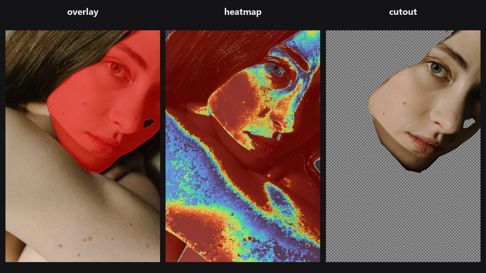

# Mask Preview

Nhìn thấy mask thực sự làm gì. Node biến mask thành một hình ảnh để bạn xem, giống chế độ quick mask trong Photoshop hay chế độ "show mask".

| | |
|---|---|
| **Trong ComfyUI** | `Add Node → ComfyUI-JH-PixelPro → mask → Mask: Preview Overlay` |
| **Phù hợp để** | Kiểm tra vùng mask phủ, phát hiện lỗ và halo, đánh giá viền mềm, xem cutout trên nền caro |

## Khi nào dùng

Mask thô là một ảnh xám khó đánh giá. Bốn chế độ xem giúp bạn thấy rõ:

| Chế độ | Bạn thấy gì | Dùng để |
|---|---|---|
| `overlay` | Ảnh phủ một màu ở chỗ mask bật | Kiểm tra vùng phủ |
| `heatmap` | Giá trị mask dạng thang màu (0 = lạnh, 1 = nóng) | Tìm các giá trị mềm hoặc một phần |
| `mask_only` | Mask dạng thang xám | Xem mask thuần |
| `cutout` | Chỉ hiện ảnh ở chỗ mask bật, trên nền caro | Đánh giá cutout, như một layer trong suốt |

Preview chỉ để nhìn. Đừng nối đầu ra của nó ngược lại làm mask. Hãy nối vào node `Preview Image`.

## Bắt đầu nhanh

1. Nối mask vào `mask` và ảnh vào `image` (tùy chọn).
2. Chọn `overlay` với `opacity` 0.5 và bật `show_edges`.
3. Nối `preview` vào node `Preview Image`.
4. Chuyển sang `cutout` để xem nó trông thế nào trên nền trong suốt.

## Thông số

| Thông số | Mặc định | Tác dụng | Gợi ý |
|---|---|---|---|
| `mode` | `overlay` | Chọn một trong bốn kiểu xem. | Xem bảng trên. |
| `color` | `red` | Màu phủ cho `overlay` và màu đường viền. | Chọn màu tương phản với ảnh. Có tám màu, từ đỏ đến trắng và đen. |
| `opacity` | 0.5 | Độ đậm của lớp phủ (`overlay`) hoặc mức trộn heatmap. | 0 đến 1. |
| `colormap` | `turbo` | Thang màu mà `heatmap` dùng. | Tên lấy từ danh sách colormap của Kornia, như `turbo`, `viridis`, `jet`. |
| `show_edges` | tắt | Vẽ đường viền ở mức 0.5 của mask bằng một nét mảnh theo `color`. | Tiện để đánh giá viền sát đến đâu. |
| `image` (tùy chọn) | không có | Ảnh nền. Không có thì nền xám trung tính (ở chế độ `heatmap` là thang màu trần). | Nhận ảnh 4 kênh; kênh alpha bị bỏ qua. |

**Đầu ra:** `preview` (IMAGE).

## Mẹo khi chỉnh ảnh

- Dùng `heatmap` trên mask đã feather để thấy chính xác dải mềm rộng bao nhiêu.
- Dùng `cutout` với nền caro tương phản để tìm halo mà nền phẳng sẽ che mất.
- Dùng `show_edges` ở chế độ `overlay` để so sánh hai mask. Chạy node hai lần với hai màu khác nhau.
- Ảnh và mask phải cùng chiều rộng và chiều cao.

??? note "Bên trong node hoạt động thế nào"
    `overlay` trộn ảnh về phía màu đã chọn với hệ số `opacity * mask`. `heatmap` dùng `kornia.color.apply_colormap` với colormap đã chọn và trộn với ảnh theo `opacity`. `cutout` trộn ảnh với nền caro 8 px theo mask. Đường viền là dải một pixel, tính bằng dilate trừ erode của mask đã ngưỡng hóa ở 0.5. Mã nguồn: `core/mask_preview.py`.

## Node liên quan

- [Mask Cleanup](mask-cleanup.md) để sửa những gì preview cho thấy
- [Alpha Matte](alpha-matte.md) cho cutout mềm để xem ở chế độ `cutout`
- [Trimap Builder](trimap-builder.md), ba vùng của nó hiện rất rõ trong `heatmap`
- [QA Image Diff](qa-image-diff.md) để so sánh hai ảnh thay vì xem mask

## Workflow mẫu

[Workflow mẫu Mask Preview](https://github.com/jetthuangai/ComfyUI-JH-PixelPro/blob/main/workflows/N-43-mask-preview.json). Hãy chép `workflows/sample_portrait.jpg` vào `ComfyUI/input/` trước.
