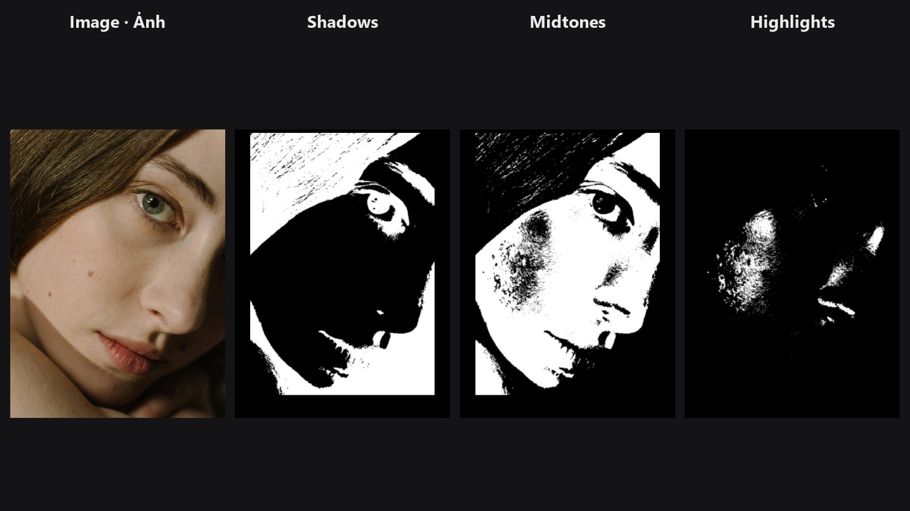

# Skin Tone Tri-Region

Splits a portrait into three soft masks: the darker skin tones, the middle ones and the brightest ones. Use them to retouch shadows, midtones and highlights of the skin independently.

| | |
|---|---|
| **In ComfyUI** | `Add Node → ComfyUI-JH-PixelPro → face → Face: Skin Tone Tri-Region` |
| **Good for** | Taming shine on highlights; lifting or warming shadows; grading the main skin tone; targeted dodge and burn |

## When to use it

Skin rarely needs the same fix everywhere. Highlights need shine control, shadows may need lifting or warming, and midtones carry the main skin colour. A luminosity mask (a mask built from how bright each pixel is) lets you target one of those ranges. This node builds three of them in one step and makes sure they add up cleanly.

Feed it an optional skin mask so that hair, clothing and background do not take part in the split. Without one, the whole frame is split by brightness.

## Quick start

1. Connect **Load Image** to `image`.
2. Optional but recommended: connect a skin-only mask (from a person or skin segmentation node) to `skin_mask`.
3. Send `highlight_mask`, `midtone_mask` or `shadow_mask` to the mask input of whatever adjustment you want to limit, for example [Face Beauty Blend](face-beauty-blend.md), a colour node or a LUT.
4. Start with the default cutoffs and adjust them to your image.

## Settings

| Setting | Default | What it does | Tip |
|---|---|---|---|
| `image` | — | The portrait to analyse. | |
| `skin_mask` | optional | Limits the split to skin. Without it the whole frame is split. | A good mask gives much cleaner results than the whole frame. |
| `shadow_cutoff` | `0.33` (0–0.5) | Brightness below this counts as shadow. | Lower it to shrink the shadow mask. |
| `highlight_cutoff` | `0.66` (0.5–1) | Brightness above this counts as highlight. | Raise it to keep only the brightest shine. |
| `soft_sigma` | `1.0` (0–8) | Softens the boundaries between the three ranges. | Raise for gentler transitions between ranges. `0` gives hard edges. |

| Output | Type | Meaning |
|---|---|---|
| `shadow_mask` | `MASK` | Darker skin tones. |
| `midtone_mask` | `MASK` | Middle skin tones. |
| `highlight_mask` | `MASK` | Brightest skin tones. |

## Tips from retouching

- The cutoff `shadow_cutoff` must be lower than `highlight_cutoff`; the node rejects other combinations.
- On a very dark or very bright portrait, move both cutoffs together so each mask still has a useful share of the face.
- The three masks always add up to your skin mask (or to a full white frame when none is connected), so nothing is lost or counted twice.
- Use `highlight_mask` for specular shine and highlight colour; `midtone_mask` for the main skin grade; `shadow_mask` for lifting and noise control.
- Preview a mask with [Mask Preview](mask-preview.md) before using it.

??? note "Under the hood"
    Brightness is Rec. 601 luma, `0.299 R + 0.587 G + 0.114 B`, computed from the clamped image. Hard masks are made from the two cutoffs, multiplied by the skin mask, blurred with a separable Gaussian (replicate padding), then renormalised so the three add up to the skin mask. Cutoffs must satisfy `0 ≤ shadow < highlight ≤ 1`, with `shadow ≤ 0.5` and `highlight ≥ 0.5`. `skin_mask` must match the image height and width. The code lives in `core/skin_tone_region.py`.

## Related nodes

- [Face Beauty Blend](face-beauty-blend.md) — blend a retouch through one of these masks.
- [Luminosity Masking](luminosity-masking.md) — more flexible brightness masks for any image.
- [Mask Combine](mask-combine.md) — combine these masks with other masks.
- [Face category overview](../categories/face.md)

## Example workflow

[Skin Tone Tri-Region example workflow](https://github.com/jetthuangai/ComfyUI-JH-PixelPro/blob/main/workflows/N-35-skin-tone-tri-region.json). It uses the person-mask node of the external A Person Mask Generator pack (install it separately) to create the skin mask. See the [Skin Tone Retouch example](../examples/skin-tone-retouch.md) for a full walkthrough.
