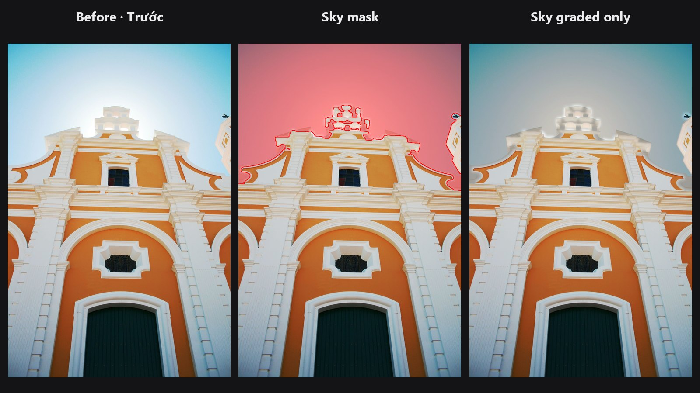

# Sky Mask

Selects the sky for you: blue, overcast or sunset. Use the mask to grade the sky on its own, swap it, or protect it from other edits.

| | |
|---|---|
| **In ComfyUI** | `Add Node → ComfyUI-JH-PixelPro → mask → Mask: Sky` |
| **Good for** | Grading or replacing the sky, darkening a bright sky, keeping the sky out of a skin or foreground edit |
| **Speed** | About 0.2 s per photo |

## When to use it

Selecting a sky by hand means a gradient mask plus a lot of cleaning around trees and roofs. This node does it from the picture itself. It needs no AI model and no download.

It looks for three things: sky colour (blue, white or grey cloud, and warm sunset glow), a smooth surface (sky has little fine texture), and a position open to the top of the frame. Leaves, buildings and grass fail the smoothness test. A white wall low in the frame fails the position test.

The mask is soft. Edges around branches and roof lines follow the real edge, so a grade applied through the mask does not leave a halo.

## Quick start

1. Load Image → **Mask: Sky**.
2. Add [Mask Preview](mask-preview.md) to see the mask over the photo.
3. Keep `sensitivity` at 0.5 and `refine_edges` on.
4. To grade only the sky, connect `sky_mask` to the mask input of [Apply ColorLab Preset](apply-colorlab-preset.md).

## Settings

| Setting | Default | What it does | Tip |
|---|---|---|---|
| `image` | | Photo with sky. | |
| `sensitivity` | 0.5 | 0 to 1. Higher also takes hazy, textured or sunset sky. Lower keeps only clear sky. | Raise it for thin cloud or sunset. Lower it if walls or water leak in. |
| `refine_edges` | on | Follows branches and roof lines at full resolution with a colour-guided filter. | Turn off only if you want a plain soft mask. |

**Output**

| Output | What it is |
|---|---|
| `sky_mask` | Soft mask of the sky. White is sky. One mask per photo in the batch. |

## Tips from retouching

- Check the mask with [Mask Preview](mask-preview.md) before you grade. Raise `sensitivity` in small steps until hazy or sunset areas are covered.
- Calm water that joins the sky at the horizon can be included. Draw or build a mask for the water and subtract it with [Mask Combine](mask-combine.md).
- White, smooth walls that touch the sky can leak a little. Lower `sensitivity`, or clean up with [Mask Cleanup](mask-cleanup.md).
- Very textured clouds need a higher `sensitivity` because they look less smooth.
- Use the inverted mask to protect the sky while you edit the rest, for example with [Color Matcher](color-matcher.md) or a Layer node.

??? note "Under the hood"
    The photo is reduced to a copy of at most 768 px on the long edge. On it, a sky score combines colour (blue by hue and saturation, bright near-grey for cloud, and warm bright upper areas at half weight for sunset) with a smoothness test on local luma variation. A higher `sensitivity` lowers the score threshold and relaxes the smoothness test.

    Candidate regions are kept only if they are connected to the top rows of the frame, or are large and in the upper half. When little sky reaches the top (looking up through branches), large clearly blue regions anywhere are kept too. Small gaps such as birds and wires are closed first.

    With `refine_edges`, the mask is scaled back to full size and refined with a colour guided filter on the original photo. Source: `core/sky_mask.py`, wrapper `nodes/sky_mask_node.py`.

## Related nodes

- [Apply ColorLab Preset](apply-colorlab-preset.md): grade only the masked sky
- [Mask Combine](mask-combine.md): add or subtract masks, for example to remove water
- [Mask Cleanup](mask-cleanup.md): remove specks and fill holes
- [Mask Preview](mask-preview.md): check the mask over the photo

## Example workflow

[Sky Mask example workflow](https://github.com/jetthuangai/ComfyUI-JH-PixelPro/blob/main/workflows/N-61-sky-mask.json) finds the sky of an architecture photo, shows it with Mask Preview, and applies a ColorLab preset only to the sky through the mask. Copy `workflows/sample_architecture.jpg` into `ComfyUI/input/` (Pexels License).
