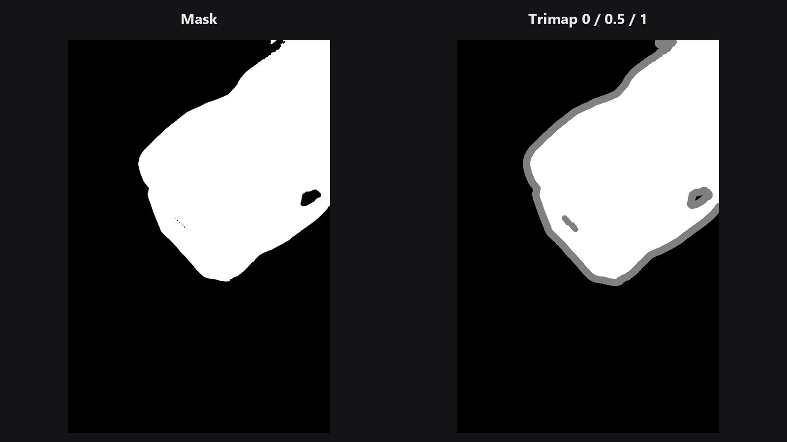

# Trimap Builder

Chuyển một mask thông thường thành **trimap**: bản đồ gồm lõi chắc chắn là chủ thể, vùng chắc chắn là nền, và một dải pixel "chưa biết" quanh viền, nơi độ trong suốt thật cần được tính ra.

| | |
|---|---|
| **Trong ComfyUI** | `Add Node → ComfyUI-JH-PixelPro → mask → Mask: Trimap Builder` |
| **Phù hợp để** | Chuẩn bị đầu vào cho [Alpha Matte](alpha-matte.md), quyết định vùng viền rộng bao nhiêu |

## Khi nào dùng

Trimap có đúng ba giá trị:

| Giá trị | Ý nghĩa | Hiển thị |
|---|---|---|
| `0.0` | Chắc chắn là nền | Đen |
| `0.5` | Chưa biết: cần tính | Xám |
| `1.0` | Chắc chắn là chủ thể | Trắng |

Thuật toán matting không cố quyết định cả bức ảnh. Nó chỉ tính dải xám. Dải này đặt càng chuẩn lên tóc, lông hay các viền mềm thì kết quả cắt tách càng tốt. Node này vẽ dải đó tự động bằng cách co chủ thể và co nền ra xa khỏi viền mask. Phần còn lại ở giữa trở thành vùng chưa biết.

## Bắt đầu nhanh

1. Lấy mask thô từ SAM, rembg hoặc công cụ tương tự.
2. Nối vào **Trimap Builder**. Bắt đầu với `fg_radius` 4 và `bg_radius` 8.
3. Kiểm tra bằng [Mask Preview](mask-preview.md) ở chế độ `heatmap`: bạn sẽ thấy ba mức phẳng.
4. Nối trimap vào [Alpha Matte](alpha-matte.md).

## Thông số

| Thông số | Mặc định | Tác dụng | Gợi ý |
|---|---|---|---|
| `fg_radius` | 4 | Co chủ thể vào trong bao nhiêu để có lõi chắc chắn là chủ thể. | 1 đến 64. Tăng để dải chưa biết bên trong rộng hơn. |
| `bg_radius` | 8 | Co nền ra xa khỏi viền bao nhiêu để có vùng chắc chắn là nền. | 1 đến 64. Tăng khi mask lỏng hoặc tóc chìa ra ngoài. |
| `smoothing` | 0.0 | Blur tùy chọn áp lên mask trước khi chia vùng, làm tròn viền răng cưa. | 0 đến 16. Mask lởm chởm thử 1 đến 2. |

Độ rộng dải chưa biết xấp xỉ `fg_radius + bg_radius`.

**Đầu ra:** `trimap` (MASK), chỉ gồm các giá trị 0.0, 0.5 và 1.0.

## Mẹo khi chỉnh ảnh

- Đặt `bg_radius` lớn hơn `fg_radius` khi mask khá chặt và tóc chìa ra ngoài mask.
- Với sản phẩm có cạnh cứng, dùng bán kính nhỏ (2 đến 4). Dải mỏng ít chỗ cho sai sót.
- Đừng blur hay đổi kích thước trimap sau khi tạo. Việc đó sinh ra giá trị trung gian và [Alpha Matte](alpha-matte.md) sẽ từ chối.
- Dọn mask đầu vào bằng [Mask Cleanup](mask-cleanup.md) trước, để các đốm lẻ không mỗi cái lại có một quầng "chưa biết" riêng.

??? note "Bên trong node hoạt động thế nào"
    Đầu vào được cắt về 0..1 và có thể blur Gaussian (`smoothing` là sigma), sau đó ngưỡng hóa ở 0.5. Lõi chủ thể là mask nhị phân bị erode bằng kernel elip bán kính `fg_radius` (OpenCV). Vùng nền là mask đảo bị erode với bán kính `bg_radius`. Mọi pixel không thuộc hai vùng trên có giá trị 0.5. Chạy trên CPU theo từng ảnh trong batch rồi trả về thiết bị ban đầu. Đầu vào phải có dạng `(B,H,W)`. Mã nguồn: `core/mask_trimap.py`.

## Node liên quan

- [Alpha Matte](alpha-matte.md), node dùng trimap này
- [Mask Morphology](mask-morphology.md) để nở hoặc co mask bằng tay
- [Mask Cleanup](mask-cleanup.md) để chuẩn bị mask đầu vào
- [Mask Preview](mask-preview.md) để xem ba vùng

## Workflow mẫu

[Workflow mẫu Trimap Builder](https://github.com/jetthuangai/ComfyUI-JH-PixelPro/blob/main/workflows/N-30-trimap-builder.json). Chép `workflows/sample_portrait.jpg` và `workflows/sample_binary_mask.png` vào `ComfyUI/input/`. Workflow hiển thị vùng chắc chắn là chủ thể, vùng chưa xác định và vùng chắc chắn là nền, dựng từ mask chủ thể. Workflow chỉ dùng node lõi của ComfyUI và pack này.

